# NTable 产品质量迭代记录

日期：2026-10-08。范围：既有工作区上的增量整改、独立库生产消费端、本地可分发产物。没有回退既有修改，没有提交、push、公开发布、修改 CI 或删除用户文件。

当前交接候选与未完成项见 [本地交付候选](release-candidate-2026-10-08.md)。下方保留历轮原始记录：早期“本轮”和安全审计结果只属于当时版本，不能代替当前矩阵；当前安全公告审计仍未取得结果。

## 本轮发现与整改

| 维度 | 可复现问题 | 结果 |
| --- | --- | --- |
| 正确性 | 字符串自然顺序把 -2 排在 -10 前、1.2 排在 1.11 前 | number 字段按有限数值比较；空值/无效值在两种方向中均排在有效数值后；同值稳定、多规则与同级排序保持有效 |
| 性能 | 每次比较重新指定 locale 选项；父子均命中时重复构建子树 | 复用 Intl.Collator；树投影每节点读取一次 children，保留祖先链与命中父节点的完整子树 |
| 输入体验 | 新建视图 Enter 未区分输入法确认 | isComposing 和 229 事件不创建；普通 Enter 创建一次并阻止默认提交 |
| 键盘与语义 | 搜索框 Up 从 -1 起算落在倒数第二项；输入缺少明确名称 | Up 定位最后结果，Down 定位首项；composition 不接管方向键；视图名、筛选值、配置字段搜索都有可访问名称 |
| 操作边界 | 连续双击复选框会打开详情 | 复选框双击停止冒泡；数据单元格双击和 Enter 仍打开记录 |
| 弹层可达性 | 640×280 视口下菜单底边落在 333.5px | 实测菜单底边为 272px，保留 8px 边距；按实际尺寸定位，短视口内部滚动，长名称截断但保留可访问文本 |

规则先记入 app/AGENTS.md，再修改实现。数值排序契约同步更新 docs/component-integration.md；其他字段排序及可见字段原始值搜索语义保持既有契约。

## 验证

- 最终 `npm run verify` 退出码 0，35/35 测试通过，无跳过项：项目类型、演示/Sites 构建、ESM/CSS/声明、严格消费端类型/生产构建、树投影/数值边界/打包契约。新增回归覆盖负数、小数、零、空值、非法值、稳定排序、多规则同级排序和单次遍历。
- 内置 Browser Use 操作生产消费端 `http://127.0.0.1:5188/`。搜索 9 项、键盘 9 项、新建视图输入事件 3 项均通过。等待每个回归完成后再更换数据；一次在键盘回归运行中切换数据造成的测试失败，不计为通过，恢复 fixture 后完整重跑通过。
- 实际指针验证：复选框双击不打开记录，数据单元格双击仍打开记录，宿主 form 提交为 0；菜单操作可提交；选择器 Up 到末项、Escape 关闭内层菜单并回到外层字段触发器。
- 数值 fixture 升序 -10、-2、0、1.11、1.2、2、空，倒序 2、1.2、1.11、0、-2、-10、空。
- 500 行 Ctrl/Meta+End 到第 500 行，活动内容 499，挂载 19 行；后台刷新及随后失败保留选择与记录。当前消费端捕获的 console error 为 0。
- `npm audit --omit=dev` 在线检查成功，运行时依赖已知公告计数 0。不是未知漏洞或整个业务系统的安全保证。
- `npm pack --dry-run` 成功：26 文件、34,633 bytes，仅库产物与 README/package.json。
- 实际 tarball 解包后的 ESM 导出为 NTable、Table、TableToolbar、ViewBar；严格 TypeScript 消费（无 Vite CSS ambient 声明）通过。隔离的是包文件和消费目录，依赖复用当前已安装版本，没有声称全新网络安装验证。

## 性能证据

同一本机 Node 进程环境、相同 10,000 条打散整数数据、三次投影：修改前 365/358/365ms，修改后 5/4/3ms。此基准只说明这组数据的排序与投影耗时，不代表渲染、网络或所有数据分布。

151 节点链式树查询：修改前 getter 11,627 次，修改后 151 次。计数回归测试同时确认叶节点即使不匹配仍随匹配祖先保留。

## 产物与边界

本轮安装包：`app/dist/kun-ntable-0.1.0-quality-20261008.tgz`，SHA-1 `2fcca7a6c5232191de4616377d326617ee4fdac6`。旧安装包保留；联调应使用本轮文件或最新 dist/lib。

库 ESM 66.62kB（gzip 18.38kB）、CSS 94.72kB（gzip 11.40kB）；React 及公开 dependencies 由宿主依赖解析。演示/消费端包含 React 与依赖，仍有 Vite 500kB chunk 提示，未通过提高阈值隐藏提示。未完成完整浏览器性能基准、真实系统输入法候选窗口、VoiceOver/NVDA 或跨浏览器验收；请求状态由宿主 fixture 模拟，不代表真实业务后端。整体交付目标仍进行中。

## 截图

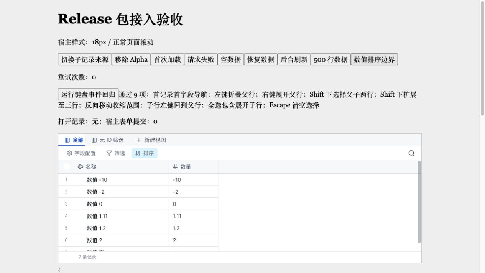

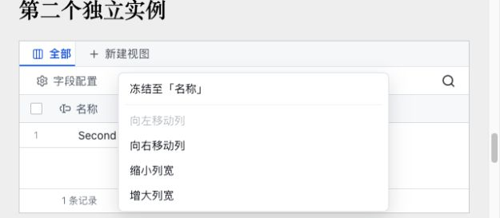

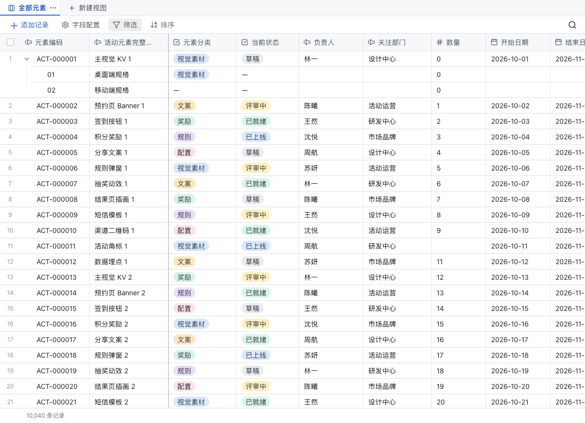

## 第二轮：滚动手势与动态状态边界

同日继续排查，补齐以下问题：

- 滚动条拖拽此前没有失去指针捕获、失焦、卸载及尺寸变化的清理。现在只有发起拖拽的主指针可驱动它；释放、取消、lostpointercapture、blur、Escape、resize、unmount 清理监听器和捕获。离开表格时仍显示正在拖动的滑块。
- 最小 28px 滑块此前可超过短轨道。尺寸现在取轨道可用范围内的值；实际 120px 宿主下，垂直轨道 16px，滑块也为 16px，offset 为 0。零轨道隐藏滑块，超范围 scroll offset 钳制到轨道范围。
- 宿主移除搜索回调后，计时器此前可能在回调恢复时提交旧草稿。现在移除回调取消计时并回退到外部查询，恢复不会复活旧草稿；函数身份正常变化不取消输入。
- 拖拽期间的 Escape 在 window 捕获阶段取消对应手势，阻止继续触发网格取消选择；列序、列宽、冻结和滚动条手势统一遵循这一边界。

最终 `npm run verify` 退出码 0，37/37 自动化测试，无跳过项。新增滚动条测试覆盖短/零轨道、overscroll、端点和拖动比例。生产消费端搜索事件 10 项、键盘事件 9 项、视图输入事件 3 项全部通过，捕获 console error 为 0，宿主 form 提交为 0。

实际指针验证：滑块拖出表格后仍可见且 scrollTop 更新；从已选择状态开始拖动，Escape 前后 scrollTop 均为 11,999px、已选记录均为 1，取消后的继续移动不滚动。列宽拖拽预览为 300px，Escape 恢复 250px，已选记录仍为 1。底层工具不支持 raw CDP 键盘事件，Escape 使用 Browser Use 的 locator 键盘接口；没有以工具失败作为产品验证通过。

本轮滚动手势清理中的 lostpointercapture/blur/unmount 分支经过代码检查；上述浏览器证据直接覆盖离开区域继续拖拽、Escape 取消及短轨道，不能把它扩写为所有中断场景和真实触屏设备均已端到端验证。

最新安装包为 `app/dist/kun-ntable-0.1.0-scroll-states-20261008.tgz`，35,059 bytes、27 文件，SHA-1 `aa1a2343fb53490ee36417bfea41a742b6d3facd`。真实解包 ESM 导入及严格类型消费均通过；依赖继续复用当前安装树。前一轮安装包保留。库 ESM 为 68.03kB（gzip 18.67kB），CSS 为 94.72kB（gzip 11.40kB）。

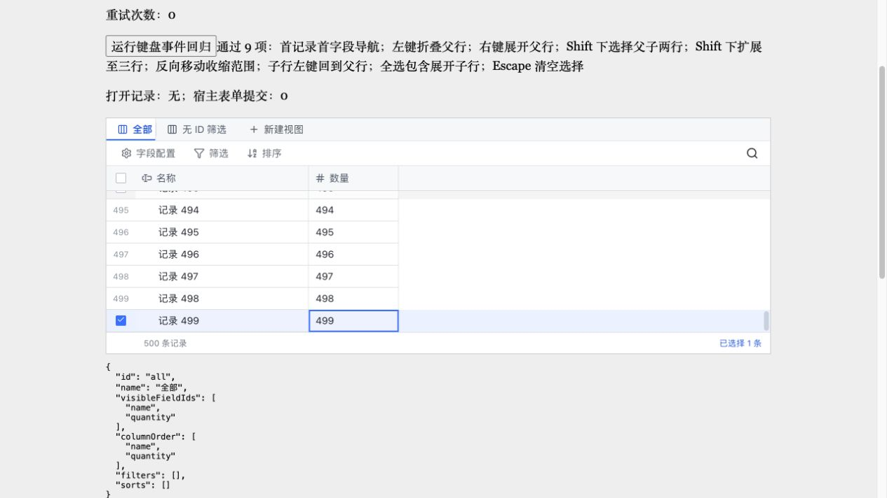

## 第三轮：字段控制与手势中断实测

字段配置的父行此前拦截子按钮 Enter/Space，焦点在“隐藏数量”时 Enter 不生效；整行拖拽也使显隐操作与拖拽共享启动区域。现在使用独立、可聚焦且有名称的拖拽按钮，原生显隐按钮保留键盘行为；没有选择回调的行移除无效按钮语义。最后一个有效可见字段的隐藏按钮明确禁用，计数排除已离开 schema 的字段 ID。字段面板移除 `any` props，排序提交同时检查两端索引范围。规则先记入 app/AGENTS.md。

`handleRef` 和 sortable `initialIndex`/`index` 使用当前 dnd-kit 官方源码文档，通过 Context7 查询：DragHandles.mdx、sortable-state-management.mdx、drag-drop-provider.mdx；对应已安装的 React 0.5.0 API。未引入新运行时依赖。

生产消费端的真实输入验证：Enter 隐藏数量，最后可见的名称隐藏按钮禁用，Space 恢复数量；手柄 Space/ArrowDown/Space 提交列序 quantity/name，实际指针手柄拖动提交回 name/quantity。Escape 取消键盘重排，不提交列序，并按外层弹层行为关闭字段配置。捕获 console error 为 0，宿主表单提交仍为 0。

消费 fixture 新增可见测试按钮，操作实际捕获元素、React 挂载状态和容器尺寸；这些按钮只位于 tests/consumer，不进入库。主指针持续按下时：

- 释放真实 pointer capture：scrollTop 3,037.5px，释放后继续移动保持该值。
- 模拟 window blur：scrollTop 6,075px，继续移动保持该值。这里只证明 blur 事件清理，没有证明真实系统窗口切换。
- 改变宿主高度：scrollTop 9,112.5px，继续移动保持该值。
- React 卸载：grid-scroll 数量为 0；重挂载 scrollTop 为 0，之前仍按下的指针继续移动不驱动新实例。

最终 `npm run verify` 退出码 0，37/37 测试通过，无跳过项；在最终生产消费构建上重新运行搜索 10 项、键盘 9 项、视图输入 3 项，全部通过。`git diff --check` 通过。临时诊断日志已移除，并检查库产物不包含它。

最新实际安装包 `app/dist/kun-ntable-0.1.0-field-controls-20261008.tgz`：35,253 bytes、27 文件、SHA-1 `7b7a3efca76c580030241fcead43b24540b087b1`。解包后的严格 TypeScript 消费和四个 ESM 导出验证通过；依赖复用本地安装树。前两轮压缩包保留。库 ESM 68.37kB（gzip 18.73kB），CSS 95.45kB（gzip 11.48kB）。消费构建 508.05kB（gzip 162.48kB），仍保留 Vite 大 chunk 提示。

真实系统输入法、辅助技术、触屏和其他浏览器引擎的证据仍待补齐，整体目标保持进行中；不能以本轮事件回归替代这些验收。

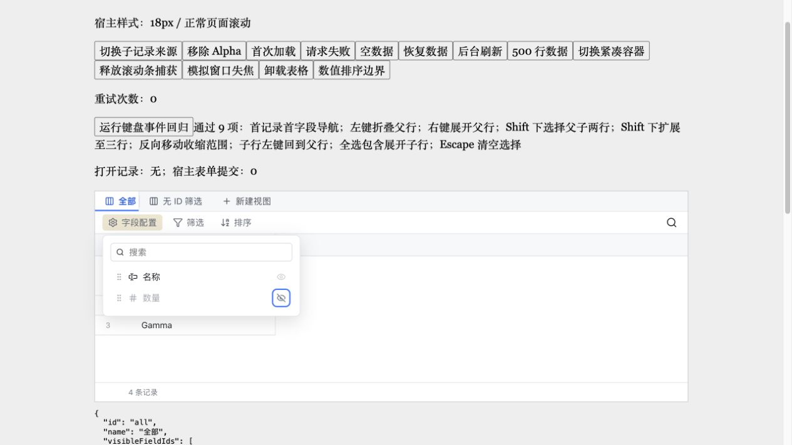

## Safari 引擎补充验收

内置 Browser Use 仅提供 Chromium 引擎，因此本轮使用已安装 Safari 的原生 UI 打开同一个本地生产消费端，新建测试标签页，没有改系统或浏览器配置。Safari 上搜索 10 项、键盘 9 项、视图输入 3 项事件 fixture 全部通过；这是事件回归，另行进行了以下原生键盘和鼠标操作：

- 鼠标隐藏数量后，隐藏名称按钮禁用。原生 Option+Tab 聚焦显示数量，Space 恢复、Enter 再隐藏；手柄键盘 Space/Up/Space 提交 quantity/name 列序。再次 Space/Down/Escape 取消，列序保留 quantity/name。
- Safari 当前默认 Tab 导航跳过部分普通按钮；Option+Tab 可逐个到达手柄和显隐按钮。没有修改“Tab 聚焦所有控件”设置，也不将默认偏好等同于组件失效。
- 500 行数据中，点击首行后 Command+End 到 500 行“记录 499”，Space 选择它；后台刷新以及失败后原生可访问树仍保留末行和“已选择 1 条”。状态条占用高度后，截图底部只完整显示到记录 498：数据和选择保留不等于活动单元格始终处于视口内，需要继续检查尺寸变化和焦点返回时的可见性。点击重试后次数为 1，状态切换为正在更新，证明回调触发而非真实网络请求完成。

这里只完成 Safari 的上述有限场景，未验证 Safari 全部列拖动、触屏、工具提示或真实系统输入法，仍不能称为完整跨浏览器验收。

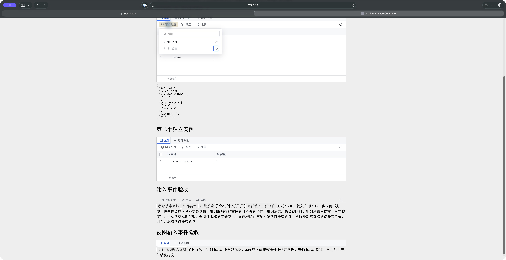

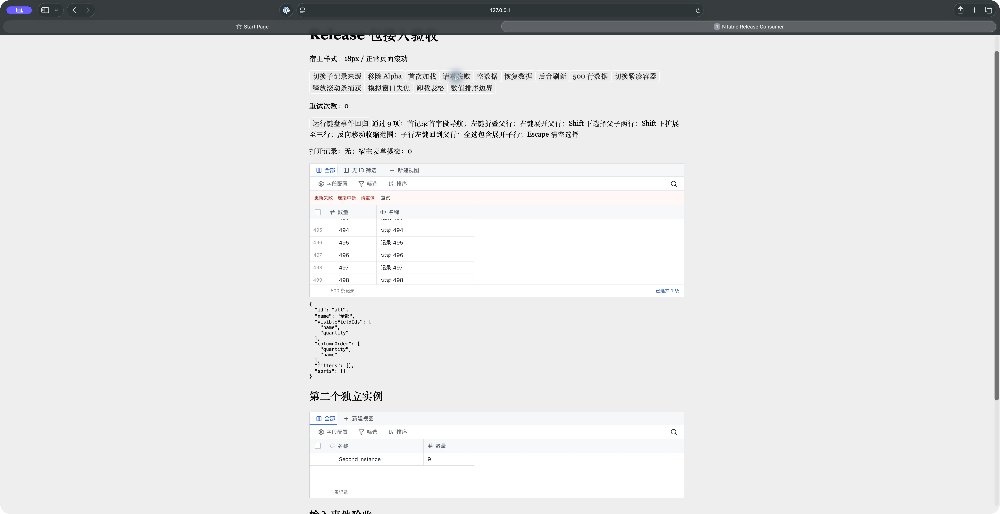

## 第四轮：长条件列表的弹层边界

先复核上一轮末行可见性：稳定后 Safari 的正在更新画面完整显示已选择的记录 499，Chromium 返回焦点时活动末行底边与视口底边一致；上一轮失败状态截图是布局更新期间的观察，不作为持续故障。实际拖动滚动条到 scrollTop 12,151px 后再进入表格，Chromium 自动将原活动记录显露。没有为未成立的故障添加滚动补丁。

随后在 640×280 视口复现真实弹层故障：添加 6 条筛选后，未限制高度的面板高 388px、top -268px，前部条件和标题移出屏幕。工具栏弹层现在由 Radix collisionPadding 保留 8px 边距，使用官方 `--radix-popover-content-available-height` 限高，限制宽度为视口减 16px，并允许内部滚动。只作用于 toolbar-panel，保留库样式边界和已有正常尺寸布局。规则先更新 app/AGENTS.md。

通过 Context7 查询 [Radix Popover 官方文档](https://www.radix-ui.com/primitives/docs/components/popover) 的尺寸约束，使用其可用高度变量。

最终生产消费端实际验证：640×280 的六条件面板 top 8px、高 112.23px、内容高 386px且 overflow auto；360×280 时 left 8px、right 352px、宽 344px。操作末尾删除按钮后剩 5 条；聚焦顶部清空按钮使面板 scrollTop 回到 0，再清空回到无条件状态。嵌套字段选择器 portal 在外层滚动区域之外仍可见，菜单底边 206px，Escape 关闭内层并保留外层。临时视口已恢复。

`npm run verify` 退出码 0、37/37 测试通过、无跳过项，包含严格消费类型、生产构建、库契约和 npm pack dry-run。实际归档仅含库产物、README 和 package.json；新包 `app/dist/kun-ntable-0.1.0-popover-bounds-20261008.tgz`，35,314 bytes、27 文件，SHA-1 `fb02bc3f3ce43fcce728dc7d5082527e3d30faca`。本轮没有重新声称 tarball 的全新依赖安装验证。库 ESM 68.41kB（gzip 18.74kB），CSS 95.76kB（gzip 11.54kB）。演示/消费的大 chunk 提示仍保留。

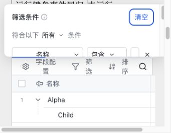

## 第五轮：选择器状态与 ESM 声明消费

选择搜索“名”后选中名称，再用 ArrowDown 打开字段选择器，旧查询仍为“名”，候选只剩名称；键盘打开没有经过原先的 onOpenChange 重置。现在所有打开/关闭路径共用 changeOpen，选择提交也清空查询。关闭状态停止入场动画，防止关闭元素继续等动画事件而留在可见 DOM。实际验证选择结果后菜单消失，键盘重开 query 为空，恢复全部候选；Escape 关闭内层、保留外层，外部关闭后面板也消失。

消费 fixture 增加可切换的 42 字段 schema，仅用于真实多候选验收。原选择器没有限高：640×280 下底边 433px。现在使用 Radix 可用高度、8px 碰撞边距及 sticky always；搜索框固定，候选列表内部滚动。最终实际内高 280px 时，菜单 top 84px、bottom 272px；ArrowUp 从搜索框到扩展字段 40，末项 top 227px、bottom 263px，Enter 可提交 extra-39。搜索“名”再选择后重开，42 候选全部恢复。临时设备视口已清除。

本轮确认 Browser viewport 能力只调整当前选中标签页（当时为主演示），因此最终消费端尺寸用其独立 CDP 明确设置，并读取 window.innerHeight 验证；没有把 720px 的观察计作短视口通过。截图工具在设备模拟时仍返回异常画布（包括空白结果），因此短视口结论仅由实际 DOM 尺寸、焦点位置和提交后的受控状态支持，不把短视口截图作为视觉通过。设备模拟已清除。

归档隔离消费发现新的发行缺陷：Bundler 门禁通过，但 NodeNext 报 TS2834，公共声明的相对 import/export 缺 `.js`。声明准备脚本现在为 TypeScript 生成的相对 module specifier 补 ESM 扩展名；公共入口和类型保持原契约。新增 NodeNext 消费配置，Bundler/NodeNext 均开启 skipLibCheck false。规则先更新 app/AGENTS.md。初次尝试旧 TypeScript compiler API 失败（已安装 7.0.2 根导出仅版本信息），未保留该依赖方式；最终脚本处理声明文本，门禁直接校验产物解析。

最终 npm run verify 退出码 0，37/37 测试、无跳过项；新增两种完整声明检查通过。最终 UI 构建上的搜索 10、键盘 9、视图输入 3 项均通过。实际 tarball 解包后在独立消费目录运行 strict + skipLibCheck false + noUncheckedSideEffectImports，两种模块解析均通过，ESM 四个导出正确；依赖复用本地树，没有新网络依赖安装的证据。

最新安装包：app/dist/kun-ntable-0.1.0-selector-quality-20261008.tgz，35,450 bytes、27 文件，SHA-1 2553e5a55236dc60ade8701c8f450c5367e2e040。库 ESM 68.46kB（gzip 18.75kB）、CSS 96.96kB（gzip 11.65kB），旧压缩包保留。git diff --check 通过。Safari 本轮修改后的完整回归和真实系统输入法、辅助技术、触屏仍待补齐。

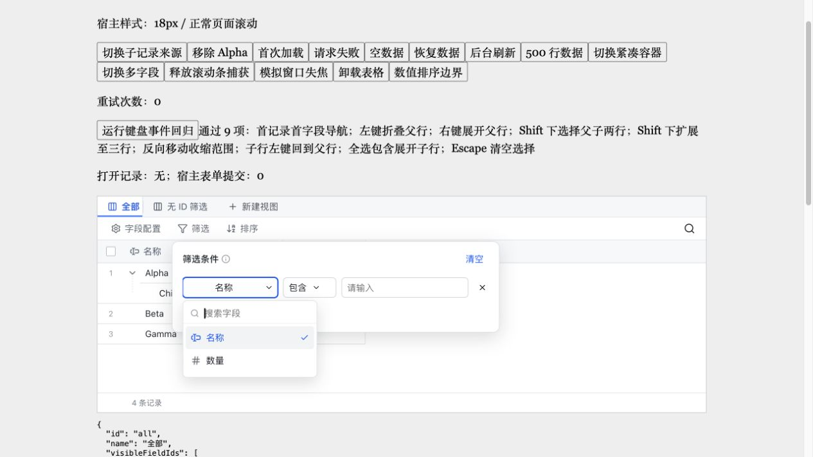

## 第六轮：视图删除后的焦点与交付审计

消费 fixture 补齐宿主删除及拒绝删除回调，不操作演示持久化或用户业务数据。删除当前“全部”视图后，原实现焦点成为 body；剩余视图按钮也没有选中语义。ViewBar 现在用 aria-pressed 表达当前视图；仅在所请求删除已被宿主反映到 views、且新当前视图存在时，把焦点放回该视图。宿主仍负责选择回退视图和持久化，没有组件代删逻辑。

实际生产消费端：允许删除后焦点为 BUTTON“无 ID 筛选”，aria-pressed true；拒绝删除时两视图均保留，焦点为“全部菜单”；最后一个视图的删除按钮禁用。删除前后没有改变记录打开或表单提交规则。视图输入事件 3 项、网格键盘事件 9 项通过，捕获的 console error 为 0。

npm run verify 退出码 0，37/37 测试、无跳过项；新增 fixture 后严格消费检查和生产消费构建再次通过。实际 tarball 的 Bundler/NodeNext strict + skipLibCheck false + noUncheckedSideEffectImports 两种消费，以及四个 ESM 导出均通过。依赖继续复用本地树。新包 app/dist/kun-ntable-0.1.0-view-focus-20261008.tgz，35,527 bytes、27 文件，SHA-1 03ff01e4b50afb6432727751a7d4d56abab254e4。旧包保留。

建立 [交付验收矩阵](delivery-readiness-2026-10-08.md)，逐项区分功能、输入焦点、视觉、异常、性能、手势、跨浏览器与分发证据和缺口。整体目标仍未完成，当前不能用局部构建/事件通过替代完整产品验收。

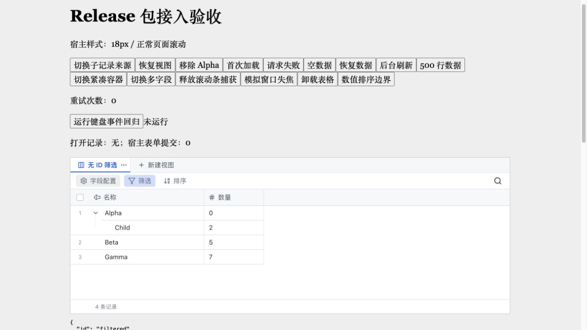

## 第七轮：浏览器运行性能与当前 Safari 回归

只新增消费端测量入口和辅助代码，不改公开库实现。保持页面可见，装载 25,000 条扁平记录并执行倒序、等值筛选、清空，共四阶段；每阶段确认真实 DOM 的行数/数值、aria-busy 稳定，继续等待两帧，记录实际挂载行数。超时/后台页输出失败；PerformanceObserver 不支持时明确标记，不把 unsupported 解释为零。

Chromium 三次装载 55.5/44.7/45.8ms、倒序 50.9/50.2/50ms；Safari 三次完整装载 77/51/54ms、倒序 67/66/49ms。25,000 条记录只挂载 20–21 行，等值筛选剩 1 行。首次 Safari 装载还观察到 129ms，保留冷启动差异。数值包含 DOM 稳定后两帧等待，不是 CPU 耗时/FPS/真实输入延迟。完整条件与四阶段结果见 [浏览器性能记录](browser-performance-2026-10-08.md)，原始 JSON/摘要保存在 app/qa。没有以这一配置建立所有数据分布和设备的性能通过结论。

Safari 重新加载当前生产消费构建后：原生删除成功焦点为“无 ID 筛选”toggle button、Value on；拒绝删除回到“全部菜单”。字段搜索“名”、选择名称、原生 Down 重开后搜索值清空且数量候选恢复，Escape 分层关闭。当前 Safari 搜索 10 项、键盘 9 项、视图输入 3 项事件回归全部通过。截图只证明该普通窗口场景，未扩写为短视口或全部手势。

本轮新增测量代码的严格消费类型检查（包括 Bundler/NodeNext）和生产消费构建通过，git diff --check 通过。库产物未改变，最新分发包继续为上一轮 view-focus tarball；不会为未进库的 fixture 改动重复包装同一份库。完整连续流程、深树/多列/连续滚动性能、真实系统 IME/辅助技术/触屏仍待验证，目标保持 active。

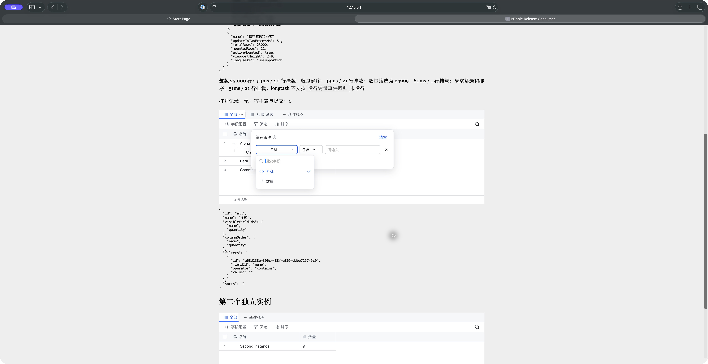

## 第八轮：连续功能流程与全部字段显示

在当前 Chromium 生产消费端串联真实操作，而非仅调用事件检查：表头键盘调整名称宽度 250→266px、重排数量/名称；数量大于 4 配合倒序返回 Gamma 7、Beta 5。切换视图后返回，列宽/列序/筛选/排序仍由宿主保存。搜索无匹配后点击清空搜索和筛选恢复四行，排序保留；子记录同时符合搜索与筛选时保留祖先 Alpha。最初 Child 不符合既有名称 contains a 条件，零结果符合 AND 组合规则，未据此误报层级缺陷。

选择 Child 后切换 getSubRows 来源到 Alternate，旧子记录的选择清理；恢复来源后冻结名称、双击打开 Alpha、选中 Alpha、后台刷新、失败、重试，数据与选择保留，重试回调次数为 1。恢复数据后创建并切换临时视图，选择清空；删除该测试视图后焦点回到“全部”、aria-pressed true。隐藏数量后，最后可见的名称不能再隐藏；显示数量恢复。宿主表单提交为 0，打开记录回调为 a，控制台 error 为 0。宿主请求由本地 fixture 控制，这不是实际网络恢复或详情页验收。

新增独立字段类型消费 fixture，覆盖 text/number/singleSelect/multiSelect/date 的正常、空、未匹配和长值，不修改库产物。实测数字 0 与 -1.25 正常保留；单选按标签显示且 draft 背景 rgb(219,234,254)，未匹配选项为 —；多选显示网页端/移动端，未匹配 legacy 保留原值；日期字符串原样显示，包括带时区字符串。悬停截断的长文本时，实际 Radix tooltip 给出完整值。正常窗口截图已逐张检查，未把 DOM 文本等同于短视口或辅助技术验收。

选择字段搜索仍遵循已公布的原始值契约：draft 命中标准值，待处理不命中；legacy 命中未匹配选项行，清空恢复四行。此处也暴露产品体验限制：用户看到选项标签，却需要搜索选项原值。当前证据确认实现与契约一致，不将其写成完整“好用”的通过结论；后续需审视标签查询语义及兼容性后，再同步规则、文档和实现。多选颜色当前不使用也属于既有公开限制。

本轮 fixture 的严格消费类型检查（Bundler/NodeNext）及生产消费构建通过；库实现未改，分发包仍为 view-focus tarball。大 chunk 提示保留。git diff --check 通过。当前连续流程只覆盖上述路径；选择类型筛选/排序、其他引擎全部类型、深树/多列/连续滚动及真实 IME/辅助技术/触屏仍不能声明完成。

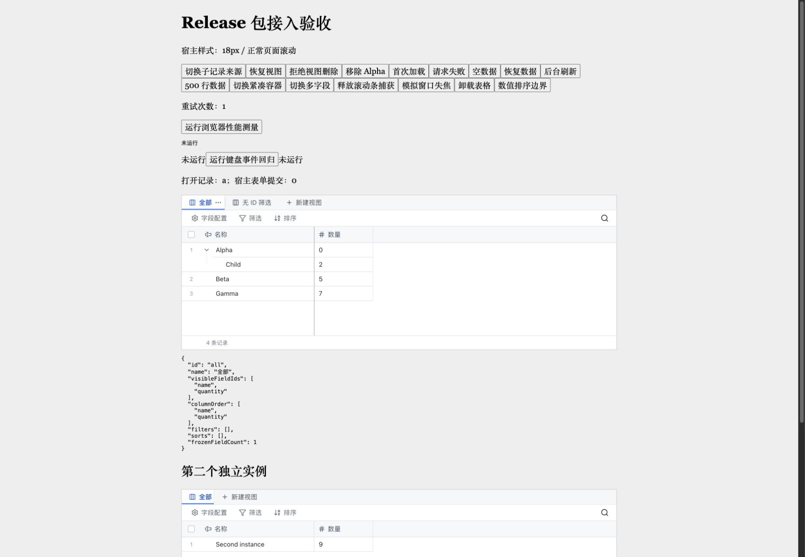

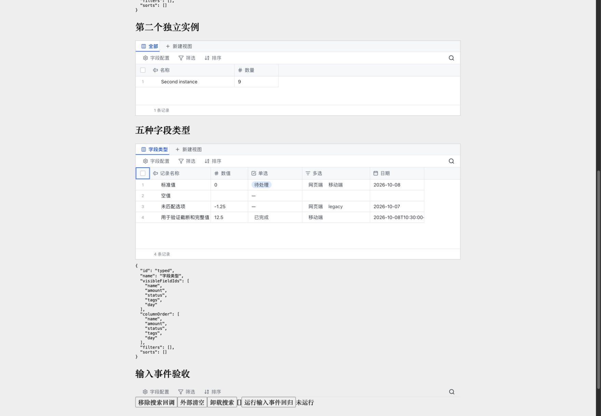

## 第九轮：选择字段显示标签搜索

第八轮发现用户看到“待处理”却搜索不到。先更新产品规则和两份接入契约，再扩展本地搜索：可见且 searchable 不为 false 的单选、多选字段同时匹配已配置选项的 label 与原始值，忽略大小写。未匹配选项保留原值查询；筛选和排序继续基于原始值，层级祖先/子树保留规则不变。选项 label lookup 每次投影只构建一次，不在每条记录中遍历整个选项列表。

新增两项有行为边界的测试：标签/原值、大小写、空值/未知选项、隐藏字段/禁搜字段，以及标签命中后保留祖先并与原始值筛选 AND 组合。npm run verify 退出码 0，39/39 测试通过，无跳过项；覆盖演示/Sites、lib、严格 Bundler/NodeNext、生产消费构建与打包契约。库 ESM 69.40kB（gzip 19.02kB）、CSS 96.96kB（gzip 11.65kB），演示/消费大 chunk 提示仍保留。

当前 Chromium 真实消费端：“待处理”返回标准值一行，“网页端”返回标准值/未匹配选项两行，DRAFT 返回标准值，legacy 返回未匹配选项，清空恢复四行，console error 为 0。截图已视觉检查。Safari 重新加载当前生产构建，用原生输入控件填写“待处理”返回一行、“网页端”返回两行，清空恢复四行；没有把控件填写解释为真实系统 IME 候选窗口验收。

新包 app/dist/kun-ntable-0.1.0-label-search-20261008.tgz：35,714 bytes、27 文件、SHA-1 2b82e960a5f50ba848c808808bba4434c75aa91e。实际解包独立目录的 Bundler/NodeNext strict + skipLibCheck false + noUncheckedSideEffectImports，以及四个 ESM 导出通过；依赖复用现有安装树。第一次 npm pack 因默认缓存写权限失败，改用本轮临时缓存后完成，没有修改系统权限或 npm 全局设置。git diff --check 通过。旧包保留。

整体目标继续 active：选择字段筛选/排序的完整操作、多列/深树及连续滚动性能、真实 IME/辅助技术/触屏证据仍需补齐。

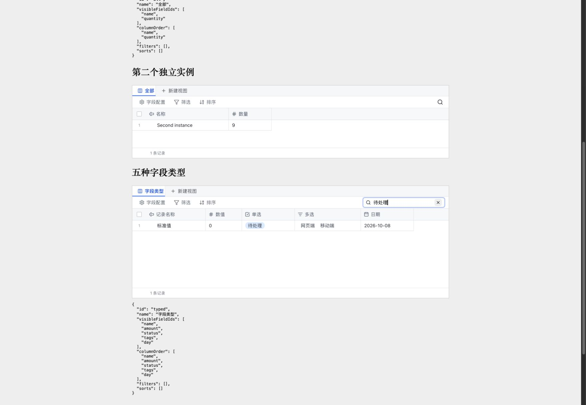

## 第十轮：深树栈溢出与连接线元数据

当前源码实测：5,001 层合法单链在 projectTree 和 collectRecordIds 都抛出 RangeError: Maximum call stack size exceeded。Table 的默认展开收集也使用递归。先更新规则，再把树构建、投影展开、ID 收集和默认展开收集改为迭代；后序构建继续保留祖先路径、父匹配子树、同级排序与计数。连接线改为存储实际绘制的祖先层级，单链共享空数组，避免按每层复制全长度 false 数组。公共 props 不变。

新增 10,001 层测试，覆盖折叠、末端命中自动展开、全部默认展开和身份收集；单次投影 getter 调用为 10,001。分支 fixture 另验连接线层级 [0] / [0,1] 与原先布局语义相同、兄弟顺序不变。npm run verify 退出码 0，41/41 测试通过，无跳过项。库 ESM 70.17kB（gzip 19.26kB），CSS 不变。随后新增深层浏览器 fixture、修正性能入口后，严格消费类型与生产消费构建再次通过。

当前 Chromium 生产消费实际装载 5,001 层，卸载/重挂载正常；搜索最深叶节点后 aria-rowcount 为 5002（含表头）、实际挂载 21 行，前五行 aria-level 为 1–5。Control+End 到末层数量 5000、aria-level 5001、挂载 20 行，Control+Home 返回；console error 为 0。截图已检查。这里只证明深树稳定性和虚拟化，极深缩进会超出名称列空间，不能写成 5,001 层可读性或辅助技术已通过；真实多分支深树及 Safari 同场景尚待验收。

25,000 行性能复核第一次失败：之前“深层目标”查询残留，测量入口重置 rows/视图却没清组件内搜索。未将超时计为通过。入口现在重挂载测试实例，清除前序查询/展开/焦点状态。用“不存在”查询预置后再启动，四阶段通过：装载 37.5ms、倒序 50.1ms、筛选 49.9ms、清空 49.1ms，挂载分别 20/21/1/21 行。原始当前结果保存在 app/qa/browser-performance-deep-tree-20261008.json。单次两帧更新时间不是 FPS、真实输入延迟或全面性能结论。

最新分发包 app/dist/kun-ntable-0.1.0-deep-tree-20261008.tgz：35,968 bytes、27 文件、SHA-1 a63f8042717148a5c43b7e13db40ff933f0c49d3；实际解包严格 Bundler/NodeNext 和四个 ESM 导出通过，依赖复用本地树。旧包保留。git diff --check 通过，整体目标 active。

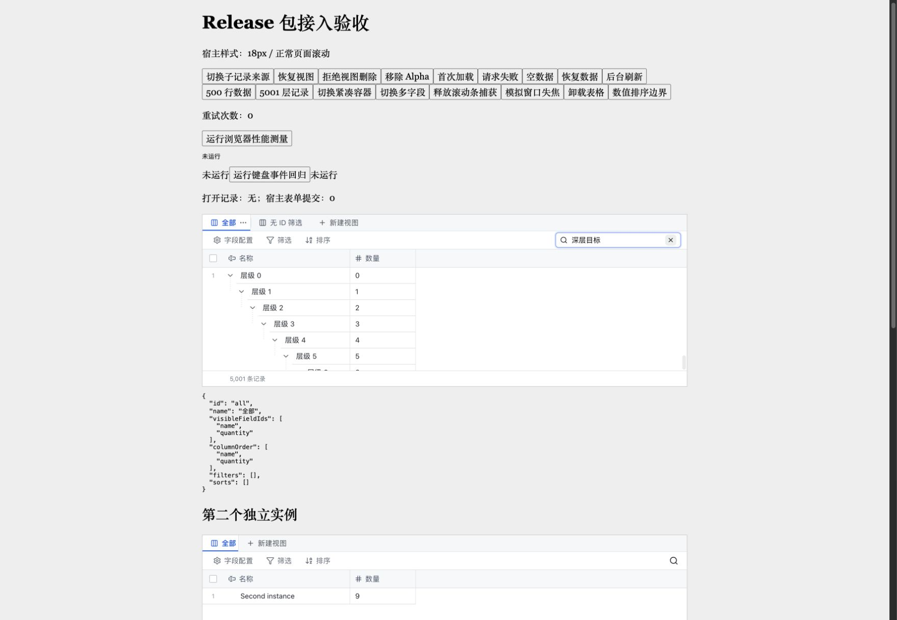

## 第十一轮：宽表和多分支树、状态条缩小视口

新增两种生产消费 fixture：2,000 行 × 42 数据列（两列冻结）和 5,461 条四分支七级树（默认全部展开）。当前 Chromium 宽表 aria-rowcount 2001、aria-colcount 43（含选择列），挂载约 20–21 行；Control+End 到记录 1999 的业务字段 40，活动单元格右边/下边与视口边缘一致，横向偏移 5064px。分支树 aria-rowcount 5462，Control+End 到数量 5460、aria-level 7，挂载 20 行。正常截图已检查。这里只补数据规模和可达性证据，没有 FPS/持续滚动测量或其他引擎的同范围结论。

复现独立 UX 缺陷：宽表末行已选中后，失败状态条将视口从 240px 缩小到 203px，稳定后活动单元格 bottom 807.73px，而视口 bottom 770.73px，末行持续被遮住。保存的质量宽表截图记录此状态，未把它写成通过。规则先增加尺寸变化时保持原有底部/右侧边缘；AutoHideScrollArea 在尺寸观察中保留原边缘偏移（1px 容差），数据范围变化时不做边缘锚定，其他位置保持偏移并只作合法范围钳制。

修复后同一路径：末行 bottom 与视口 bottom 同为 770.73px，scrollTop 63833、选择仍为 1。中间位置由 240px 缩小到 203px 时 scrollTop 前后均为 564px，没有跳到末端。120px 宿主容器在工具栏+失败状态下实际网格高度为 0，这不是“完整可用”的通过场景；仍需审视极小宿主尺寸的接入约束与呈现。

新增尺寸变化测试覆盖贴边缩小/扩大、亚像素容差、中间位置、数据增加/减少及原来不可滚动状态。npm run verify 退出码 0，42/42 测试通过，无跳过项。当前 console error 为 0。库 ESM 70.62kB（gzip 19.40kB），CSS 不变，大 chunk 提示保留。最新包 app/dist/kun-ntable-0.1.0-resize-edge-20261008.tgz：36,126 bytes、27 文件、SHA-1 d31af70d0958108827344ee920c7ddf0c42ff483；实际解包严格 Bundler/NodeNext 与四个 ESM 导出通过，依赖复用本地树。git diff --check 通过。整体目标 active。

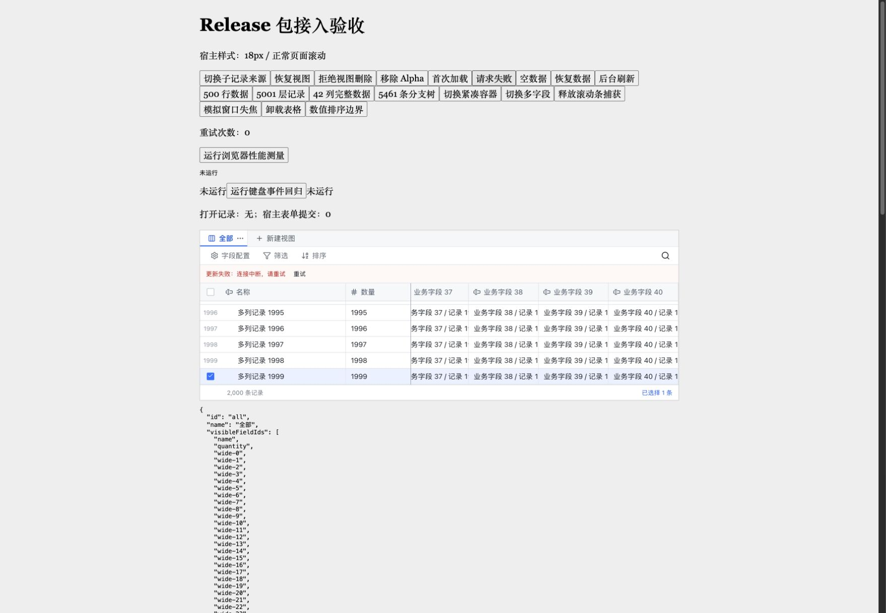

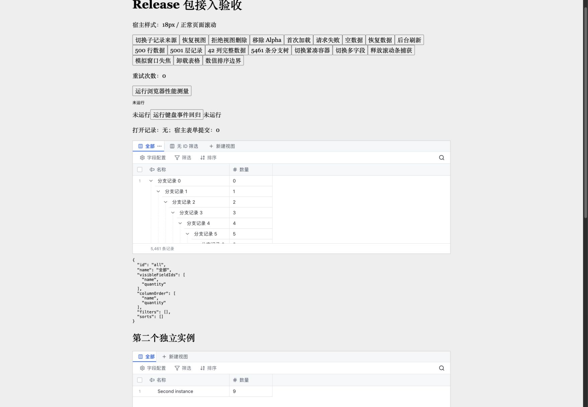

## 第十二轮：极小宿主容器的可达降级

第十一轮已确认 120px 宿主在状态栏出现后记录区高度归零。规则先增加最小记录区（表头 36px + 一行 32px），接入文档明确正常 NTable 至少约 168px，带状态约 205px，长状态文本可能更多。CSS 为 NTable 保留最小 table track；不足时组件自身滚动其布局。独立 Table 的记录 track 同样至少 68px，并内部容纳溢出。正常高度下保留原内部虚拟滚动，不修改宿主 body。

当前 Chromium：120px NTable + 失败状态，root height 120/scrollHeight 205，grid height 68，Control+End 到 Gamma 数量 7，root scrollTop 80，活动行完全落在 root 和 grid 内；重试按钮仍可通过操作滚动到达并触发一次回调。截图已检查。独立 Table 新增 100px 宿主 fixture，带失败信息后 table scrollHeight 135、grid height 68，Control+End 到 7，内部布局 scrollTop 20，活动单元格仍在 table 边界内。这里的降级允许工具栏随外层滚动暂时移出可见区，不声明极小容器能同时显示全部控件。

恢复 340px NTable 后 root scrollHeight 等于 340，root scrollTop 0，无外层纵向溢出；刷新状态 grid 204px。42 列数据末端键盘导航仍正常，root/table scrollWidth 均等于 clientWidth 958px，横向滚动仍由内部 grid 承担，没有新增外层横向滚动。console error 为 0。

本轮 npm run verify 退出码 0，42/42 测试通过、无跳过项；独立 Table fixture 增加后严格消费类型及生产消费构建再次通过。大 chunk 提示保留。跨浏览器同尺寸、空态长提示和高缩放完整路径仍待补齐，目标继续 active。

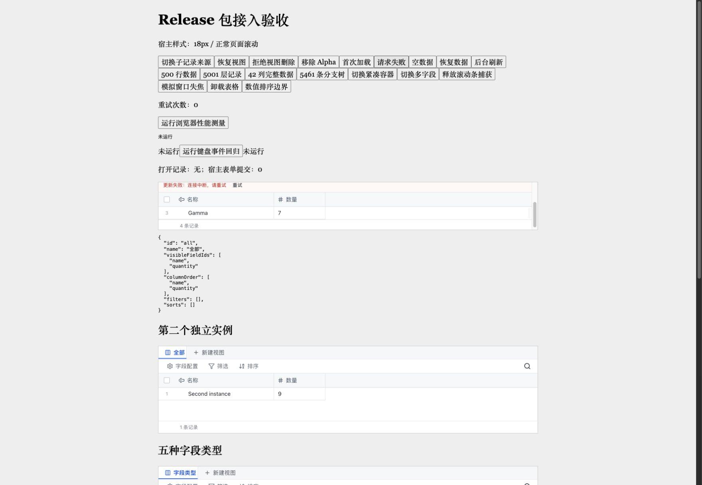

本轮分发包 app/dist/kun-ntable-0.1.0-small-host-20261008.tgz：36,186 bytes、27 文件、SHA-1 71aa301cfefb3e5d30e6c3e92a2cb36eac11702a。实际解包的严格 Bundler/NodeNext 与四个 ESM 导出通过，依赖复用本地树；旧包保留。git diff --check 通过。

## 第十三轮：配置面板严格类型门禁

库源码此前继承 strict false，严格消费只证明公开声明可被宿主解析，不能替代源码严格检查。本轮先更新规则，再为 FieldConfigPanel、FilterPanel、SortPanel 及其依赖建立 tsconfig.lib-panels.json，npm run typecheck:panels 纳入 verify。共享 SelectControl 使用泛型字符串选项契约，保留 FilterOperator 和匹配模式联合类型；Lucide icon、popover children/active、sort patch 均显式建模。拖拽结束回调从 provider props 推导，不自造依赖事件形状。字段 map lookup 通过类型谓词排除缺失字段，移除不必要的筛选关系断言，RadioGroup 回调仅提交合法 asc/desc。

新增严格门禁通过；npm run verify 退出码 0，42/42 行为与分发测试通过，无跳过项。对整个库另跑 --strict --noEmit，剩余 158 条诊断均在 Table.tsx，因此整个库的源码严格迁移尚未完成，不能扩大本轮通过范围。没有关闭诊断、加入绕过注释或把错误边界改回 any。

当前 Chromium 真实生产消费：单选 equals draft 返回标准值，equals 待处理返回无匹配，符合原始值筛选契约；多选 contains legacy 返回未匹配选项行，清空恢复四行。单选顺序为 null/draft/ready/unknown，对应空值/标准值/长名称/未匹配；倒序反转，受控状态 direction 为 desc。截图已检查，console error 为 0。一次菜单关闭后 fill 触发工具 target token mismatch；重新读取输入可见状态后填写成功，没有把工具焦点同步错误记作产品缺陷。

后续仍需完成 Table 源码严格类型、全场景手势与输入验收、持续滚动性能等，目标保持 active。

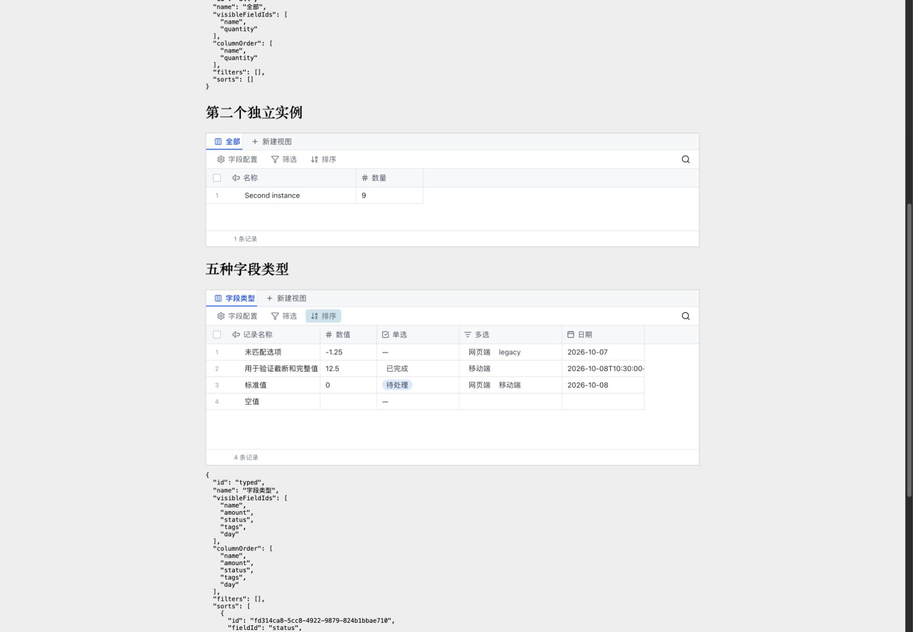

最新包 app/dist/kun-ntable-0.1.0-panel-types-20261008.tgz：36,348 bytes、27 文件、SHA-1 b2a7bbf8656a8a9d1bb3a9971ac2df1cb134013a。实际解包的 strict + skipLibCheck false + noUncheckedSideEffectImports，Bundler/NodeNext 及四个 ESM 导出通过；依赖复用本地安装树。旧包保留，git diff --check 通过。

## 第十四轮：整个库源码严格类型

完成 Table.tsx 上一轮 158 条严格诊断整改：可空字段 ID/菜单/活动单元格、历史投影、列拖拽取消引用、滚动指标与计时器均显式建模；区分 React 起始事件与 DOM PointerEvent/KeyboardEvent 生命周期监听；HeaderCell、Cell、AutoHideScrollArea 不再以 any 接收 props，单元格值为 unknown。map lookup 明确收窄有效 Field，DOM target 非 Element 和相关节点不存在时提前返回，避免直接调用 closest/节点尺寸。useImperativeHandle 的非空引用限于 React 挂载后的 ref 生命周期，未扩大为普通业务数据断言。公开 TableProps 和回调形状保持原契约。

规则同步后 tsconfig.lib.json 开启 strict，新增 typecheck:lib，verify 从局部面板门禁升级到所有 src/ntable、src/components 源码检查。局部配置保留为可单独运行的检查，未删除已有文件。npm run verify 退出码 0，42/42 测试通过、无跳过项，源码 strict、声明生成、Bundler/NodeNext 消费、构建和 pack 契约全部通过。演示工程 tsconfig.json 的 strict false 不解释为已经迁移；本轮严格范围是独立库源码。

当前 Chromium 最终生产构建：键盘事件 9 项、搜索事件 10 项、视图创建事件 3 项均通过；搜索回归初次因为输入框未打开而失败，按 fixture 明确前提打开后重跑通过，没有计入第一次失败。实际指针拖动名称列宽由 250 提交为 280px，宿主视图 columnWidths 保存正确，console error 为 0。截图已检查。其他完整手势、跨引擎、真实系统 IME/辅助技术/触屏及持续滚动性能证据仍不能由类型门禁替代，整体目标 active。

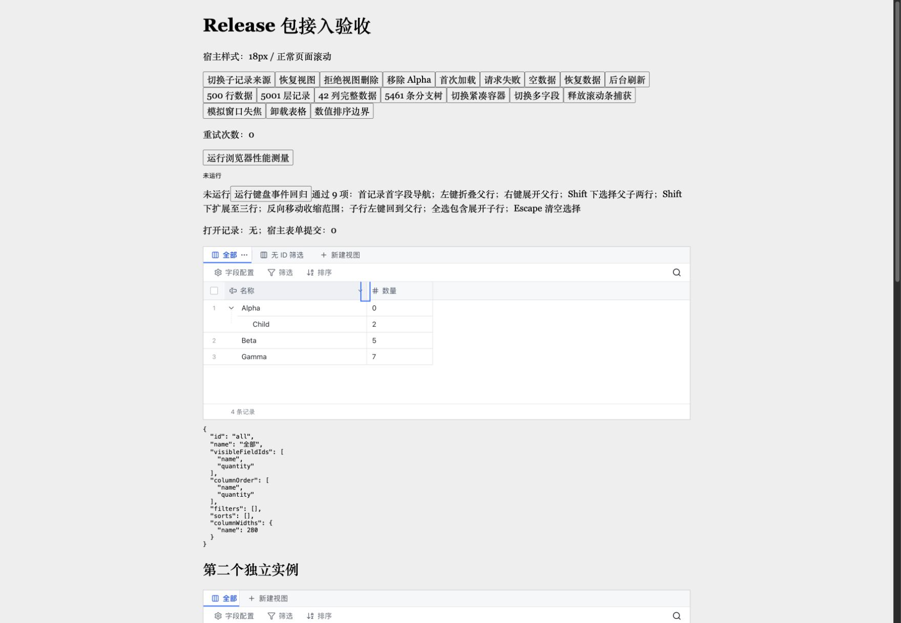

最新包 app/dist/kun-ntable-0.1.0-strict-source-20261008.tgz：36,394 bytes、27 文件、SHA-1 2a3efdfa13d3b69ff6c72b513d8c7bc0ddb6b1c6。实际解包的 strict + skipLibCheck false + noUncheckedSideEffectImports，Bundler/NodeNext 和四个 ESM 导出通过；依赖复用本地树，旧包保留。git diff --check 通过。

## 第十五轮：连续滚动的实际移动帧测量

新增消费端 UI 入口，在当前可见数据上以每帧半个视口步长纵横往返（每方向最多 120 次），记录 RAF 间隔、挂载行/单元格数、DOM 可见区连续覆盖与 longtask。只在 visible 页面运行，帧超时失败，observer 在所有等待失败/正常结束路径都断开，无可滚动范围时不生成结论。程序化滚动不等于真实滚轮、触屏延迟或视觉 FPS。滚动纵向覆盖前约 14,400px 后返回，未声称持续扫完整个 2,000/5,461 行数据。

初版 480 帧包含到达横向边缘后的空走帧，宽表 P95 33.3ms、分支树 17.4ms。发现口径会稀释移动成本后，修正为只采集实际偏移变化的帧，并区分纵/横采样数；旧宽表 JSON 保留，不将初版混合结果作为最终性能通过。

当前 Chromium、普通窗口、可见记录区 240px（宽表测量开始 grid 在窗口 y602–842，window innerHeight 1228）：

| 数据 | 实际移动帧 | P50/P95/max 间隔 ms | >50ms 帧 | 最大挂载行/单元格 | DOM 覆盖缺口 | longtask |
| --- | --- | --- | --- | --- | --- | --- |
| 2,000 行、42 列、两列冻结 | 262（纵240/横22） | 16.7 / 33.5 / 50.8 | 4 | 34 / 1462 | 0 | 53、58ms |
| 5,461 条七级四分支树、2列 | 240（纵240/横0） | 16.7 / 17.5 / 33.3 | 0 | 34 / 102 | 0 | 无观察项 |

原始当前结果：app/qa/scroll-wide-motion-20261008.json 与 scroll-branch-motion-20261008.json；初版宽表为 scroll-wide-20261008.json。两组结束偏移都回到 0，console error 为 0；测量现场截图已检查。DOM 覆盖检查不是逐帧像素证明；上述单次结果不能外推不同机器/引擎/输入设备。

宽表存在明确优化空间：相同记录视口下挂载全部 42 列，屏幕外列仍有 DOM/React 成本；P95 约两帧且有长帧。此为由代码与测量作出的待验证优化方向，尚未用 profiler 证明各部分 CPU 占比。下一轮优先针对列渲染建立对照并改进，不能把本轮写成滚动性能已全面达标。

本轮仅修改消费测量 fixture，严格消费类型与生产消费构建通过，git diff --check 通过；库产物不变，最新分发包仍为 strict-source tarball，不重复包装。整体目标 active。

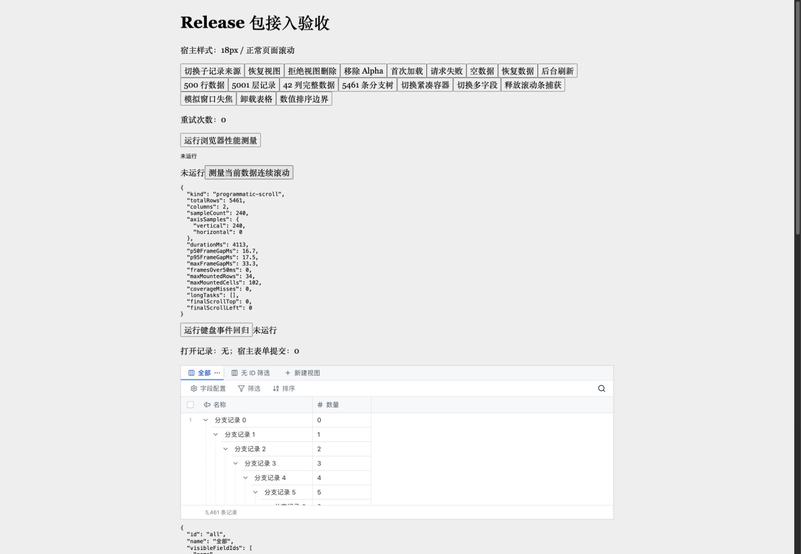

## 第十六轮：宽表列按需挂载

先建立可失败反馈：本机 Chromium 2,000×42 列、冻结前两列的原滚动场景复测 P95 50ms，未满足本次诊断用的 25ms 目标。关闭逐帧 DOM 采样后仍为 34.8ms（3 帧超过 50ms）；保留相同 2,000 条完整记录与 42 列 schema、仅显示前四列时降到 18.6ms，零长帧。对照支持列渲染规模是主要优化方向，未以此证明各模块 CPU 占比。原始对照分别保存在 app/qa/scroll-wide-no-dom-20261008.json 与 scroll-four-column-control-20261008.json；不采样时挂载数和覆盖缺口返回 null，不能写成零。

规则先更新 app/AGENTS.md。新增 columnWindow.ts：完整列宽和 CSS Grid track 保留，按横向视口及左右 160px 余量挂载列；冻结列、活动列、菜单列、缩放/拖拽列和高亮列保留。显式 gridColumn 保持原逻辑位置与 aria-colindex；搜索/筛选/排序仍消费全部可见 schema 字段。ResizeObserver 与横向 scroll 更新窗口，尺寸未知时先挂载全部列；因此本轮主要优化稳定滚动，不声明初次装载成本已消除。两项新增测试覆盖冻结/活动保留、普通小表、初始零尺寸和多种宽度/冻结/偏移下所有可见列均挂载。

最终生产消费端两次同场景程序化滚动：各 263 个实际移动帧（纵向 240，横向 23），P95 均 17.6ms，最大间隔分别 17.7/33.1ms，超过 50ms 帧均为 0，无观测 longtask；最多挂载 34 行、272 单元格（原场景 1,462）。纵向 DOM 覆盖缺口为 0。原始数据为 app/qa/scroll-wide-windowed-20261008.json、scroll-wide-windowed-repeat-20261008.json。纵向每方向最多 120 步，只覆盖前约 14,400px；覆盖探针只验证纵向行带，不代表横向每帧几何或全部记录、真实输入、跨引擎均验收。25ms 是此次本机诊断阈值，未作为所有设备的产品承诺。

实际 UI 检查：全表 aria-colcount 43、scrollWidth 6,022px，起始只挂载 8 个表头与 160 个单元格；Control+End 到业务字段 40 / 记录 1999，aria-colindex 43、scrollTop 63,796、scrollLeft 5,064，活动单元格完整可见，冻结两列仍挂载。末列菜单向左移动提交 wide-39 到倒数第二位，增宽提交其 156px；恢复原场景后实际指针将末列由 140 拖至 110px，正确提交 wide-39。截图已检查冻结边界及末端列画面。普通表格键盘事件 9、搜索事件 10、视图输入事件 3 全通过，console error 0；合成输入法事件不替代真实系统 IME。

本轮 npm run verify 退出码 0，44/44 测试，无跳过项；整个库 strict、演示/Sites、lib、严格 Bundler/NodeNext 和生产消费构建通过。最新实际包 app/dist/kun-ntable-0.1.0-column-window-20261008.tgz：36,868 bytes、28 文件、SHA-1 8c0315abeb2630edd054c3b949cc292a9fcb30e8。实际解包的严格 Bundler/NodeNext 与四个 ESM 导出通过，依赖复用本地树，未声称新环境网络安装完成。大 chunk 提示继续保留。整体目标 active。

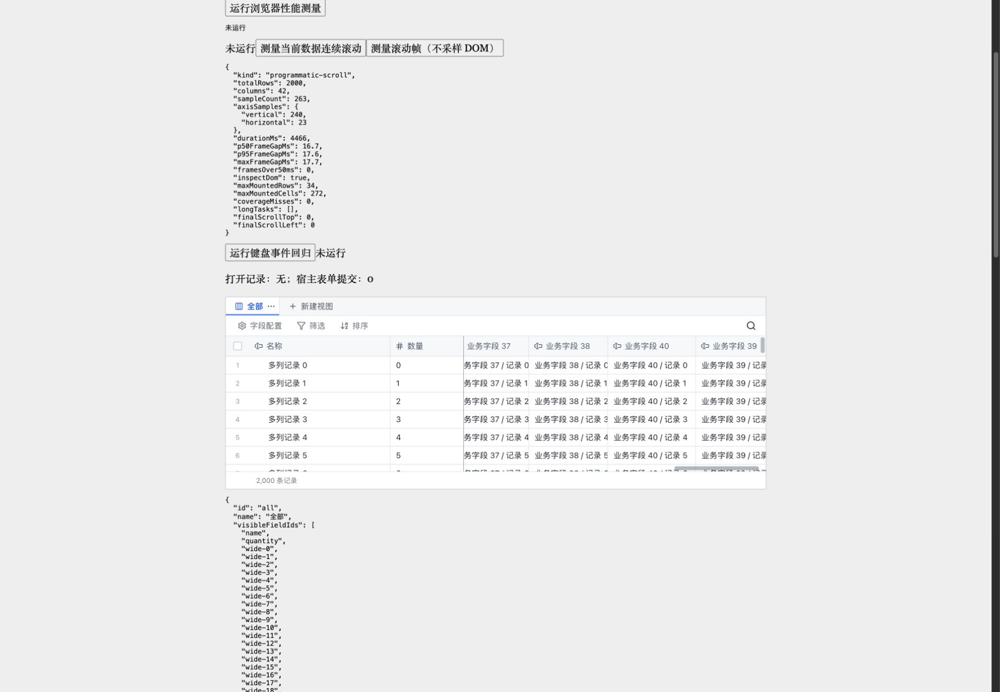

## 第十七轮：横向跳动时旧列窗口的短暂缺口

补充真正逐帧的横向覆盖探针：分别合并表头和一条屏幕内数据行的实际单元格区间，冻结层参与覆盖；短表只检查实际 grid track 内容，不把正常右侧空白判为缺列。未采样的挂载数/覆盖字段仍为 null。新增仅横向测量入口和最多六个失败帧的列索引证据，属于长期验收工具而非临时业务日志。

修复前 2,000×42 场景有 38 次横向带缺口；缩小到七行、只横向往返仍有 8 次。scrollLeft 已到 958px 时挂载列仍属于上一个窗口，实际覆盖仅 724/958px，右侧缺口 234px；反向亦复现。失败原始证据为 app/qa/scroll-wide-coverage-20261008.json、scroll-horizontal-gap-before-20261008.json。纯计算可见列测试不足以发现 React 提交延迟，稳定后的截图也不证明每帧连续覆盖。

规则先增加原生滚动更新时机。Table 仅在横向偏移或视口宽度改变时，在原生 scroll 回调内同步提交列窗口；纯纵向滚动和未改变的尺寸直接跳过，初始化/ResizeObserver 仍普通更新，不在 React 生命周期调用 flushSync。Context7 获取的 React 官方文档确认同步 DOM 提交的用途与性能代价：[flushSync 契约](https://github.com/reactjs/react.dev/blob/main/src/content/reference/react-dom/flushSync.md)。不把同步更新当作普遍性能优化，后续需继续缩小渲染成本。

修复后七行最小回放 22 帧、缺口 0，浏览器检查明确断言 horizontalCoverageMisses 为 0；完整宽表 262 帧（纵向 240/横向 22），横纵缺口均 0，最大 272 单元格。取消冻结后横向 22 帧、缺口 0、最大 240 单元格。对应原始文件 scroll-horizontal-gap-fixed-20261008.json、scroll-wide-sync-coverage-20261008.json、scroll-unfrozen-sync-coverage-20261008.json。范围仍为纵向前约 14,400px 往返，不包含完整 2,000 行。连续 41 个 Right 从表头选择列走到业务字段 39（aria-colindex 42），活动元素仍挂载，不能误写成已到最后一列。

本轮性能证据不能沿用第十六轮的 17.6ms：Chromium 带新增横向检查 P95 33.4ms、最大 50.1ms、2 帧超过 50ms；无 DOM 采样 P95 34.2ms、最大 66.6ms、6 长帧。Safari 当前带覆盖探针 262 帧，横纵缺口均 0，最大 272 单元格，但 P95 69ms、最大 91ms、73 帧超过 50ms，longtask unsupported；原始 AX 结果为 safari-scroll-sync-coverage-20261008.txt。同步修复解决空白时序，未证明帧性能达标，后续优先诊断 Safari 与列窗口换入成本。

完整 npm run verify 退出码 0，44/44 测试、无跳过；strict 库源码、演示/Sites、lib、两种消费解析与生产消费者通过。最新包 app/dist/kun-ntable-0.1.0-scroll-sync-20261008.tgz：36,925 bytes、28 文件、SHA-1 1589b14393c2547eaf5d59d39beff0e082691aca。实际解包严格 Bundler/NodeNext 与四个 ESM 导出通过，依赖复用本地树。库 ESM 72.19kB、gzip 19.91kB，CSS 97.21kB、gzip 11.71kB；demo/fixture 的大 chunk 提示保留。整体目标 active。

Safari 进一步关闭 DOM 采样：262 帧、P95 69ms、最大 99ms、94 帧超过 50ms；覆盖和挂载数为 null，不能据此声明缺口为零。AX 原始输出尾部截断，完整 UI 截图确认最终 scrollTop/scrollLeft 都是 0。由此不能把全部帧延迟归因于新增覆盖探针。该结果保存在 safari-scroll-sync-no-dom-20261008.txt 和下方截图。

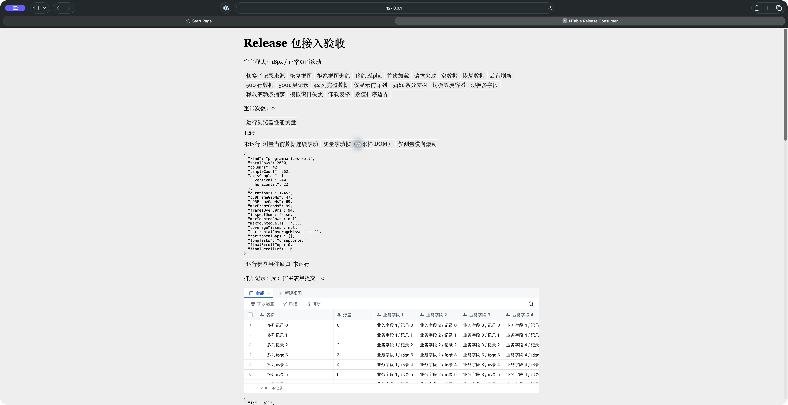

最终当前构建普通表格事件回归：键盘 9 项、搜索 10 项、视图输入 3 项通过，console error 0。git diff --check 通过。

## 第十八轮：帧调度基线与单元格 props 复用

先完善反馈工具：增加 120 帧空闲基线、滚动分轴 P95 及视口/DPR，避免只凭汇总帧间隔归因。Safari 同机 2560×1227、DPR 2 空闲 P95 18ms、最大 53ms、1 长帧；同 2,000 条完整数据仅显示四列，纵向 240 帧 P95 43ms、4 长帧。空闲结果不能替代滚动性能；四列结果支持渲染数量与滚动更新有成本，尚未证明某模块 CPU 占比。

规则先更新。Table 冻结单元格的 style 按 schema/order/width/freeze 复用，避免每次 viewport 滚动重建相同对象；仅按列数缓存，不引入记录级无限缓存。第一列直接传稳定 DisplayRow，展开状态、dividerInset 与稳定 row-ID toggle 回调独立传递，不再每次滚动拼装含新闭包的树 props。保留正常浅比较，不通过忽略变化的自定义 comparator 换取性能。宿主 getCellProps 仍按当前挂载调用，未缓存其结果或改变公开契约。

对照过程完整保留：只稳定几何的四列复测 P95 61ms、30 长帧，未取得可宣称的提升；同阶段完整宽表 P95 34ms、3 长帧（纵向 33/横向 37ms）。最终两类 props 复用后 Safari 无采样宽表 P95 42ms、最大 64ms、4 长帧（纵向 42/横向 33ms），带逐帧覆盖 P95 36ms、最大 102ms、4 长帧（纵向 38/横向 30ms）。不同回放有波动，不据此给确定提升比例或宣称帧预算达标。最新覆盖回放横纵缺口均 0、最大 34 行/272 单元格，longtask unsupported；无采样的覆盖字段为 null。

原始 AX 文件为 app/qa/safari-idle-frames-20261008.txt、safari-four-columns-no-dom-20261008.txt、safari-four-columns-stable-geometry-20261008.txt、safari-wide-stable-geometry-20261008.txt、safari-wide-stable-cells-no-dom-20261008.txt、safari-wide-stable-cells-coverage-20261008.txt。Safari AX 对长 JSON 有截断，完整截图确认 horizontalCoverageMisses 0 与最终两个偏移为 0；未把截断文本解释为完整 JSON。仍只覆盖纵向前约 14,400px 与完整横向往返，非真实滚轮、触屏或全部记录。

最终 npm run verify 退出码 0、44/44 测试无跳过，所有构建/strict/消费门禁通过；Safari 键盘树导航和选择 9 项、Chromium 键盘 9/搜索 10/视图输入 3 项通过。最新实际包 app/dist/kun-ntable-0.1.0-stable-cells-20261008.tgz：36,960 bytes、28 文件、SHA-1 9e04c6161ed3661a4242b1064e76e6b9da301d49。实际解包严格 Bundler/NodeNext 与四个 ESM 导出通过，依赖复用本地树。库 ESM 72.20kB、gzip 19.95kB，CSS 97.21kB、gzip 11.71kB；大 chunk 提示保留。整体目标 active，后续仍需缩小实际渲染/换入成本及真实输入验收；单元格 Tooltip Provider 的成本仅作为未验证候选，未修改或宣称解决。

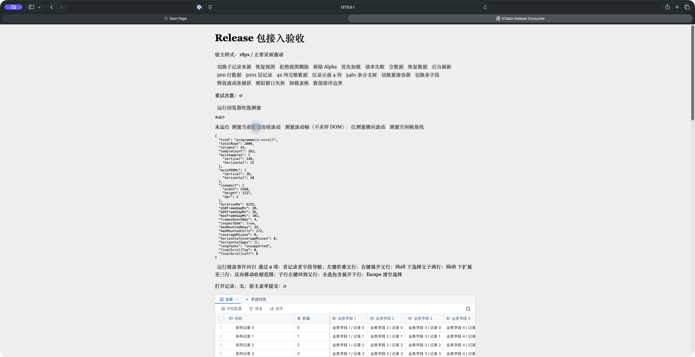

最终 Chromium 完整宽表覆盖回放：262 帧，P95 17.7ms（纵向 17.7/横向 17.6），最大 83.3ms、1 帧超过 50ms；横纵缺口均 0，34 行/272 单元格，console error 0。原始数据 app/qa/scroll-wide-stable-cells-20261008.json；与 Safari 的窗口宽度不同（1774×1228、DPR 2），不据此推算引擎性能比例。git diff --check 通过。

## 第十九轮：紧凑空态与外层布局的记录可见性

真实 Chromium 120px 宿主复现空态问题：失败 overlay 顶部 638.23px，标题起点 624.23px，图标高度 0；首部位于负滚动区域，overlay 的 padding 又把其 32px 可用区域撑到 48px并越过记录区底边。仅设置 overflow auto 不能解决 flex 居中的负起点。规则先更新，空态新增自然尺寸、不收缩的 content group，auto margin 在空间足够时居中、溢出时从顶部开始；padding 移入 group，overlay 本身不再被 padding 撑出记录区。状态/alert、重试与清空语义保持。正常 340px 高度的失败空态 overlay 204px，内容居中，六项实际布局检查通过，截图已检查。

新增消费端 layout-checks.ts，通过真实 getBoundingClientRect、实际 scrollIntoView/focus 检查而非字符串 CSS 断言：不越过 shell、首部可达、图标自然高度、标题可完整显露、操作在空态及组件宿主内可见。Chromium 120px 错误与无匹配空态均通过六项；实际重试触发一次回调，清空搜索/筛选后恢复 4 条记录。Safari 120px 错误六项、加载三项、空数据四项通过；错误 overlay 32px、内容 150px，空数据 114px、加载 67px，允许内部滚动，未声明所有空态内容在 32px 内同时可见。Safari 原始 AX 结果 safari-compact-error-layout-20261008.txt、safari-compact-empty-layout-20261008.txt；正常截图 quality-empty-state-normal.png。

随后发现独立的外层裁切：只验证活动 cell 在 grid 内还不够。以 focus({preventScroll:true}) 加合成 Control+End 隔离验收工具自动滚动，Chromium 120px NTable 和 100px 独立 Table 均出现“活动记录被组件外层布局裁切”。第十二轮正常 locator 的可见性证据不足以证明组件会主动显露外层内的记录，本轮采用无自动滚动反馈重新审计。

Table 新增针对组件自身 .ntable-table/.ntable 布局滚动的显露检查：活动 cell 或状态改变、网格获得焦点时执行；聚焦网格的组件布局尺寸变化时由 ResizeObserver 复核，卸载断开观察。只调整组件自己拥有的布局滚动，不滚动任意宿主页祖先；内层虚拟滚动及正常尺寸布局保留。修复后 Chromium/Safari 两种组件的检查均通过：活动数量 7、grid 68px；NTable host 120px、scrollTop 54，独立 Table host 100px、scrollTop 4，末行在 grid 和组件外层内完整可见。布局 ResizeObserver 的额外尺寸变化分支经过代码检查，未把本轮导航回放扩写为所有动态尺寸场景已验收。

Safari 原生 Command+Home 额外尝试被浏览器处理为主页导航，已恢复本地验收页；该尝试不计为网格键盘验收。上述末行布局回放使用合成 Control+End，建立真实 DOM 位置证据，不替代所有原生键盘/辅助技术证据。最终 Safari 截图已在本地页重新保存，显示 Gamma / 7 完整可见。

完整 npm run verify 退出码 0、44/44 测试无跳过，strict/演示/Sites/lib/两种消费者解析与构建通过；新增 fixture 后另跑消费类型/构建门禁通过。最新包 app/dist/kun-ntable-0.1.0-compact-layout-20261008.tgz：37,217 bytes、28 文件、SHA-1 ae1bae3d33fba9d91416b0c72bf0c1b6c89ee7d5。实际解包严格 Bundler/NodeNext 和四个 ESM 导出通过，依赖复用本地树。库 ESM 73.18kB、gzip 20.18kB，CSS 97.67kB、gzip 11.75kB；大 chunk 提示保留。本轮未重测完整性能，不沿用旧构建时序作为新性能达标结论，整体目标 active。

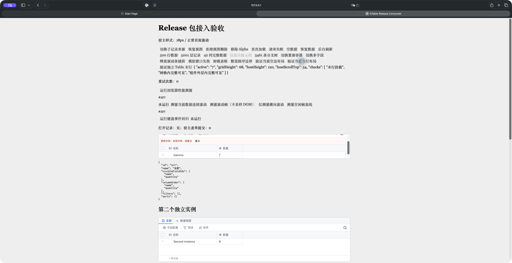

当前最终构建 Chromium 键盘事件 9/搜索事件 10/视图输入 3 全通过，console error 0，git diff --check 通过。

## 第二十轮：聚焦中段记录后的动态高度变化

以 500 行生产消费场景保留网格焦点与活动身份，再将宿主高度从 340px 依次改为 120px、90px、340px。新增 checkFocusedResize 验证中段及末行对照，使用 focus preventScroll 和合成键盘事件定位，实际 DOM 检查活动单元格在内层 viewport（避开 36px sticky 表头）与组件外层内均完整可见；finally 恢复 fixture 原高度。修复前中段在 120px 明确失败“活动记录被内层网格裁切”，末行对照通过，说明原有底边锚定不足以覆盖中段。

规则先更新。revealActiveInLayouts 现在先按当前活动 cell 的实际边界调整内层纵向滚动，再处理组件自己的外层布局；数据行保留 sticky 表头占用的 36px，活动表头按完整 viewport 判断。既有聚焦与 ResizeObserver 入口复用，不改变公开 API，不滚动任意宿主页。

最终 Chromium/Safari 的中段与末行均通过三种高度：中段活动值 5，120/90px 时 grid 68px、scrollTop 128，恢复后 grid 240px，活动身份和焦点未变；末行活动值 499，紧凑时 scrollTop 15,968，恢复后 15,796。原始证据为 app/qa/focused-resize-middle-chromium-20261008.json、focused-resize-last-chromium-20261008.json、focused-resize-middle-safari-20261008.txt、focused-resize-last-safari-20261008.txt。这是合成导航加真实布局证据，不能替代原生键盘、辅助技术或触屏验收；动态宽度、高缩放及所有尺寸组合未完成。

完整 npm run verify 退出码 0，44/44 测试无跳过；strict/演示/Sites/lib/两种消费解析与构建通过。最终 Chromium 键盘事件 9、搜索事件 10、视图输入 3 通过，console error 0。实际包 app/dist/kun-ntable-0.1.0-focused-resize-20261008.tgz：37,307 bytes、28 文件、SHA-1 336cbf68a4d505305481e0124215704d3acf30f8；实际解包严格 Bundler/NodeNext 与四个 ESM 导出通过，依赖复用本地树。库 ESM 73.51kB、gzip 20.28kB，CSS 97.67kB、gzip 11.75kB；大 chunk 提示保留。本轮未重新测量滚动性能，不外推历史帧时序。整体目标 active。

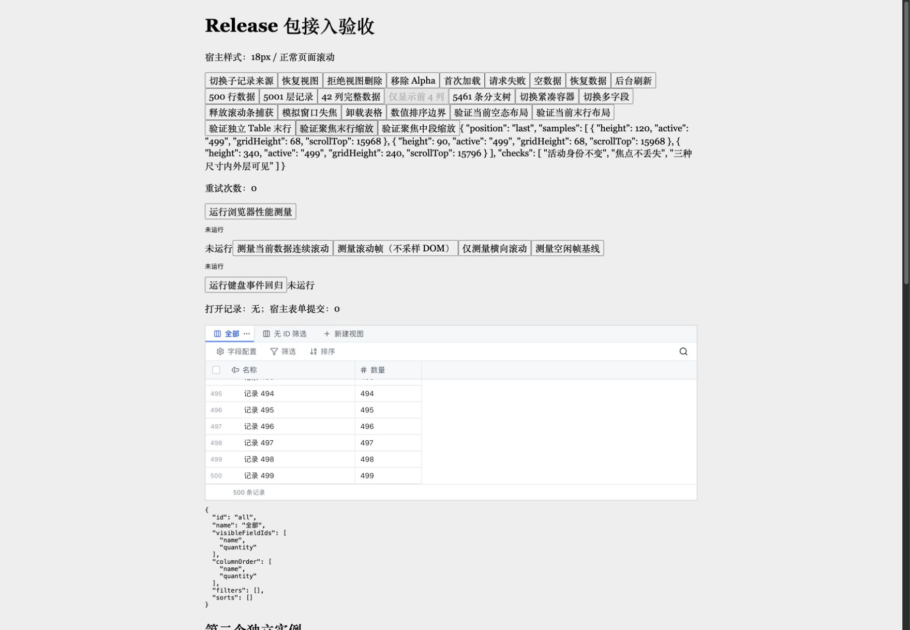

## 第二十一轮：聚焦宽表中段列后的动态宽度变化

新增消费端 checkFocusedWidth，500px 初步回放失败后核对几何：两列冻结加行号占 422px，剩余不足一个 140px 单元格，该尺寸不适合断言完整可见。将完整可见验收改为 700/600/900px，记录这一区别而非以不可能的几何作为产品错误。有效尺寸下中段（倒数第二字段）700px 仍失败“活动列被视口或冻结列裁切”；末列对照通过，右边缘锚定不能覆盖中段活动列。

规则先更新。revealActiveInLayouts 在纵向显露后，针对普通活动列按同一行真实冻结单元格的右边界调整横向滚动；冻结活动列不执行普通列滚动。剩余空间小于 cell 时按首部显露，避免两边反复抢占；此分支未作为所有极窄容器体验完成的证据，冻结区占满视口仍待完善。逻辑保持活动身份、焦点、公开 schema 和冻结设置，不滚动任意宿主页。

Chromium/Safari 同一 2,000×42 场景中段和末列三种宽度均通过。中段为业务字段 39 / 记录 1999，scrollLeft 分别 5,182/5,282/5,125；末列为业务字段 40 / 记录 1999，分别 5,325/5,425/5,125。实际 DOM 检查 cell 完整位于冻结边界之后和 viewport 右边界之前，活动元素保持挂载、身份及网格焦点不变。原始证据 app/qa/focused-width-middle-chromium-20261008.json、focused-width-last-chromium-20261008.json、focused-width-middle-safari-20261008.txt、focused-width-last-safari-20261008.txt。finally 恢复 fixture 宿主原宽度。该回放使用合成导航和真实布局，未声称所有原生键盘或每个动画帧已验收。Chromium 中段高度 120/90/340px 回归通过，活动 5、紧凑 scrollTop 128，未因横向修复退化。

npm run verify 退出码 0，44/44 测试无跳过，strict/演示/Sites/lib/严格 Bundler 和 NodeNext/消费构建通过。最终 Chromium 键盘 9、搜索 10、视图输入 3 项通过，console error 0。库 ESM 73.92kB、gzip 20.40kB，CSS 97.67kB、gzip 11.75kB；大 chunk 提示保留。本轮未重新测量完整滚动性能。整体目标 active，高缩放、冻结区超出小屏、真实输入性能及 IME/辅助技术/触屏仍需补齐。

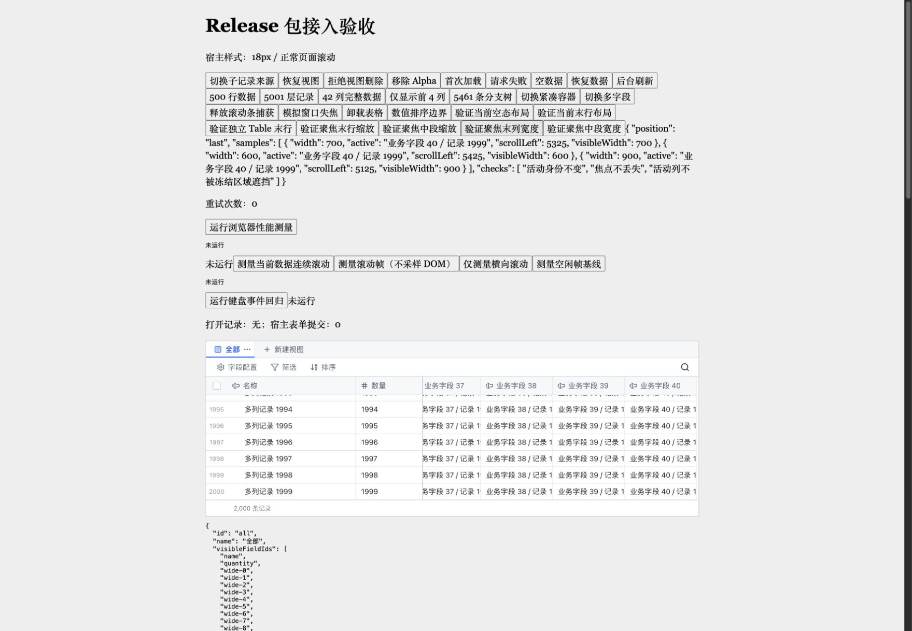

本轮实际包 app/dist/kun-ntable-0.1.0-focused-width-20261008.tgz：37,435 bytes、28 文件、SHA-1 02a30dfabe883855cdbce2ee54cc304c8e671476；实际解包严格 Bundler/NodeNext 和四个 ESM 导出通过，依赖复用本地树，未验证新环境网络安装。git diff --check 通过。

## 第二十二轮：窄容器冻结区遮住全部普通列

沿用第二十一轮的几何反证：期望冻结两列共 422px（含行号），500px 剩余空间不足一个 140px 普通字段，320px 更会被完全遮挡。窄容器完整可见不能依靠单纯改变 scrollLeft；冻结区自身必须让出空间。本轮先说明并询问窄屏行为，未收到调整意见后按推荐方案实现暂时减少实际冻结列、恢复宽度后恢复，保存值不变；规则、公共类型说明和接入/API 契约同步记录。此适配选择未声称已对照 Feishu 所有窄屏行为。

新增 fittingFrozenCount：在视口宽度已知时，冻结前缀和首个普通字段需要同时容纳，逐列减少实际前缀；未知初测宽度保留期望值。单字段本身超宽时仍横向浏览，不保证同时显示全部内容。Table 分开期望/实际冻结数量；冻结样式、列窗口、导航和边界使用实际值，菜单当前设置与 pending 提交完成判断使用期望值。焦点显露在实际冻结数量/宽度提交后复核，避免仅以 ResizeObserver 回调内的旧 DOM 样式判断。尺寸变化不调用 onUpdateView；显式菜单/拖动仍由宿主接收持久化意图。

45/45 单元及契约测试无跳过，包含宽度阈值 562/561px、500/320/900px、未知宽度、单字段/无字段及超宽字段。完整 npm run verify 退出码 0，整个库 strict、演示/Sites/lib、严格 Bundler/NodeNext 与生产消费者通过；增加宿主调用次数检查后另跑消费类型/构建门禁通过。库 ESM 74.21kB、gzip 20.50kB，CSS 97.67kB、gzip 11.75kB，大 chunk 提示保留。

最终 Chromium/Safari 2,000×42 场景、倒数第二列与最后一行的动态宽度回放均通过：500px 实际冻结 1 列、320px 0 列、900px 恢复 2 列，活动值始终为业务字段 39 / 记录 1999，scrollLeft 5,382/5,562/5,125，焦点/活动身份不变、单元格完整位于未遮挡区域。宿主调用计数明确断言尺寸变化未调用 onUpdateView，最终受控 frozenFieldCount 仍为 2。原始证据 app/qa/responsive-freeze-chromium-20261008.json、responsive-freeze-safari-20261008.txt；宿主宽度由 finally 恢复，截图已检查。使用合成导航加真实 DOM 布局，不替代所有原生键盘、每帧动画或触屏证据；普通工具栏在 320px 的完整操作路径仍待验收。

最终 Chromium 键盘 9/搜索 10/视图输入 3 通过，console error 0。实际包 app/dist/kun-ntable-0.1.0-responsive-freeze-20261008.tgz：37,650 bytes、28 文件、SHA-1 9b9c039ea4d68ea361cd959193318500029801d1；实际解包严格 Bundler/NodeNext 及四个 ESM 导出通过，依赖复用本地树，未声称新环境网络安装完成。本轮未重新测量完整性能。整体目标 active，仍需宽度/高度组合、极小单字段、工具栏、高缩放及真实输入/IME/辅助技术/触屏验收。

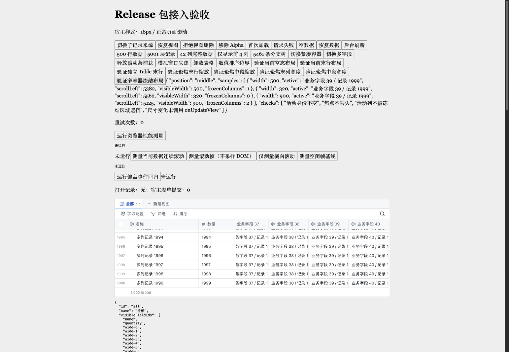

## 第二十三轮：窄屏搜索与工具栏自身溢出

320px 宿主在搜索关闭时按钮正常，搜索展开后真实 DOM 显示字段配置左边 -69px、关闭按钮右边 348.84px（host 322px 含边框），NTable scrollWidth 439px；聚焦输入会拖动整体布局，部分操作不可同时达到。规则先更新，toolbar-left 采用不收缩的操作按钮和自身横向滚动，toolbar-right 限制在工具栏宽度的 60% 内，搜索框/输入可缩，图标和关闭按钮不缩。视图标签 min-width 0 / max-width 100%，防止固有宽度约 326px 撑开父网格轨道；不改变宿主 body 样式。

独立布局探针再发现按钮部分可见时仅 focus 不会完整显露；真实 Chromium Tab 到筛选也没有滚动（group scrollLeft 0）。TableToolbar 在操作组 focus capture 内按真实按钮边界调整自己的 scrollLeft，不滚动整个 NTable 或宿主页。修复后真实 Tab 到筛选 actionOffset 55.5、NTable scrollLeft 0，按钮完整可见。checkToolbarLayout 检查根无横向溢出/偏移，逐个聚焦按钮后在操作组与根边界内，搜索输入至少 56px 且关闭按钮完整可见。

Chromium/Safari 320px 搜索打开均通过五项：操作组约 118px，scrollWidth 分别 250/247px，输入宽度 111px，字段配置/筛选/排序逐个聚焦可见，关闭按钮可达。原始证据 app/qa/toolbar-narrow-chromium-20261008.json、toolbar-narrow-safari-20261008.txt。两个引擎实际关闭搜索、打开筛选、添加条件、输入 Beta 后均剩一条记录；Chromium 关闭搜索布局四项通过（group 268px），另实际新建并切换“窄屏验收”视图，布局无整体溢出，截图已检查。原生 Safari 的有限指针/文本流程不代表完整触屏或系统 IME；该 fixture 未带添加记录按钮，包含该按钮的组合、高缩放及嵌套弹层完整短屏仍待补齐。

最终完整 npm run verify 退出码 0，45/45 测试无跳过，整个库 strict、演示/Sites/lib、严格 Bundler/NodeNext 与消费构建通过；Chromium 键盘 9/搜索 10/视图输入 3 项通过，console error 0。ESM 74.57kB、gzip 20.59kB，CSS 99.62kB、gzip 11.97kB，大 chunk 提示保留。未重新测量完整滚动性能，整体目标 active。

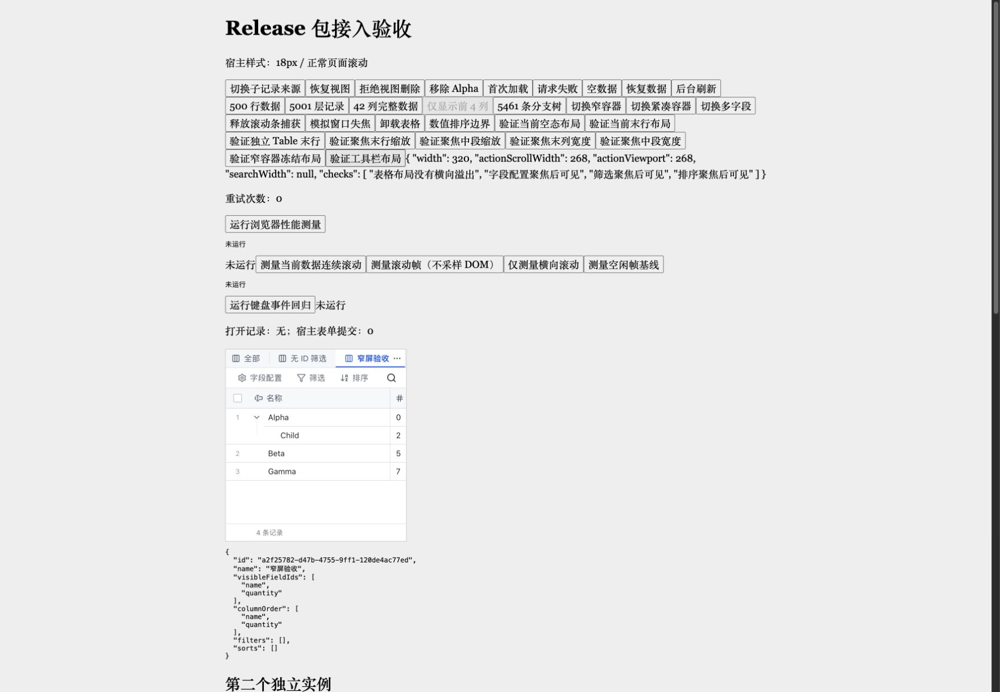

实际包 app/dist/kun-ntable-0.1.0-narrow-toolbar-20261008.tgz：37,964 bytes、28 文件、SHA-1 c0af75fa30d541e1f1104d3c2182c4889fb472f3；解包严格 Bundler/NodeNext 和四个 ESM 导出通过，依赖复用本地树，未验证新环境网络安装。git diff --check 通过。

## 第二十四轮：包含添加记录入口的窄屏组合

本轮仅完善生产消费 fixture，添加可切换 onAddRecord、回调计数和明确聚焦添加按钮的验收入口，未修改库源码/公共行为或生成新库包。宿主负责真正的新建记录，fixture 只计调用，不能解释为宿主业务新增/保存已验收。

Chromium/Safari 在 320px 宿主、添加入口与搜索同时存在时均通过六项布局检查：操作组 118px、搜索输入 111px，操作 scrollWidth 357/353px，添加/字段配置/筛选/排序逐个聚焦均完整可见、关闭搜索可达、NTable 无整体横向溢出。原始证据 app/qa/toolbar-add-narrow-chromium-20261008.json、toolbar-add-narrow-safari-20261008.txt。Chromium locator 原生输入 Enter/Space 每次触发一个回调，计数 0→1→2，表单提交 0；截图已检查添加入口和搜索同时显示的现场。

Safari 原生反向 Tab 未依次经过按钮，从验收入口已聚焦关闭按钮的状态连续五次 Shift+Tab 后落到另一个表格单元格；该行为原因未确证，未修改 Safari/OS 键盘偏好，也未宣称完整 Tab 路径通过。原生点击添加一次产生计数 1。最终重载后的独立回放使用 fixture 的 focus preventScroll 明确建立添加按钮焦点，AX 确認 button 添加记录，再以原生 Return/Space/点击产生计数 0→1→2→3，表单提交 0。原始最终 AX app/qa/add-native-safari-20261008.txt。程序化建立焦点后的原生激活只支持按钮激活语义，不能替代原生 Tab 可达性或辅助技术验收。

当前新 fixture 的 npm run typecheck:consumer 和 build:consumer 退出码 0，严格 Bundler/NodeNext 检查及生产消费构建通过；Chromium 键盘 9/搜索 10/视图输入 3 回归通过，console error 0，git diff --check 通过。库代码及分发包与第二十三轮相同，45 项库测试和实际包记录仍对应那次验证，本轮未冒称重新跑了完整 verify 或重新测量性能。整体目标 active，高缩放、真实触屏、Safari 完整键盘路径、辅助技术与实际宿主新增记录仍须分别验收。

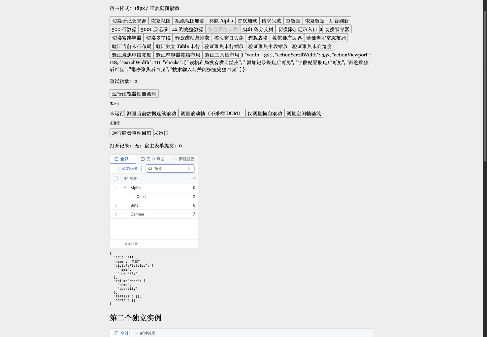

## 第二十五轮：受控当前视图在长标签列表中不可见

新增八个测试视图的消费场景，宿主直接将第八个设为 activeView。修复前 320px 宿主回放明确失败“当前视图标签及菜单没有完整显露”：受控状态已更新，但横向标签组仍停留在左端。浏览器 locator 自动显露只能证明点击路径，不能证明宿主外部切换，因此使用直接设置 fixture 状态和真实 DOM 包含关系检查。

规则先更新。ViewBar 在 views/active ID 提交后局部显露当前标签及菜单，不因普通状态切换调用 focus；焦点进入标签/菜单/新建控件时只滚动 .view-tabs。ResizeObserver 检查宽度变化，标签组内已有焦点时优先显露该控件，否则显露当前标签；卸载断开。大于视口的 item 按首部显露，未声称超长视图名可同时完整显示。既有成功删除后的 focus preventScroll 保留，与局部显露组合，不滚动 NTable 或宿主页。

Chromium/Safari 同一 320px、八视图场景通过：当前验收视图 8 及菜单完整可见，group scrollLeft 678.5/666px，NTable 无横向溢出。原始证据 app/qa/view-active-narrow-chromium-20261008.json、view-active-narrow-safari-20261008.txt。实际打开该测试视图的菜单并删除后，宿主选定验收视图 1：Chromium 七标签、offset 0、active 获得焦点、visible true、outerOffset 0；Safari 原始 AX 明确焦点为 toggle button 验收视图 1，随后布局检查 offset 0、标签及菜单完整可见。删除证据 view-delete-narrow-chromium-20261008.json、view-delete-narrow-safari-focus-20261008.txt、view-delete-narrow-safari-20261008.txt。点击验收按钮后的 focused false 是验收按钮拿到焦点，不与此前删除时焦点恢复相混淆。Chromium 将长列表在正常/320px 间切换后，最终当前标签布局复核通过；所有动态尺寸和每帧状态仍未全部验收。截图当前视图和报告均为验收视图 1，已检查。

最终完整 npm run verify 退出码 0，45/45 测试无跳过，库 strict/演示/Sites/lib/严格 Bundler 和 NodeNext/消费者构建通过；Chromium 键盘 9/搜索 10/视图输入 3 通过，console error 0。实际包 app/dist/kun-ntable-0.1.0-view-visibility-20261008.tgz：38,234 bytes、28 文件、SHA-1 24d51f44b1b4d65910ce0796f1ad3631c6e4db37；实际解包两种严格解析和四个 ESM 导出通过，依赖复用本地树。ESM 75.51kB、gzip 20.85kB，CSS 99.62kB、gzip 11.97kB，大 chunk 提示保留。本轮未重新测量性能，整体目标 active；超长视图名、Safari 原生 Tab、真实 IME/辅助技术/触屏、高缩放仍待补齐。

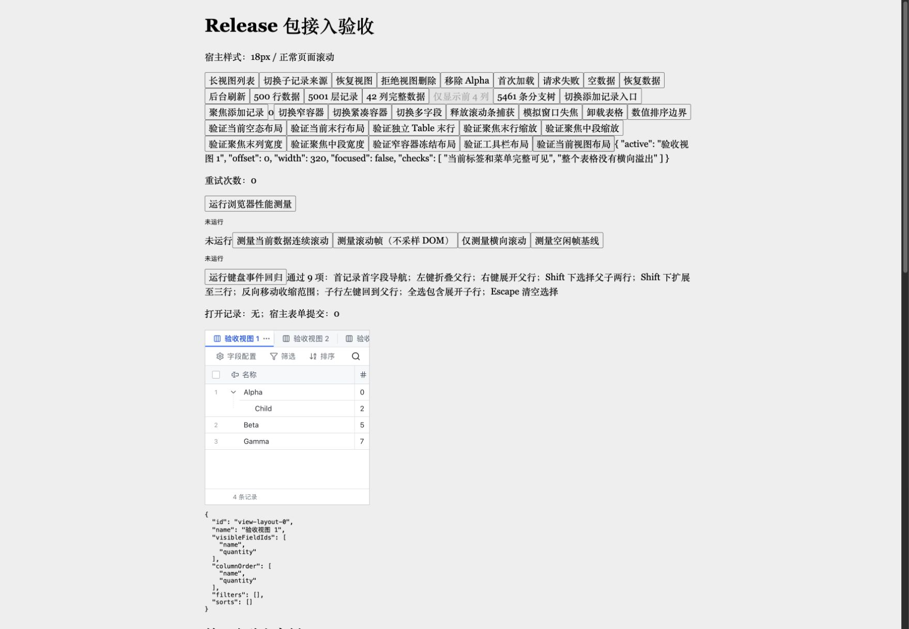

## 第二十六轮：超长视图名称与菜单可达性

160 字完整测试视图名在 320px 宿主中将 active wrap 撑到 2,351.8px，布局检查失败“当前视图标签及菜单没有完整显露”。仅显露首部不能让标签与菜单同时使用。规则先更新，名称改为独立 span，文字区 max-width 12em、CSS ellipsis，完整源字符串及按钮无障碍名称保留，复用共享 Tooltip；wrap 不超过标签区，图标和菜单不收缩，避免字符串截断或把提示改成仅 title 属性。

原有 protected-view SSR 测试以 >全部</button> 限定标签必须是按钮直接文本，新增 span 后失败。已改为读取 aria-pressed=true 按钮的完整文本语义，仍断言“全部”且保留保护菜单/导航规则；未屏蔽测试或放宽删除保护检查。最终完整 npm run verify 退出码 0，45/45 测试无跳过，库 strict/演示/Sites/lib/严格 Bundler 和 NodeNext/消费构建通过。

Chromium/Safari 320px 长名布局均通过，完整 160 字名称保留、offset 0、标签及菜单完整可见、NTable 本身无横向溢出。Chromium label clientWidth 168px、scrollWidth 2,285px，按钮宽 210px；实际指针悬停后 Tooltip 可访问文本与可见文本均为完整 160 字，框 360×152px、left 325.5/right 685.5，位于 1,774px 浏览器视口内。原始布局 view-long-name-chromium-20261008.json、view-long-name-safari-20261008.txt，截图 quality-long-view-tooltip.png 已检查。截图中宿主 fixture 的长 JSON pre 会撑宽宿主页，不应与库根布局断言混同，后续可完善验收页面自身的长证据显示。

两个引擎实际打开长名视图的菜单并删除后返回“全部”；Safari 原始 AX view-long-name-delete-safari-20261008.txt 明确焦点在 toggle button 全部。额外 Chromium Control 焦点、从运行键盘回归按钮 Tab 到长名标签时，实际 activeElement 已是标签，但 Tooltip data-state 仍 closed、role tooltip 数为 0；延后观察仍为 0。此路径尚未定位根因，不能写成键盘完整提示通过，下一轮应优先区分真实键盘焦点、工具输入方式和共享 Tooltip 的触发逻辑。

最终 Chromium 键盘 9/搜索 10/视图输入 3 通过，console error 0。库 ESM 75.63kB、gzip 20.85kB，CSS 100.53kB、gzip 12.03kB；大 chunk 提示保留。本轮未重新测量完整性能。整体目标 active，长标签键盘提示、真实 IME/辅助技术/触屏、高缩放及 Safari 原生完整 Tab 仍待验收。

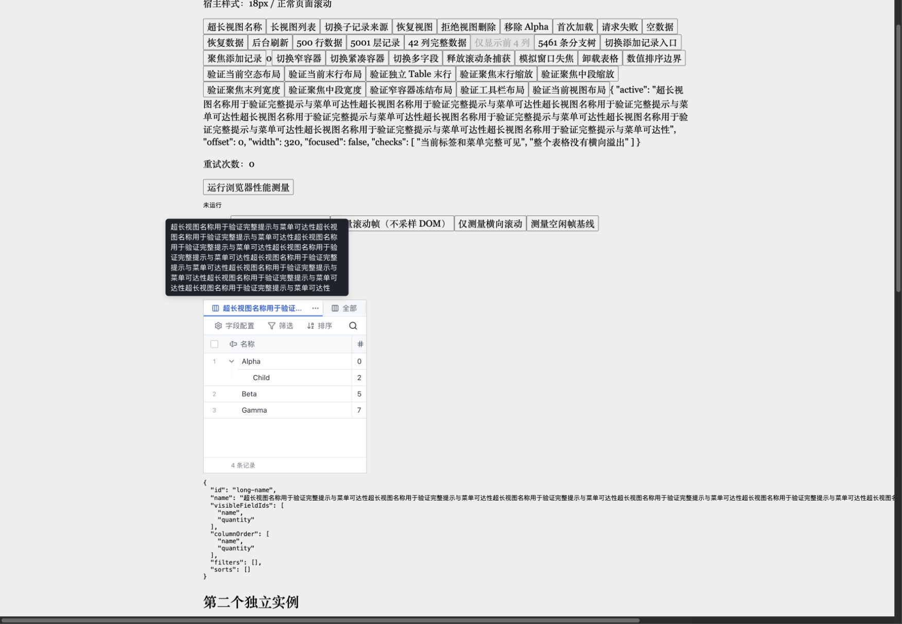

实际包 app/dist/kun-ntable-0.1.0-view-label-20261008.tgz：38,328 bytes、28 文件、SHA-1 1a9d1dd97b50b51994d0d70949708508df786b8a；实际解包两种严格解析与四个 ESM 导出通过，依赖复用本地树，未验证新环境网络安装。git diff --check 通过。

## 第二十七轮：焦点提示隔离与输入路径证据

针对第二十六轮“标签已聚焦、提示 closed”的观察，本轮未直接改共享 Tooltip。Context7 查询官方 [Tooltip 文档](https://www.radix-ui.com/primitives/docs/components/tooltip)：Tab 聚焦无延迟打开，激活或 Escape 关闭；当前安装源码 app/node_modules/@radix-ui/react-tooltip/dist/index.mjs 177–212、308–338 同时证明 onFocus 在非 pointerdown 时打开，以及触发器祖先 scroll 捕获事件会关闭。官方焦点契约与当前安装源码的滚动关闭分开作为证据。

新增 checkViewTooltipFocus，以 focus preventScroll 建立真实 DOM 焦点，100ms 后检查按钮仍聚焦、aria-describedby 对应全文匹配、data-state instant-open，并明确断言没有 click/pointerdown/ancestor-scroll。Chromium/Safari 320px、160 字名称均通过，events 只有 focus。原始证据 app/qa/view-focus-tooltip-chromium-20261008.json、view-focus-tooltip-safari-20261008.txt。此隔离检查建立基本 focus 逻辑正常，不能替代原生 Tab、真实辅助技术或所有滚动焦点组合。

进一步增加仅用于 owned fixture 的有界输入轨迹：最多 40 个事件类型，不记录键入值或业务数据，读取后移除全部监听，重复开始和卸载均清理。干净 Chromium 从运行键盘回归按钮 Tab 到当前标签：读取报告前 focused true、instant-open、160 字、descriptionMatches true；轨迹 focusin/keyup，读取报告按钮导致最后一个 focusout，报告读取后的 closed 是预期失焦，不与读取前状态相混淆。完整 beforeRead/afterRead 证据 view-tab-input-trace-20261008.json，截图 quality-view-keyboard-tooltip.png 已检查。

对照直接对标签 press Control：focused true 但 closed，事件顺序 focusin → ancestor-scroll → keydown → keyup → ancestor-scroll，之后点击读取报告才有 focusout；原始 view-direct-press-scroll-trace-20261008.json。这证明当前失败对照包含工具/浏览器显露的祖先滚动，符合已安装 Tooltip 的滚动关闭逻辑。第二十六轮的历史 Tab 路径未记录轨迹，不能倒推每次失败都已证明同一原因。本轮澄清基本焦点逻辑和干净 Tab，不将历史观察删除或包装成已修复库 bug。焦点进入视口外标签而发生局部滚动时的提示体验仍需要下一轮独立验收。

本轮只修改消费端验证工具，库源码和第二十六轮实际包不变。当前 npm run typecheck:consumer/build:consumer 退出码 0，严格 Bundler/NodeNext 和生产消费构建通过；库 45 项测试及 tarball 证据仍对应第二十六轮，未冒称本轮重新执行全量 verify/打新包/测性能。整体目标 active，Safari 原生全 Tab、焦点滚动组合、真实 IME/辅助技术/触屏及高缩放继续保留未完成。

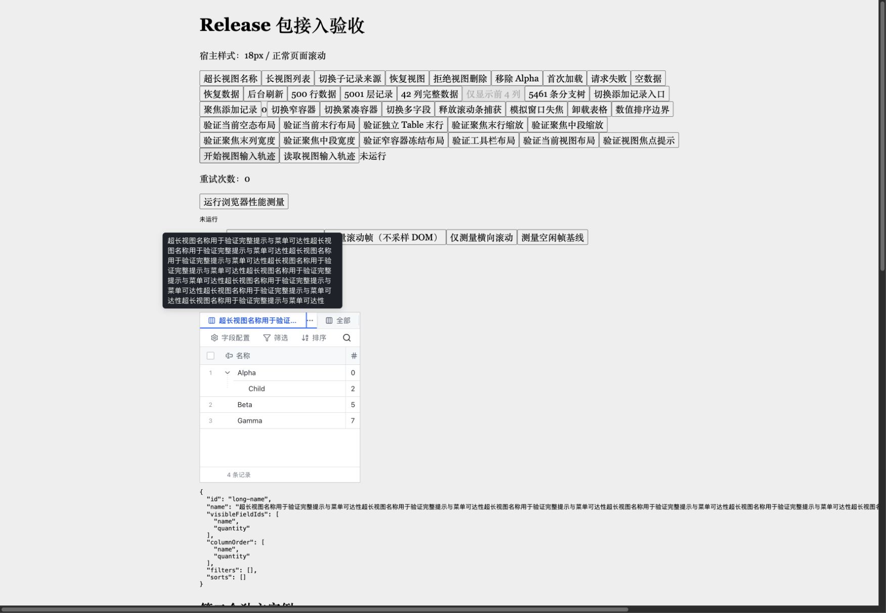

当前最终消费构建 Chromium 键盘 9/搜索 10/视图输入 3 回归通过，console error 0，git diff --check 通过。

## 第二十八轮：滚动显露后的焦点提示

新增八视图 fixture：首个名称 160 字，当前为第八项，320px 标签容器先显露末项。修复前聚焦首项触发 focus → ancestor-scroll，提示 closed，完整名称无法读取。根因是局部显露滚动发生于 Radix 打开后，祖先 scroll 的默认关闭随后生效。

先补产品规则，再为共享 Tooltip 增加内部 settleFocus 选项，仅 ViewBar 使用。受控 Root 的焦点打开等待两个 animation frame，让初始显露滚动先完成；定位、碰撞、悬停和后续滚动关闭继续由 Radix 管理。失焦、pointerdown、click、Escape、Enter、Space 和卸载取消待执行帧，不重复打开。默认单元格/筛选提示不增加状态与计时。当前受控 API 由 Context7 查询官方 Tooltip Root open/onOpenChange 文档确认。

实际最新生产消费构建：Chromium 首项聚焦前 scrollLeft 779.5，之后 0；Safari 768 → 0。两者保持真实 DOM 焦点，aria-describedby 全文 160 字匹配、instant-open，轨迹只有 focus/ancestor-scroll；验证器断言初始确实在视口外、之后按钮完整可见。证据 app/qa/view-focus-settled-chromium-20261008.json、view-focus-settled-safari-20261008.txt。已检查下方截图，名称完整显示且提示没有超出浏览器视口。

消费端另验六条关闭路径：等待期间 Escape/Enter/Space、失焦取消；重新聚焦可打开；之后实际修改局部 scrollLeft 正常关闭。两引擎通过，证据 view-focus-cancel-chromium-20261008.json、view-focus-cancel-safari-20261008.txt。这些取消键使用 fixture synthetic keydown，不能替代全部原生键盘；Safari 额外补当前已显露标签 focus 6 字全文匹配、原生 Escape 后 AX 中不再有 tooltip 且焦点仍为该标签，见 view-focus-native-escape-safari-20261008.txt。初次用“无滚动隔离”检查聚焦末项时，因首项显露而末项在视口外，按预期报 ancestor-scroll；再次检查已显露末项通过，未放宽隔离检查以掩盖条件不满足。

npm run verify 退出码 0，45/45 测试；追加 fixture 后 typecheck:consumer/build:consumer 通过。Chromium 最新键盘 9/搜索 10/视图输入 3 项回归通过，console error 0。构建仍保留消费端/演示超过 500kB chunk 警告，没有关闭告警。实际包 app/dist/kun-ntable-0.1.0-focus-settled-20261008.tgz：38,556 bytes、28 文件、SHA-1 40c8ba7b6b112f9ef8831bc2ccc89a287b3891d7；pack dry-run、真实解包严格 Bundler/NodeNext 和四个 ESM 导出通过，复用本地依赖树，未验证干净网络安装。打包默认 npm cache 写权限失败后改用 /private/tmp 独立 cache 完成，没有修改系统 cache 权限。git diff --check 通过。

整体目标保持 active；此次补齐视口外聚焦后的完整名称体验，不外推为真实 IME、辅助技术、触屏、高缩放、完整 Safari 原生 Tab 或最新连续输入性能已经通过。

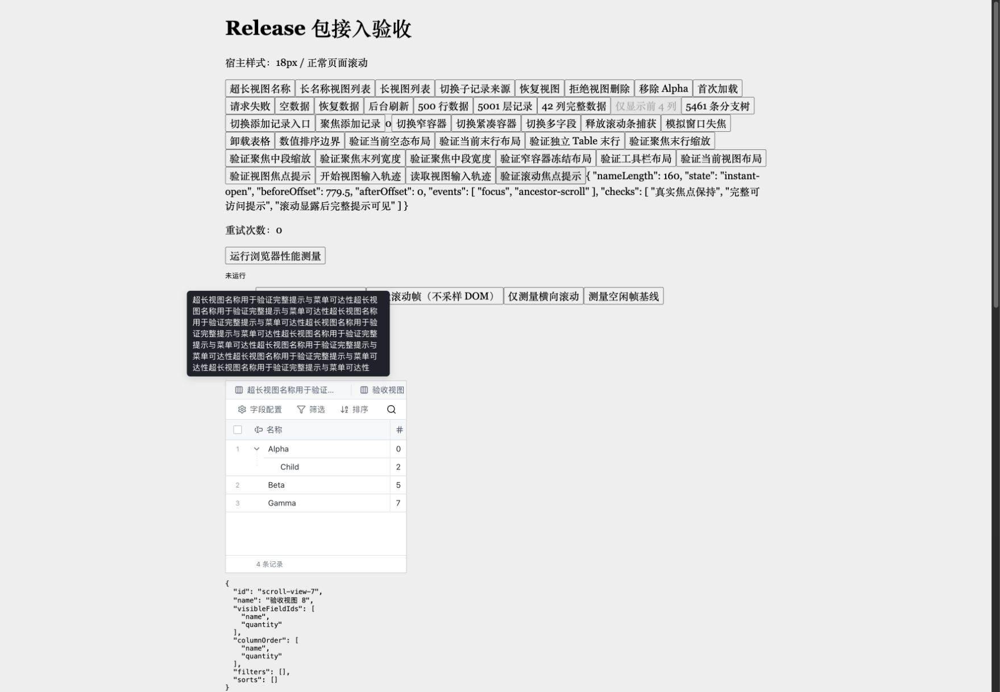

## 第二十九轮：实际页面缩放下的有限验收

本轮先现场检查 app/AGENTS.md 与当前工作区，保留既有未提交成果。消费端工具栏报告新增 window.innerWidth/innerHeight、devicePixelRatio、visualViewport.scale，用实际浏览器状态校正缩放判断，而不依据按键次数推定。typecheck:consumer 与 build:consumer 退出码 0，库源码与第二十八轮包未变化。

Safari 原生 View → Zoom In 和页面快捷键：初次四次放大实测 DPR 3.5、CSS 视口 1462×701，对应基线 DPR 2 的 175%，不能称为 200%。再放大实测 DPR 4、1280×613（200%），之后 DPR 6、853×409（300%）。额外放大仍停留这一状态，本轮没有证明 400%。原始证据 zoom-toolbar-safari-200-20261008.txt、zoom-toolbar-safari-300-20261008.txt。

200% 和 300% 下固定 320px 宿主的工具栏局部焦点显露均通过：字段配置、筛选、排序可达，NTable 无整体横向溢出。300% 打开搜索后，动作组可见宽 118px、内容宽 246px，输入宽 111px、关闭按钮完整可见；证据 zoom-search-safari-300-20261008.txt。焦点验收由 fixture 使用真实 DOM focus，不外推为完整原生 Tab。

300% 实际原生打开筛选 → 添加条件 → 输入 Beta，视图状态保存 value Beta，主表只剩 Beta 和 1 条记录，表单提交仍 0。截图 quality-zoom-safari-filter-300.png 已目视检查：标题、字段/操作符/值、删除和添加入口完整，弹层在屏幕内，无可见裁切。这里只证明该单条件流程，不代表多条件长列表、全部嵌套选择器和全部弹层均已验收。原始 AX zoom-filter-safari-300-20261008.txt。

随后用原生 Actual Size 快捷键恢复，工具栏报告重新显示 2560×1227、DPR 2、visualScale 1。没有保留浏览器缩放变更。IAB viewport capability 请求 443×307 后，在消费标签实际观测仍为 1774×1228；已经 reset，不能将那次普通尺寸的筛选成功冒称为 400% 等效窄视口证据。其截图按实际条件保存为 quality-filter-baseline-20261008.png。400% 与 Chromium 真正页面缩放、其余弹层仍留待下一轮。

本轮取得高缩放有限场景证据，没有发现足以修改库的当前缺陷；不为验证而改视觉或放宽门禁。git diff --check 通过。整体目标 active，真实 IME、辅助技术、触屏、全部原生键盘路径与当前真实持续输入性能仍未完成。

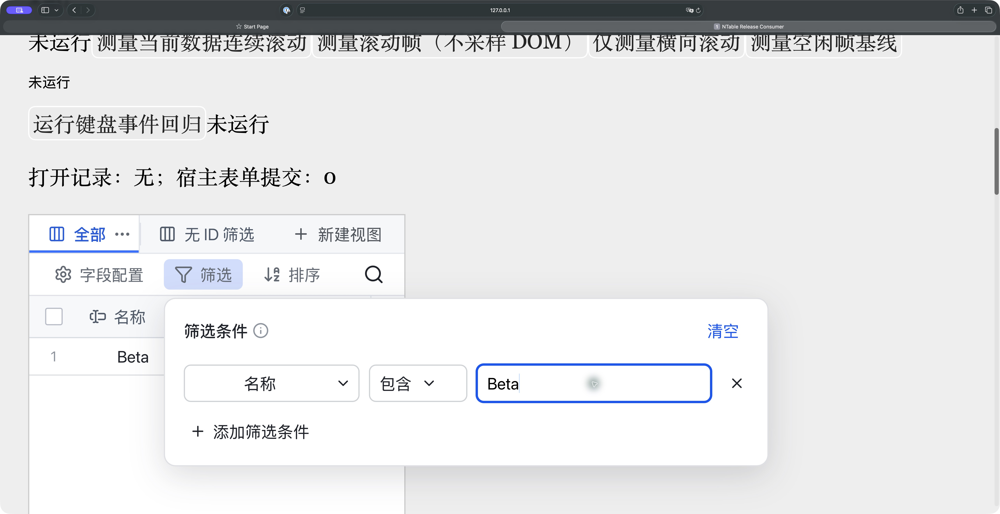

## 第三十轮：窄短布局视口中的配置操作

本轮无库源码更改。复核筛选、排序和字段配置实现后，使用 IAB 当前消费标签的 CDP Emulation.setDeviceMetricsOverride 设置 443×307、DPR 2、mobile false；只作为布局空间测试，不称为真实 400% 页面缩放。实际 innerWidth/innerHeight 443×307，visualViewport 428×307（垂直 scrollbar 占 15px），与上一轮 browser viewport 请求未生效的情况区分。

首次改变已经打开的弹层所在视口后，anchor 随页面重新布局落到视口外，弹层 top 822；此时不能按旧页面状态推定按钮可见。重载并按 UI 重新打开后，筛选弹层稳定为 left 8、right 435、top 8、bottom 133.734。其右边缘按 innerWidth 保持 8px inset，但相对于不含系统 scrollbar 的 visual viewport 背景边缘仍超出 7px；交互控件最右 407 均在 428 内。该边界差异及已打开弹层的动态重排场景保留为下一轮排查，未将全部碰撞处理称为通过。

实际添加五条筛选规则，scrollHeight 344、clientHeight 124、scrollTop 178.5；末项输入 Beta 后打开操作符，菜单末项“不为空” bounds left 188/right 272/top 246/bottom 276，在视口内。点击后第五条 operator isNotEmpty、value 空字符串，随后删除末项回到四条。空操作符不保留旧值，实际选择/提交生效。保存首个条件布局截图 quality-filter-443x307-20261008.png，采用 CDP Page.captureScreenshot 捕获实际布局；高层截图在临时 emulation 下缩放映射不适合独立判断。

继续按 UI 添加名称排序，选择倒序，再添加数量排序：两条字段触发器宽 92px、名称可见，sorts 中 name desc/quantity asc，随后删除第二条后仅剩 name desc。原始受控状态 narrow-panel-sort-state-20261008.json；单条删除后的状态另见本轮工具结果，不以先前状态替代删除证据。

字段配置实际搜索数量 → 隐藏 → 显示，visibleFieldIds 从 name/quantity 到仅 name，再恢复。切换 42 列数据后，长字段列表定位业务字段 40，实际隐藏并得到“显示业务字段 40”按钮，bounds left 300/right 322/top 92.5/bottom 114.5，在视口内；随后实际恢复。隐藏后的状态 narrow-field-state-20261008.json，截图 quality-fields-443x307-20261008.png 已目视检查，末项与眼睛按钮可见，列表内部滚动有效。定位动作可能包含工具自身显露滚动，证明实际可操作，不证明纯指针滑轮或全部原生 Tab 路径。

最后 clearDeviceMetricsOverride，实际回到 inner 1774×1228、visual 1759×1228；console error 0，git diff --check 通过。未改生产代码，也未重复声称本轮执行全量 verify 或重新打包；库验证和实际包仍对应第二十八轮，消费端构建对应第二十九轮。目标 active，动态弹层重排、视觉 viewport 边界、真实高缩放、IME/辅助技术/触屏与当前持续输入性能继续补齐。

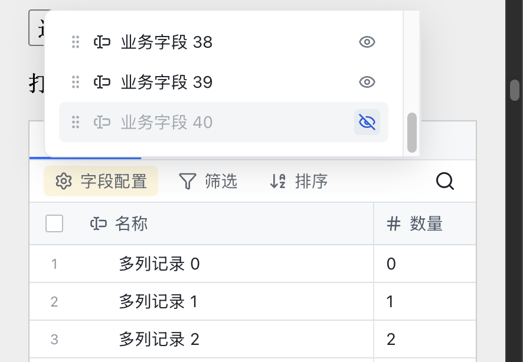

## 第三十一轮：弹层使用 Radix 可用宽度

针对第三十轮视觉 viewport 的 15px 系统 scrollbar 差异，当前生产消费端复现：innerWidth 443，documentElement.clientWidth/visualViewport.width 428；Radix --radix-popover-content-available-width 为 412px，现有 .toolbar-panel 仅 max-width calc(100vw - 16px) 得到 427px。弹层 left 8/right 435，视觉右边缘要求 <=420；红色判据 pass false、overflow 15。尺寸超过引擎已提供的可用空间，而非缺少碰撞检测。

按规则先修改 app/AGENTS.md，再将 overrides.css 中工具栏弹层 max-width 改为 min(CSS viewport 上限, Radix available-width)，变量缺失时回退既有 CSS viewport 上限。普通 width 340/516 与内部滚动保留，不手算 scrollbar、不修改宿主样式、不变更定位实现。Context7 查询官方 Popover 文档返回自定义属性约束内容尺寸的模式；当前 available-width 数值由实际 DOM 读取确认，未把查询未返回的详细变量定义当作直接引文。

最新库和生产消费构建的同一判据变为 pass true：宽 412、left 8/right 420，视觉左右各 8px；证据 panel-visual-width-fixed-20261008.json。筛选输入 Beta 实际生效；排序添加数量并切倒序，字段触发器宽 77px，排序弹层 left 8/right 420；字段配置 left 37/right 357，实际隐藏/恢复数量通过。默认视口恢复后筛选弹层宽度仍为 516px（1774×1228）。截图 quality-panel-width-fixed-443x307.png 已目视检查，弹层背景和内部控件均保留可见留白。CDP 临时指标已 clear，未留调试覆盖。

Safari 当前默认实际视口重新加载最新构建，原生筛选 → 添加条件 → 输入 Beta，主表只剩 Beta/1 条记录，见 panel-width-safari-filter-20261008.txt。这是默认尺寸的跨引擎回归，未冒称重新做了 300% 或 400%。

npm run verify 退出码 0，45/45；CSS 作用域门禁和库/演示/Sites/严格 Bundler/NodeNext/消费构建通过。库 ESM 76.52kB（gzip 21.07）、CSS 100.60kB（gzip 12.04），演示和消费构建 >500kB 告警保留。pack dry-run 与实际包 app/dist/kun-ntable-0.1.0-panel-width-20261008.tgz：38,562 bytes、28 文件、SHA-1 98adefe67558be44b808358c529a308e2de83e0d。新临时目录真实解包、严格 Bundler/NodeNext、四个 ESM 导出通过；依赖复用本地树，不代表干净网络安装已通过。console error 0、git diff --check 通过。

右侧视觉边界缺陷已修复；已打开弹层在触发器因视口变化移出屏幕后应如何保持可用仍需要独立交互排查，本轮重新打开后的定位正确不能覆盖它。真实高缩放、IME/辅助技术/触屏、完整原生 Tab、当前实际持续输入性能仍待验证，整体目标 active。

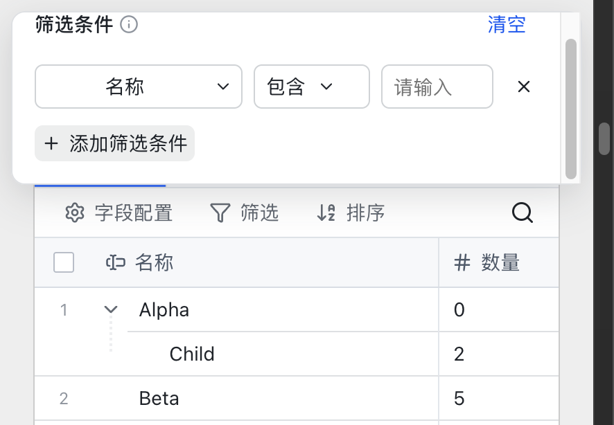

## 第三十二轮：触发器不可见时关闭配置弹层

重新复现编辑中把布局视口从 1774×1228 缩至 443×307：筛选值 Beta，页面 scrollY 62.5，触发器 top 973.234/bottom 999.234，弹层 top 822/bottom 966，整个弹层不可见。候选 sticky always 实测仍然失败（panel-sticky-rejected-20261008.json）；安装的 Radix Popper shift 使用 mainAxis true/crossAxis false，对于上下弹层仅约束横轴，不能修复本轮纵向脱离。Context7 查询可见 sticky 属性与碰撞约束内容模式，但返回片段不直接证明纵向保持；以当前源码与实际候选失败为最终证据。候选 prop 未保留。

通过可选偏好问题给出“触发器完全不可见时关闭、保留条件、不拉动页面”的推荐方案，等待至少 60 秒未收到调整后采用推荐值。先更新规则，再把 ToolbarPopover 改为受控 open，仅打开期间观察触发按钮 IntersectionObserver；完全无可见面积时关闭，卸载/关闭 disconnect。可见性关闭专门阻止 Radix 自动恢复到屏幕外触发器；正常 Escape/外部关闭保留原始焦点恢复。不手写定位，不改变宿主页面滚动，不依赖全局持续监听。现有 optimistic commit 每次输入已向宿主提交，关闭不清空条件。

最新生产消费端同场景：弹层不再挂载、aria-expanded false、scrollY 仍为 62.5、焦点 body，受控 filter value Beta 保留；恢复视口后重新打开 input 仍为 Beta。正常 Escape 后最终焦点仍在 data-tool 筛选按钮（关闭后焦点恢复异步，不用紧接事件的瞬时 null 误报失败）。证据 panel-resize-dismissal-20261008.json，恢复后的截图 quality-panel-edit-preserved.png 已目视检查。

排序添加 quantity asc 后缩小同样关闭，sort 保留、页面 scrollY 不变；字段隐藏 quantity 后缩小关闭，visibleFieldIds 仅 name，filter/sort 均保留，见 panel-fields-resize-dismissal-20261008.json。Safari 最新生产消费构建实际原生筛选输入 Beta，再原生页面向下滚动两页：AX 不再包含筛选弹层，受控视图仍含 Beta，见 panel-safari-page-scroll-dismissal-20261008.txt；这验证另一引擎的真实页面滚动关闭路径，不外推为所有缩放和所有输入法。

全量 npm run verify 退出码 0，45/45，原有演示/消费 >500kB chunk 警告保留。pack dry-run、实际包 app/dist/kun-ntable-0.1.0-panel-visibility-20261008.tgz：38,704 bytes、28 文件、SHA-1 220bf8ea910c6368904cb97454472f7d6c031305；独立临时目录真实解包 Bundler/NodeNext 严格类型解析及四个 ESM 导出通过，依赖仍复用本地树。临时 CDP 视口覆盖已 clear，git diff --check 通过。

本轮解决触发器完全脱离后的弹层遗留，并明确选择关闭而非固定脱离锚点的弹层。真实系统 IME、辅助技术、触屏、完整原生 Tab、400% 与真实持续输入性能仍待补齐，目标 active。

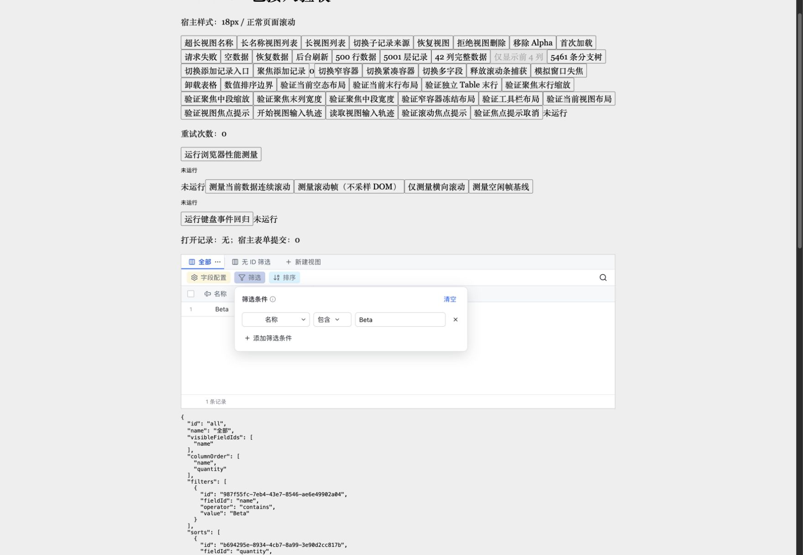

## 第三十三轮：真实滚轮事件与慢帧证据

新增仅消费端的被动滚轮探针与紧凑摘要，覆盖观测和无 DOM 观测分开，异常采样保留、监听清理有界。实际 Chromium 浏览器协议 24 个可信滚轮输入下，DOM 横纵覆盖缺口 0；但不采样 DOM 的首波仍出现 116.7ms 和重复后的 82.4ms 间隔。随后两次暖态最大 17.6ms 不能否定首波问题。Safari 原生小样本复测 P95 54ms、max 74ms，且 longtask API 不支持。

详细条件、限制与原始证据见 browser-performance-2026-10-08.md 第三十三轮。当前消费端严格类型/构建通过，库包对应第三十二轮；没有为使报告变绿改生产代码。性能验收继续未完成，需要进一步区分浏览器/工具调度、冷启动和渲染成本。整体目标 active。

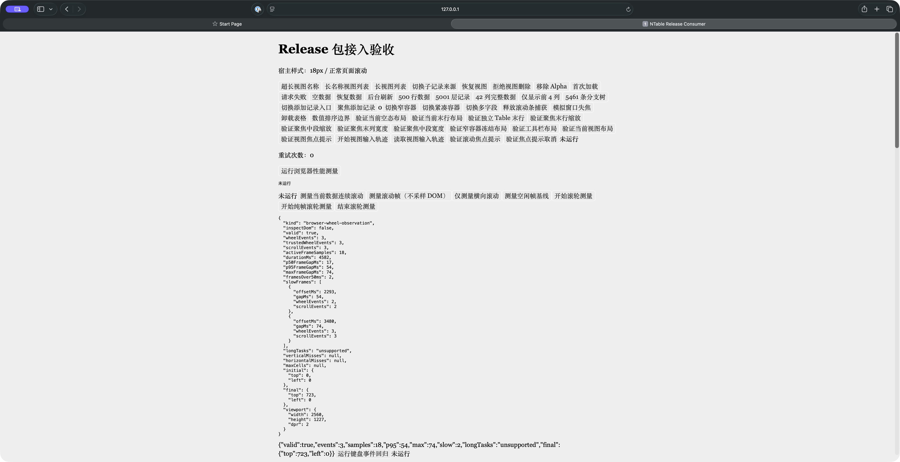

## 第三十四轮：性能对照收紧排查范围

新增纯原生滚动基线和有界长动画帧观测，仅诊断 fixture，无生产代码改动。Chromium 同样 24 次可信滚轮输入：表格累计 TaskDuration 312.72ms，原生容器 19.98ms；本次两组均无 >50ms 帧，不能解释前次异常。Safari 同构建原生容器最大间隔 17ms，宽表最大 54ms、有两次慢帧；距离/容器高度不同，不作为完整因果实验。证据与全部限制见 browser-performance-2026-10-08.md 第三十四轮。

本轮有了优先排查表格滚动更新、挂载和样式成本的对照证据，不把慢帧笼统归为环境，也不凭均值宣布已解决。消费端类型和构建通过，整体目标 active，性能具体热点和前次首波异常仍需继续定位。

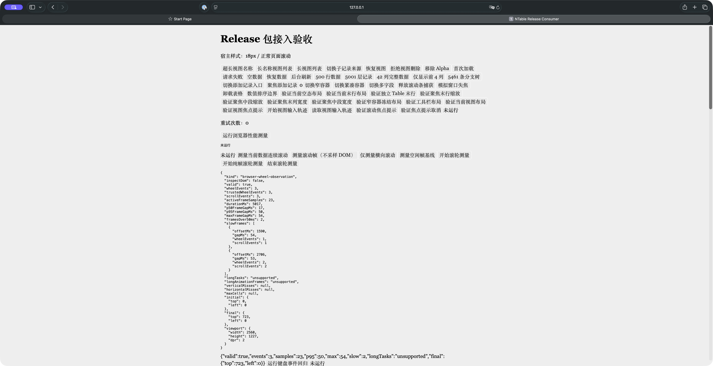

## 第三十五轮：定位行挂载的测量成本

采集当前 2000×42 宽表滚动 CPU profile，临时 source map 定位到 TanStack 同步滚动更新后的 Radix useSize layout effect。核对当前 CheckboxBubbleInput 实现，宿主 form 中行复选框的桥接会读取尺寸和建立 ResizeObserver，作为下一轮隔离对照候选。约 915ms profile 中该 self sample 22.47ms，仍有 263.73ms program/native 未细分，不把采样归属当作完整因果证明。

本轮带 profiler 输入仍有 50.3ms rAF 间隔和一条 108.2ms 长动画帧（scripts 空）；没有用 longtask 空或 P95 17.6ms 隐去它们。诊断资料、调用链和限制见 browser-performance-2026-10-08.md 第三十五轮。正常消费构建已恢复、严格类型检查通过，生产库及实际包未变。下一轮验证减少行复选框挂载成本是否能保持选择、表单、双击与键盘边界，整体目标 active。

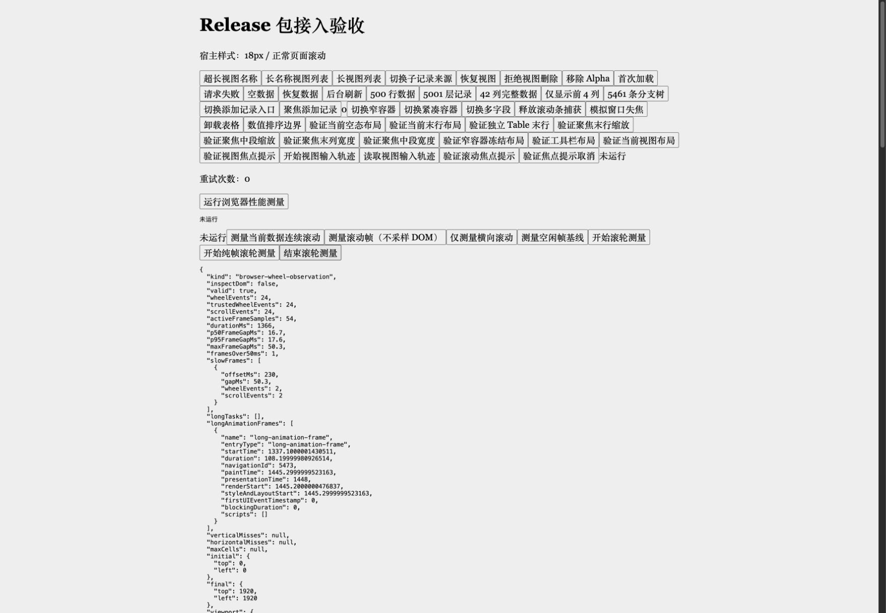

## 第三十六轮：减少行选择代理并修复原生点击时序

行选择改成原生受控 checkbox，表头三态保留 Radix。2000×42 表单宿主隐藏桥接 input 从 21 降到 1，避免每个虚拟行的桥接尺寸读取与监听。原生选择必须先读取 checked，再更新活动行和恢复网格焦点；实际指针验证发现并修复 capture 同步提交重置 checked 的问题。视觉验证修复背景 shorthand 导致勾选图标未居中的问题。

两引擎单击/双击隔离、9 项键盘事件回归通过；Chromium input Enter、Space、表头 mixed/全选及零表单提交通过。最终全量 verify 45/45，新实际 tarball 严格 Bundler/NodeNext 与四个导出验证通过，复用本地依赖树。

保留全部性能反证：最终 Chromium 无 DOM 最大 150/83.6ms，带覆盖最大 200.1ms 且一次 longtask；Safari 原生小样本 max 94ms。横纵 DOM 覆盖缺口 0 不能替代流畅度验收。此次减少了重复代理结构，但没有证明最终持续输入性能稳定提升。下一轮继续分析未分类执行/绘制与调度，性能门禁仍未完成，目标 active。

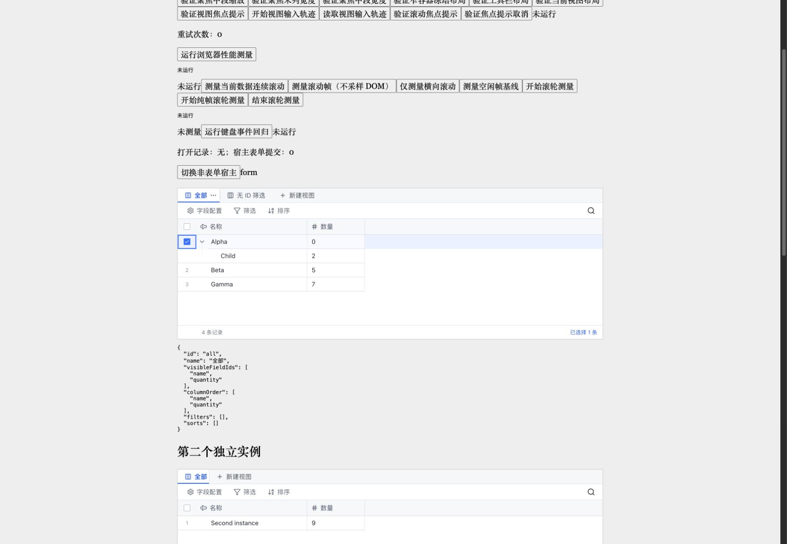

## 第三十七轮：降低预渲染规模，保持范围与焦点

固定行 overscan 从每侧 12 调整为 4，活动行仍单独保留。当前两轮同协议宽表累计任务约 250–260ms，之前交替样本约 305–344ms；此为本机短样本，不作为普遍收益承诺。两引擎各 262 次程序化滚动的行列 DOM 覆盖缺口均 0，最多挂载 18 行/144 cells。Chromium 大幅滚轮跳转缺口 0，实际末行末列键盘导航身份、焦点和可见边界通过，两引擎 9 项事件回归通过。

仍保留慢帧：Chromium 程序回放 max 65.7ms、大幅输入 max 132.4ms；Safari 最新完整摘要 max 354ms/P95 67ms，初次局部 AX 还观察到 569ms。继续调查挂载/提交、绘制与调度，未完成性能交付门禁。最终 verify 45/45、新实际包严格两种解析模式和四个导出通过；详细证据与限制见 browser-performance-2026-10-08.md 第三十七轮。

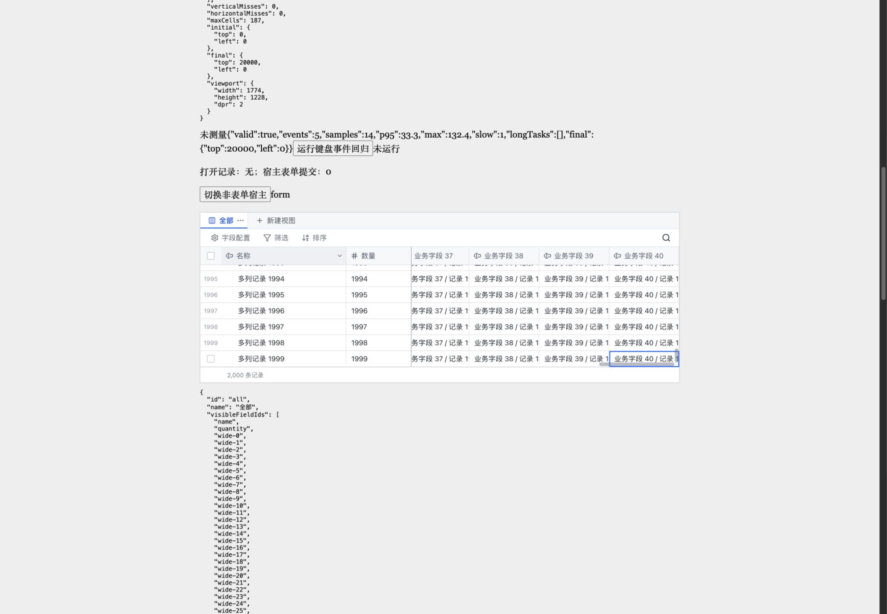

## 第三十八轮：保护提示接替，拒绝收益不明确的优化

试验共享单元格 Radix Tooltip Provider，短样本脚本成本近乎不变；实际悬停从长文本移到同一行数值时旧提示保持，新值未接替。恢复独立 Provider 后同一路径显示 12.5，Escape 正常关闭。已撤回候选并把这条回归约束写入产品规则，原始记录见 browser-performance-2026-10-08.md 第三十八轮。

最终 JS/CSS 与第三十七轮真实包一致，全量 verify 45/45，控制台无 error。此轮得到拒绝候选的交互证据，不算性能瓶颈修复；下一步转向仍未解释的挂载/提交与绘制成本。整体目标 active。

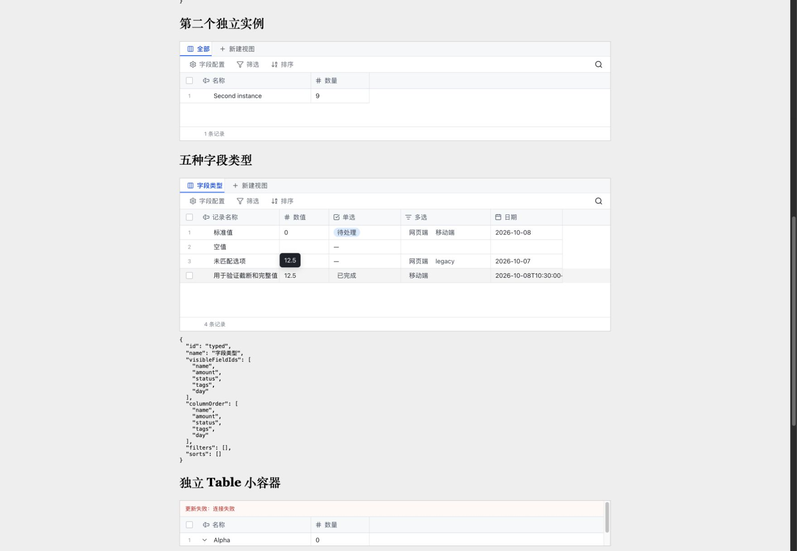

## 第三十九轮：演示与组件库统一严格类型门禁

此前 app/tsconfig.json 的 strict false/skipLibCheck true 只覆盖演示宽松检查，库另设 strict。实跑 tsc --noEmit --strict --skipLibCheck false，唯一错误为 main.tsx 把 HTMLElement|null 传给 createRoot；没有增加 any、非空断言或类型抑制。先更新工程规则，再统一 strict true/skipLibCheck false（库配置继承该声明检查），入口显式检查 #root，缺失时抛出明确启动错误，存在时正常渲染。全量 verify 45/45，应用/库/消费严格类型、演示/Sites/lib/消费构建、pack dry-run 通过。

临时本机生产 preview 5190 使用最终 dist/client 构建：页面挂载成功，空白新增草稿保存禁用；双击主视觉 KV 1 打开正确详情，取消后可见行 aria-rowcount 前后均为 10003、控制台 error 空。footer 总记录 10040 与当前展开后可见行数不同，二者不混用。仅验证启动和打开/取消边界，没有保存业务记录，没有验证缺失 #root 的真实 HTML 运行分支。证据 demo-strict-startup-20261008.json、quality-demo-strict-startup.png（已检查）。原本的 dev 标签未刷新或关闭；临时新标签与 preview 会话已关闭（退出码 130）。

最终库 index.js/ntable.css 与第三十七轮已验 tarball 逐字节相同；本轮不新增实际包或发布，不把类型门禁完善当作慢帧解决。真实输入/辅助技术/触屏、Safari 慢帧等剩余交付要求仍保留，目标 active。

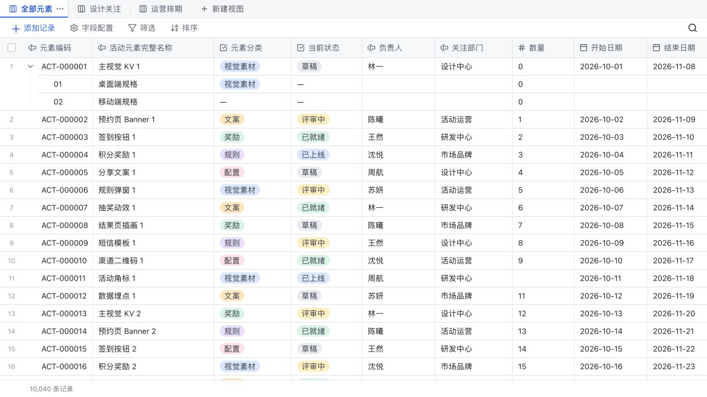

## 第四十轮：让部分选中状态清晰可辨

高对比模拟验收发现表头部分选中始终使用 Check；正常配色下没有 indeterminate 背景，白色图标对比不足，高对比下又容易与全部选中混淆。先补产品规则，再统一计算 allSelectionState：部分选中显示 Minus 并使用选中底色，全部选中显示 Check，未选中没有图标；保留 aria-checked mixed 和原有选择行为。样式源在 overrides.css，经库构建限定作用域。

Chromium 当前消费构建逐步验证未选→部分选中→全选→清空，分别为 false/mixed/true/false，图标与 footer 选择数量一致。forced-colors 浏览器模拟同路径通过，原生行 checkbox fallback 保留可辨认选中状态；这只是媒体模拟，不代表真实操作系统高对比主题已验收。已清除媒体模拟；普通主题截图遇到宿主残留黑色绘制，computed body 背景实际为灰色，刷新测试页后重新键盘选中一行，截图恢复正常。没有把残留绘制推断为生产 CSS 缺陷。Safari 正常配色实际点击选择一行，AX 表头 mixed Value 2、行 Value 1、footer 已选择 1 条一致，Minus 清晰可见。

全量 npm run verify 45/45，通过严格类型、各构建、消费解析与 pack dry-run；git diff --check 通过。新真实包 dist/kun-ntable-0.1.0-mixed-checkbox-20261008.tgz（39165 bytes、28 files）解包后严格 Bundler/NodeNext 和四个 ESM 导出通过，依赖复用现有本地树，不能算干净联网安装。证据 checkbox-three-state-20261008.json、mixed-checkbox-safari-20261008.txt、mixed-checkbox-package-20261008.json。Safari 慢帧、真实 IME/辅助技术/触屏、完整原生 Tab 和 400% 等门禁仍未完成，整体目标 active。

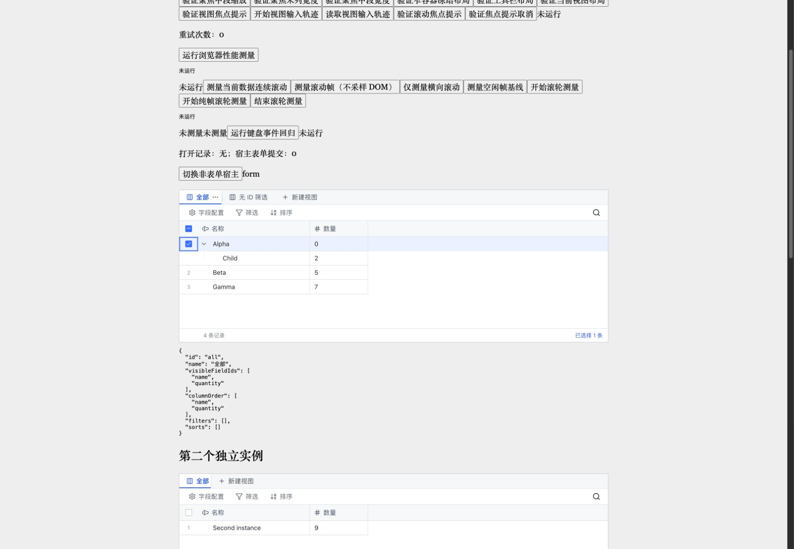

## 第四十一轮：选择字段连续筛选与排序验收

复用当前 5188 生产消费构建的五种字段 fixture，以实际 Chromium UI 连续操作，不修改库源码或重定义原值筛选契约。单选 draft 返回标准值、待处理标签作为筛选值返回零条、unknown 返回未匹配选项；多选 web 返回标准值和未匹配选项、网页端标签返回零条。多选为空只返回空数组记录，隐藏输入并将已提交 value 清为字符串空值；清空恢复原四条。

单选顺序/倒序分别按原值文本排序；多选更换字段保留倒序，随后顺序及 ArrowRight 键盘倒序符合原值序列。排序结果读取必须等实际虚拟行提交：一次即时读取已得到 asc 状态但行仍为上一次顺序，保留该原始观察，再独立读取稳定行确认最终顺序，未把即时快照当作产品错误。最终清空筛选和排序，四条记录原顺序恢复。对保存的稳定结果做 13 项数量/顺序断言，另检查空值草稿清除和最终无规则，均通过；控制台 error 空。

证据 app/qa/select-continuous-chromium-20261008.json、quality-select-continuous.png（已检查）。本轮仅验收和文档变更，不重复全量构建；最近源码验证仍为第四十轮 verify 45/45 和实际包。结果仅证明四条已知数据的 Chromium 单条件连续路径，没有证明所有操作符、多个条件和优先级组合，也没有代替 Safari 对应流程。性能和真实设备输入门禁继续未完成，目标 active。

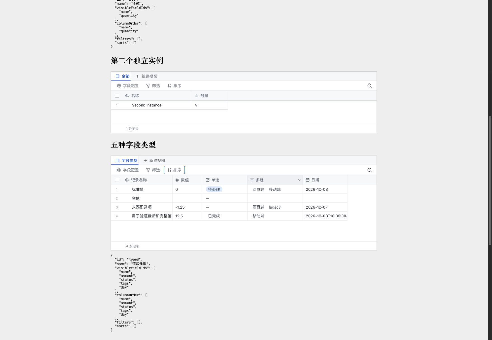

## 第四十二轮：缓存线性列几何，移除平方级前缀计算

当前 Table 每次渲染按每个 index slice/reduce 重算起点，并重复构建宽度数组、grid template、总宽和拖拽起点。先补工程规则，再增加 columnGeometry 单遍历产生全部起点/末尾插入边界、总宽和模板；Table 将 fieldWidths 和 geometry 依 orderedFields/liveWidths 缓存，冻结样式、列窗口、拖拽起点和插入位置复用。没有改变滚动同步提交、列窗口覆盖或 Tooltip Provider。

新增不等宽/空字段/末尾边界测试；10,000 列代理计数证实每个宽度只读取一次。独立 Node 几何小样本：42 列 10,000 次旧 12.23ms、新 8.61ms；1000 列 500 次旧 124.57ms、新 8.73ms，结果逐项相同。该对照是孤立计算，不代表浏览器滚动性能或全部产品收益。

最终构建两引擎各 262 次程序回放（240 纵/22 横）均无 DOM 覆盖缺口，最多18行/144 cells。Chromium max17.7ms/P95 16.9ms；Safari max92ms/P95 61ms、29次超过50ms，仍不满足性能交付。不能用较早354ms和本次92ms的不同样本宣布 Safari 修复。Chromium 末列 700/600/900px 容器宽度回归保持活动身份、焦点和无遮挡；实际网格 Shift+Right 将名称宽从250增加到266，相邻起点同步+16；Alt+Right 重排为数量/名称且保持宽度。

宽表数据不符合现有键盘 fixture 的树行前提，首次运行返回 null focus；恢复四条树记录后9项事件通过，未隐去该前提失败，也未把它当作生产键盘错误。当前消费控制台 error 空。

全量 verify 46/46（含新增几何测试）、严格消费两种解析模式及所有构建通过；新实际包 kun-ntable-0.1.0-column-geometry-20261008.tgz 解包后严格 Bundler/NodeNext 和四个导出通过，复用现有依赖树；git diff --check 通过。证据 column-geometry-cost/chromium/safari/keyboard/package-20261008 和已检查截图。保留 Safari 慢帧、真实设备输入和全部尚缺验收项，目标 active。

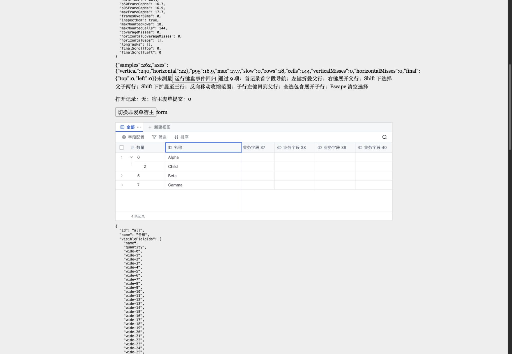

## 第四十三轮：稳定滚动容器监听器生命周期

源审查确认 AutoHideScrollArea 的 hovered 依赖会在每次进入/离开时重建 scroll 监听器和 ResizeObserver、读取尺寸并重新初始化边缘锚定。先补产品规则，再让观察只持续一个挂载生命周期，回调通过 hoveredRef 读取即时状态。进入时取消遗留隐藏计时，拖拽结束回调也读当前悬停而非开始拖动时的闭包值；卸载继续清理计时、监听器及观察。保留原显隐样式、900ms 时长和所有手势取消路径。

工程结构确定减少悬停导致的重连，但不作为速度证明。实际 Chromium pointer 进入增加 scrollbars-visible，离开移除；透明度渐变期间即时 opacity 仍为1，不将该快照当作隐藏失败。末列700/600/900px宽度变化的活动身份/焦点/冻结遮挡回归通过。最终262次程序回放横纵覆盖缺口0，Chromium max48.1ms/P95 17.4ms；Safari候选max437ms/P95 77ms、83慢帧。同诊断页面上一版库max431ms/P95 72ms、83慢帧，覆盖也0。小样本未显示候选显著差异，更没有证明 Safari 性能改善；不能直接与上轮92ms比较作为收益或回归结论。

发现拖拽结束闭包可能读旧hover状态，但旧版实际指针对照没有进入gotpointercapture、top未变化，故没有证明问题已复现或修复。新增fixture被动轨迹记录trusted/primary/pointerType/buttons/capture和scrollTop，最多128事件，重启/停止/卸载清理，不改变输入或生产库。原始旧版可信pointerdown和move保存，validDrag false，禁止把它作为拖拽验收通过。此项仍需有效捕获路径验证。

全量verify46/46，最终实际tarball kun-ntable-0.1.0-scrollbar-hover-20261008.tgz严格Bundler/NodeNext和四个导出通过，依赖复用本地树。实验使用上一版JS仅覆盖生成的lib/consumer产物，最终lib已恢复为已验新包相同JS，消费重新构建，Safari已reload最终版本；未回退任何源码工作。git diff --check通过。证据scrollbar-hover-chromium/safari/safari-old-comparison/old-pointer/package-20261008，截图quality-scrollbar-hover.png已检查。性能、真实设备输入和有效拖拽路径仍未完成，目标active。

## 第四十四轮：证明真实捕获路径，排除无效协议拖拽

继续调查第三十三/四十三轮可信协议事件但未滚动的输入。增强fixture有界被动轨迹：记录按下后的连接/捕获快照、React与native主指针属性、结束时scrollTop/hover/显隐/opacity；停止和卸载阻止待执行微任务追加记录。临时生产分支日志显示左键/主指针/viewport/metrics均有效，setPointerCapture调用后为true；没有resize/end取消日志，但后续协议move落在grid-row，没有gotpointercapture、位移为0。保留此失败输入，不将其判为组件拖拽失败。临时日志已全部移除。

IAB该输入没有形成有效捕获后，使用已有Safari页面原生App drag。先按原始5120×2634截图像素确认坐标；误用CSS尺寸的首次点击落在页面重试文字区域，随后核对截图修正，没有盲用旧坐标。第一条原生竖向拖拽观察到gotpointercapture/pointerup，scrollTop从0变为3797、记录从0附近变为114附近。

最终无诊断日志构建再验证：从竖轨thumb拖到表格左侧外部并释放，完整可信pointerdown→gotpointercapture→move→pointerup→lostpointercapture链路，scrollTop3797。等待超过900ms后结束状态为hovered false/visible false/opacity0；实际记录已滚动。微任务里的captured false在原生成功案例同样出现，说明立即快照不能代替稍后的捕获事件和位移，已补验收规则。该证据支持当前Safari原生竖向拖出释放与自动隐藏，不覆盖横轨、Escape、失焦和触屏，也没有证明旧闭包风险的前后因果修复。

最终verify46/46、git diff --check通过；库JS/CSS逐字节等同第四十三轮已验实际包，未新增包，不把临时日志产物交付。主要新增为fixture诊断与工程验收规则。证据scrollbar-cdp-diagnostic-20261008.json、scrollbar-native-drag-20261008.txt、scrollbar-native-outside-release-20261008.txt及已检查quality-scrollbar-native-outside-release.png。Safari慢帧及其他交付项继续开放，目标active。

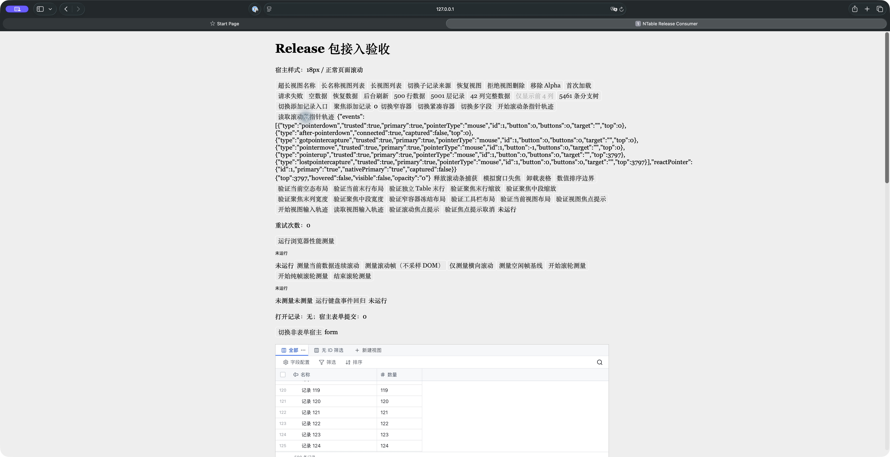

## 第四十五轮：修复末列滚动边界和键盘加宽显露

当前Safari原生横轨拖出释放形成完整捕获生命周期，末列40和冻结名称/数量可见，但结束left5064、maxLeft5067。末列resize-handle负right伸出边框，将虚拟网格末端增加3px空间。先补规则，在HeaderCell显式标记最后逻辑列，限定该把手right0，保留命中宽度和中间列边界命中。Chromium末列未挂载/挂载前后scrollWidth均6022，把手右边在header内侧1px；修复后Safari原生同路径left=maxLeft=5064，hovered/visible false、opacity0。

实际键盘回归又发现最后表头140→156px后scrollLeft仍5064，activeRight1374.5超过viewportRight1358.5，焦点虽保持但新增16px裁切。将聚焦显露检查加入fieldWidths及缩放状态变化，指针缩放期间跳过，提交/取消后按实际几何显露。最终Chromium同路径left5080、activeRight=viewportRight1358.5、activeWidth156且网格仍聚焦。这修复列宽改变而非仅容器宽度改变的边界。

Safari最终原生横轨：初始left24（预备点击会显露活动单元格），到末端5064，完整got/lost capture且纵向top0；超过隐藏计时后opacity0。原生末列把手向左拖50截图像素，最大范围5064→5039，实际left=maxLeft5039；末列仍呈现，证明收进列内后的把手可命中且提交了范围变化。第一次读取该缩放结束时opacity1处于渐变，未将它当作自动隐藏结果；自动隐藏证明来自之前横轨结束的opacity0。没有声称全范围持续绘制覆盖或所有取消路径已验证。

新增fixture横向位移/最大范围/轴记录，保持被动有界。最终verify46/46、git diff --check通过，新实际包kun-ntable-0.1.0-terminal-resize-20261008.tgz（39390bytes/28files）解包后严格Bundler/NodeNext与四个导出通过，复用本地依赖树。证据terminal-resize-chromium、terminal-keyboard-resize-before/after、terminal-horizontal-native-final、terminal-pointer-resize-safari-final、terminal-resize-package-20261008及已检查截图。Safari慢帧、真实IME/辅助技术/触屏等仍未完成，目标active。

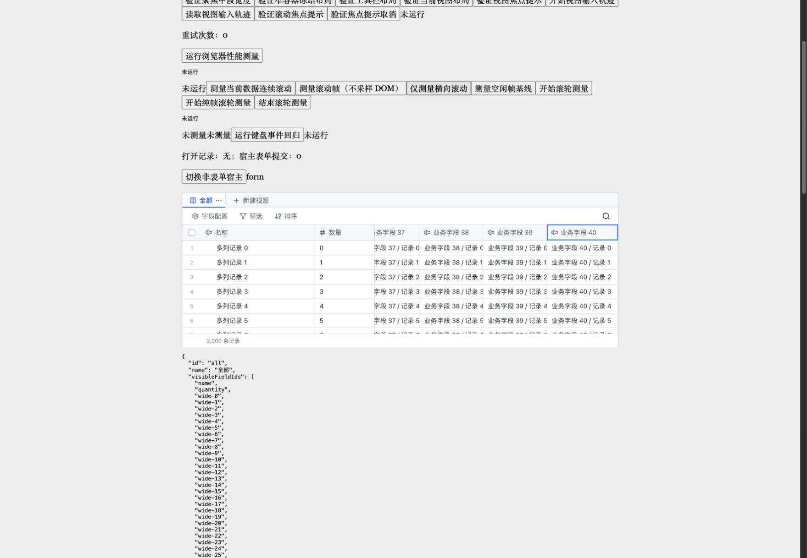

## 第四十六轮：原生键盘基础路径与优先级调整

按用户最新要求，Safari 性能只要求正常可用、无重大问题；不再追逐极致帧率或以历史慢帧数值单独阻断交付。继续检查影响日常操作的明显卡顿、无响应、渲染错误与交互失效。

新增消费者限定的有界焦点/导航事件轨迹（最多128项，不记录输入值，停止和卸载移除监听）。Safari 原生普通 Tab 从主网格退出至下一网格，Shift-Tab 可返回；Option-Tab 可继续经过下一实例按钮。反向 Option-Shift-Tab 尝试未移动，保留原始证据，不判为产品缺陷。随后用 fixture 按钮显式聚焦主工具栏字段配置，原生 Option-Tab 到筛选/排序、Enter 打开排序面板并聚焦选择排序字段；Escape 恢复排序触发器，再 Option-Tab 到搜索。该起点由 fixture 聚焦，不能声称整个路径均从页面原生 Tab 进入或全控件已覆盖。

证据 native-keyboard-entry-exit-20261008.txt、native-keyboard-toolbar-attempt-20261008.txt、native-keyboard-toolbar-success-20261008.txt；截图 quality-native-keyboard-toolbar.png 已检查。消费者三套严格类型与生产构建、git diff --check 通过；库源码未在本轮变化，最近完整 verify 为第四十五轮46/46。目标保持 active。

## 第四十七轮：筛选组合、跨类型切换与清空恢复

基于当前生产消费者，IAB 实际点击/输入连续验证11项稳定行结果：默认所有交集、任意并集且忽略未填写条件、数值大于切换文本后操作符回到包含、非法数字在两种模式均不匹配、空值与另一条件无交集、删除另一条件后仅保留空值、非空包含零和负数、从空值规则恢复比较时不复活旧值、0.0匹配数值0、最终清空恢复四条记录。记录每一步受控view、可见名称和aria-rowcount，与明确期望逐项比较；11/11通过。

首次fill在关闭子菜单后的工具输入阶段焦点失配，一次新快照和重试成功；保留输入机制说明，不当作业务错误。前两次读数用了不存在的行身份属性而获得null，这两项保留为诊断，未计入通过数。最终使用gridcell名称读取与行计数一致。本轮未修改产品代码，未以无缺陷替代完整交付；真实IME、其余操作符和设备组合仍未全覆盖。证据filter-combinations-chromium-20261008.json，截图quality-filter-combinations.png已检查，无控制台error。

## 第四十八轮：关闭搜索恢复键盘焦点

当前生产消费者实际按Enter关闭搜索，document.activeElement成为BODY，键盘失去表格局部位置。先补产品规则，在TableToolbar记录仅由显式关闭产生的恢复请求，在关闭提交后的layout effect聚焦重新挂载的搜索触发器，preventScroll避免滚动宿主；初始挂载和回调移除不产生恢复请求。搜索清空与防抖取消逻辑保持。

最终Chromium Enter关闭后聚焦本实例搜索按钮，scrollY1162保持；再Tab进入同一实例grid。补浏览器事件回归断言，11项通过，包括防抖、合成composition边界、关闭取消、焦点恢复、回调移除/恢复、外部重置、卸载取消。Safari原生Option-Tab至搜索、Enter打开、Option-Tab至关闭、Enter关闭后AX焦点回到搜索按钮；起点由fixture聚焦，非全页面Tab覆盖。

最终verify46/46、git diff --check通过。实际包kun-ntable-0.1.0-search-focus-20261008.tgz解包后严格Bundler/NodeNext及四个导出通过，复用本地依赖树；npm默认缓存在sandbox下EPERM后切换专用/tmp缓存成功，未改系统配置。证据search-close-focus-chromium、search-close-focus-safari、search-focus-package-20261008；截图quality-search-close-focus.png已检查。宿主必须立即更新受控视图、异步保存/回滚由宿主负责的现有契约仍适用，不能将完全拒绝回调更新的宿主当作已支持的异步保存模式。目标active。

## 第四十九轮：配置选择器当前值可访问标记

生产选择器选项只有selected样式和勾选，没有可访问状态。保留普通按钮与现有箭头/Enter行为，按WAI-ARIA通用当前项语义补aria-current true；不冒用aria-selected的listbox/tab语义或需要切换的aria-pressed。规则只标记与实际value相等的选项，不将显示回退当作已提交值。[WAI-ARIA aria-current](https://www.w3.org/TR/wai-aria-1.2/#aria-current)。

当前生产消费者5组状态通过：初始字段唯一当前项、搜索排除当前值后无标记、ArrowDown/Enter选择数值后重开更新标记、数值关系唯一等于当前项、新增排序未选值无标记。每组DOM当前项与视觉勾选逐项一致。该证据是属性与实际交互检查，不代表真实读屏朗读已验收。截图quality-selector-current.png已检查。

最终verify46/46、git diff --check、实际包kun-ntable-0.1.0-selector-current-20261008.tgz严格Bundler/NodeNext和四个导出通过（本地依赖树）。证据selector-current-20261008.json、selector-current-package-20261008.json。目标active。

## 第五十轮：配置控件移除后的焦点恢复

先核实业务接口契约：schema变化后宿主清理失效字段引用并补列序。新增受控消费者fixture按该契约移除/恢复数值字段，支持1500ms延迟更新以在面板保持打开且输入聚焦时验收；计时器重启/卸载会清理。移除当前数值条件后原版本焦点落BODY，筛选面板仍开。

先补规则，再由ToolbarPopover记录聚焦控件；正常blur和关闭清除候选。在仍打开的提交中，只有该控件已断开且焦点确实落BODY时，聚焦现存dialog并preventScroll；面板有明确可访问名称。不影响宿主schema清理职责或修改查询规则。

生产消费者验证：外部更新清理聚焦筛选值后焦点为筛选配置dialog，scrollY1215不变，Tab进入面板控件；键盘删除最后筛选条件/排序规则后分别恢复相应dialog。焦点主动移到宿主恢复数据按钮后，延迟schema恢复保持该按钮焦点。最终构建再查删除恢复、Escape返回筛选触发器，以及子选择器Escape返回筛选字段通过，无控制台error。该证据限于IAB真实控件输入；Safari对应路径与真实读屏尚未验证。

最终verify46/46、git diff --check及实际包kun-ntable-0.1.0-schema-focus-20261008.tgz严格Bundler/NodeNext与四导出通过（复用本地依赖树）。证据schema-removal-focus-20261008.json、schema-focus-package-20261008.json；quality-schema-focus-recovery.png已检查。目标active。

## 第五十一轮：双轴审查与列菜单失效边界

详见worktree-review-2026-10-08.md。Standards初轮2项、Spec初轮1项（排序文档同源）已整改；运行时实测旧菜单在amount移除后错误加宽status176。现field/index不再对应当前列对象时绘制前关闭菜单，按焦点归属决定是否恢复grid；移除、外部重排、重开操作目标及外部焦点保留通过。两代理定向复核无新阻断。最终库verify46/46、fixture严格类型/消费构建、实际包两模式/四导出通过（本地依赖树）。目标active。

## 第五十二轮：横向滚动后的冻结列拖动

对第五十一轮只读疑点做原生实测：42列/2000行冻结名称、数量，键盘End滚到横向末端，将名称拖到冻结数量右侧，旧版把名称放到远处普通区，冻结区变为数量+业务字段1。证据frozen-drag-native-before-fix-20261008.txt和前后截图；原生桌面截图本轮实际为1920×964，按新截图定位，不复用旧5120坐标。一次AX选择误匹配了独立紧凑树表，核对截图和2000记录主表标识后重新定位，未用错实例的结果证明产品问题。

先补规则，按实际表头rect计算grab偏移；落点在冻结前缀用viewport坐标，在普通区用scroll内容坐标，不能把冻结区指针映射到被卷走的普通列。插入引导线与同一落点计算一起更新，冻结槽位补scroll偏移，普通槽位受真实冻结边界裁切。复用缓存offsets，不再在drag开始做前缀slice/reduce。新增纯几何回归覆盖两冻结列、5064滚动、普通区、无冻结、空字段。

最终Safari原生同路径first quantity/name/wide-0/wide-1，nameIndex1/quantityIndex0；反向拖动恢复nameIndex0/quantityIndex1。新增消费者列序定位短摘要，避免原生AX截断大viewJSON。中间帧遮罩和引导线尚未获得连续视觉证据，未用终态代替全手势绘制验收。当前结果证明原生横向滚动后冻结前缀相邻重排修复。

最终verify47/47、git diff --check、实际包kun-ntable-0.1.0-frozen-drag-20261008.tgz严格两解析模式与四导出通过（本地依赖树）。npm pack首次prefix调用仍在根目录失败后用app工作目录成功，不改系统配置。证据frozen-drag-native-final、frozen-drag-native-reverse、frozen-drag-package-20261008；quality-frozen-drag-native-final.png已检查。目标active。

## 第五十三轮：冻结拖动源列高亮与取消轨迹

- 本轮沿第五十二轮继续验收中间态，不再把 Safari 极致性能作为交付门槛。先在消费 fixture 增加有界、被动的列拖动诊断，最多120帧/128事件、20秒自动清理，重启和组件卸载也会清理。没有修改生产输入或注入指针捕获。
- Safari 原生相邻交换确认 trusted pointerdown/move/up 和 got/lost capture，提交顺序 quantity/name，结束后拖动层消失。工具的原子 drag 在绘制前完成，帧样本0，因此不声称原生中间绘制完成。原始证据 `app/qa/column-drag-painted-native-20261008.txt`。
- 内置浏览器用分阶段协议输入保持拖动，确认灰色遮罩与蓝色插入线坐标正确，但发现淡蓝源列高亮使用内容坐标，冻结列横向滚动后高亮移出可视区。修复 Table 的 frozen source highlight 加当前 scrollLeft；普通列保留内容坐标。产品规则先同步。
- 修复后实际截图 `app/qa/quality-column-drag-held-fixed.png`：源列高亮 left442.5/width250，遮罩 left712.5/width250，落点线 left821.5/width2；第二次移动遮罩 left692.5，而源高亮仍442.5。截图已实际检查。长期保持轨迹120帧的抓取锚点误差0，有120帧引导线；该次探针先达到20秒停止，没有记录释放，不将 release:false 判为产品失败。
- 紧凑的完整协议输入轨迹补 got/lost capture、1个中间帧、锚点误差0；Escape 后无拖动层，最终列序仍 name/quantity，释放不提交。证据 `app/qa/column-drag-cancel-chromium-20261008.json`。此为协议输入，不能外推为原生设备或所有取消路径。
- 新最终 `npm run verify` 47/47；严格应用/库/消费类型检查、演示/Sites/lib/消费构建通过。`git diff --check` 通过。实际包 `app/dist/kun-ntable-0.1.0-drag-highlight-20261008.tgz` 39727 bytes/28 files，SHA1 822272b7f084113fcba0dd1addd200f7d177520e；新临时解包消费者 Bundler/NodeNext 严格类型与四个导出通过，复用本地 node_modules，不是全新网络安装。
- 仍未覆盖普通/冻结区跨界的全部拖动组合、持续自动滚动、真实触屏、OS IME及读屏等；目标保持 active。

## 第五十四轮：跨区拖动与自动滚动高亮裁剪

- 内置浏览器实际协议输入：末端 wide-39 普通列拖入冻结区首位，frozenFieldCount仍2；再拖回普通末端后42列完整序列恢复；拖出表格释放无提交且拖动层清除。证据 `app/qa/column-drag-cross-region-20261008.json`；最终构建再次跨区往返恢复通过，见 `column-drag-cross-region-final-20261008.json`。均非原生触屏验收。
- 保持右边缘输入触发自动滚动，scrollLeft由0增长至3987。早期实际截图显示普通源列淡蓝高亮滑入冻结区并染到数量列：scrollLeft63、源高亮left759.5/width140，而冻结边界822.5，clip-path:none。证据 `column-drag-autoscroll-early-before.png`。
- 产品规则先补冻结边界裁剪。源高亮使用clip-path，仅裁剪越过冻结边界部分，遮罩和插入线保持独立。首版React状态裁剪落后9px一帧，因此改为手势更新同步设置当前scrollLeft对应的局部CSS变量，取消/结束清理；保留布局状态值为首次绘制fallback。
- 最终保持态实测scrollLeft54/highlightLeft768.5/clip54，实际可见起点822.5与冻结边界一致；取消后无层且CSS变量为空，列序保持。截图 `quality-column-drag-autoscroll-final.png` 已检查；原始几何和最终state见 `column-drag-autoscroll-final-20261008.json`。此为有限保持态和连续自动滚动观测，不外推所有设备或取消路径。
- `npm run verify`最终47/47、严格应用/库/消费类型、各构建通过；实际dry-run和新解包消费者Bundler/NodeNext严格类型及四导出通过，复用本地依赖树。新包 `app/dist/kun-ntable-0.1.0-drag-clip-20261008.tgz` 39858 bytes/28 files，SHA1 81b0458a511b70a2b033a1fb557be074153e4232；`git diff --check`通过。
- 本轮有一次轮滚异步提交期间尝试开始拖动没有有效保持态；恢复观察后重试成功。历史console在17:44:32.689Z记录旧消费asset index-BgBaitkj.js中的setPointerCapture InvalidStateError，最终构建实际跨区流程未新增该日志，但不能仅据旧asset将其归为传输错误。下一轮继续审查失效指针/表头卸载时的捕获异常与清理边界；目标保持active，实际IME/读屏/触屏等仍未全部验收。

## 第五十五轮：拖动阈值前源表头卸载导致捕获异常

- 使用 diagnosing-bugs 流程，先在当前生产消费构建复现实际错误，再修复。最小实际协议输入：42列 -> 横向起点 -> 按下普通wide-0表头（880,512）-> 按住期间横向滚轮6000 -> 稳定观察scrollLeft5064/sourceMounted false -> pointermove(1250,512)。当前asset index-CF1H-tbe.js在17:50:08.146Z抛出setPointerCapture InvalidStateError，原始记录 `app/qa/column-drag-capture-before-20261008.json`。用始终挂载的冻结name表头执行相同滚轮路径，正常激活拖动且没有新增错误，排除该路径中指针统一失效的解释。
- 已检查项目无CONTEXT/ADR文件。规范依据 https://www.w3.org/TR/pointerevents/#dom-element-setpointercapture ：未connected元素捕获抛InvalidStateError；无活跃pointerId抛NotFoundError，两者不混淆。问题是虚拟列窗口只保留已激活draggingFieldId，按下与4px阈值之间源列仍会被移除。
- 规则先同步。Table从pointerdown开始存pressedFieldId并加入windowedColumns保留集；结束/取消清除。源字段被宿主schema移除时layout effect取消旧手势；达到阈值时还有isConnected检查，不对失效源调用捕获。没有吞掉异常或增加广泛try/catch。
- 原始反馈路径复验：scrollLeft5064时sourceMounted true；后续dragging true；Escape/释放后sourceMounted false、无拖动层、临时clip变量为空，保存列序不变；本轮时间边界后的新console errors为空。证据 `column-drag-pending-source-after-20261008.json`。浏览器实际DOM路径承担回归验证，已有windowedColumns retained单元覆盖保留机制，没有用只验证浅层函数的新增测试冒充实际捕获修复。
- 消费fixture新增1500ms延迟移除普通schema控制，取消/重新安排计时和卸载清理。实际激活wide-39拖动期间触发宿主移除，稳定后aria-colcount3、sourceMounted false、dragging false、无拖动层、clip变量清空；继续移动/释放无提交，完整columnOrder仍原序，无新console error。证据 `column-drag-host-source-removal-20261008.json` 和已查看截图 `quality-column-drag-host-removal.png`。这仅证明协议输入/当前宿主schema路径，不等于真实触屏或所有捕获失败情况。
- 最终库完整verify47/47通过；新增fixture再次严格consumer类型和生产构建通过；git diff --check通过。新实际包 `app/dist/kun-ntable-0.1.0-pending-source-20261008.tgz` 39947 bytes/28 files，SHA1 1292796638c922def6e724488e8b88aad085d1da；实际dry-run、新解包消费者Bundler/NodeNext严格类型和四导出通过，仍复用本地依赖，不是全新网络安装。无临时生产日志、无push/publish，目标active。

## 第五十六轮：实际包全新依赖安装与生产宿主验收

- 用第五十五轮实际包`kun-ntable-0.1.0-pending-source-20261008.tgz`，SHA1 1292796638c922def6e724488e8b88aad085d1da，创建`/private/tmp/ntable-clean-consumer-pm7wf3q3`，独立新缓存`/private/tmp/ntable-clean-npm-cache`，未链接仓库node_modules。临时目录规则在AGENTS.md；可复用源夹具保留`app/tests/clean-install-consumer.tsx`。
- 首次沙箱npm遇DNS ENOTFOUND；确认同一进程仍重试后显式终止，退出130；沙箱外执行`npm install --ignore-scripts --no-audit --no-fund --fetch-retries=0 --update-notifier=false --cache /private/tmp/ntable-clean-npm-cache`，75包/17秒成功。仅安装当前临时目录、无全局依赖/系统配置修改。ignore-scripts下后续严格检查和生产构建实际通过；不宣称依赖安全审计完成。
- 主机Node24.21.0/npm11.19.0，宿主React/ReactDOM19.2.0、types19.3.0、TS7.0.2、Vite6.4.2。新lock仅一份node_modules/react、react-dom，均19.2.0；无顶层包软链接。完整锁保存`app/qa/clean-install-lock-20261008.json`，摘要`clean-install-package-20261008.json`。
- 新依赖树运行tsc strict/skipLibCheck:false/noUncheckedSideEffectImports:true，分别Bundler与NodeNext均通过；Vite生产构建通过，4个公共组件真实导入和CSS入口生效。保留上游use client指令在客户端构建被忽略提示和510kB chunk提示，不将提示隐藏或等同实际运行性能。
- 沙箱绑定本机5189报EPERM、进程退出1；沙箱外仅127.0.0.1生产预览成功，IAB打开当前新构建。11项有限关键流程全部true：导出、Beta双击打开、失败保留3数据行、重试计数1/alert消失、全选3行、Beta搜索1行/关闭恢复3行、关闭搜索焦点回搜索按钮、数值倒序Beta/Alpha/Child、筛选Beta1行、创建并切换“干净接入视图”、console errors0。原始结果`clean-install-browser-20261008.json`。
- 初版fixture错误地给标签传入纯blue/green底色，截图文字可读性差；调整为#e8f1ff/#e7f6eb浅底色，并标注宿主状态。仅fixture外观修改，实际库tarball不变。最终两模式严格检查与生产构建再次通过，生产页面3行基线和截图`quality-clean-install-consumer-final.png`已实际检查。没有将原始11项流程声称为所有产品路径覆盖。
- 本轮完成此前新依赖安装门禁的当前环境证据，不等于public npm发布、SSR/RSC或其他版本/平台兼容。完整库验证仍为第五十五轮47/47；本轮仅新增fixture及证据，无生产库修改。目标保持active，实际IME/读屏/触屏及其他显式剩余验收继续。

## 第五十七轮：连续键盘筛选修复与真实高倍率验收

- 上轮已完成新依赖安装，本轮沿独立消费页检查键盘和倍率。IAB的super+plus未改变innerWidth1280/dpr1，因此不把该尝试算缩放证据；说明能力缺口后复用已有Safari标签页，临时打开独立消费页，结束恢复100%和原5188地址。
- fixture增加被动resize视口输出，组件卸载清理监听。Safari baseline1920×874/dpr1；115%1669×760/dpr1.15；200%960×437/dpr2，排序弹层主要控件可见；300%640×291/dpr3，筛选面板、字段/关系/值/删除/添加控件实际可见。原生输入Beta关闭后1条记录，焦点回筛选。截图 `quality-clean-safari-zoom-200.png`、`quality-clean-safari-zoom-300-condition.png`、原始结果 `clean-safari-zoom-300-filter-20261008.txt`。不是触屏/系统字号/读屏证据。
- 连续键盘从宿主按钮进入视图/新建/字段配置、关闭恢复、筛选/排序入口和嵌套字段搜索。复现筛选关键缺陷：Enter打开筛选仍聚焦触发器；Tab去排序且dialog0，无法正常Tab进入条件。证据 `clean-filter-keyboard-before-20261008.json`。另实际字段面板aria-label为“字段配置配置”，重复命名。
- 原因是filter-panel的onOpenAutoFocus只preventDefault。规则先补，改为preventDefault后聚焦content（preventScroll），避开自动聚焦info tooltip同时让Tab进入条件；dialog名字仅在label没有配置后缀时补配置。没有修改公共API或Tooltip交互。
- 最终实际包安装到独立npm消费者，严格Bundler/NodeNext和生产构建通过。完整键盘回归：打开筛选聚焦DIV/筛选配置，初始tooltip0，Tab进入信息按钮/添加条件，Enter添加，Shift-Tab经删除到值输入，提交Beta/1数据行；Escape稳定回筛选。保持刚关闭时BODY短暂快照，等待稳定焦点后确认恢复，不误判提交时序为新缺陷。字段面板名称“字段配置”通过。
- 连续Tab进入排序，Enter/Down/Down/Enter选择quantity asc，Escape恢复排序；Tab进入搜索，Enter/Tab/Enter关闭搜索恢复；Tab到单一网格入口，方向键/Space选择一行/Enter打开beta，Shift-Tab返回搜索。当前console errors0；证据 `clean-keyboard-filter-after-20261008.json`。仅协议键盘路径，不宣称OS IME或真实辅助技术朗读。
- 新最终包Safari300%再测筛选Beta输入/提交，截图 `quality-clean-filter-keyboard-zoom-300-final.png`已实际检查，原始AX `clean-safari-zoom-300-final-20261008.txt`确认1记录和筛选触发器焦点，倍率/地址已恢复。200%截图是同库CSS修复前键盘版本；不伪称最终包全套200%操作覆盖。
- 最终库npm run verify47/47、git diff --check通过；真实dry-run、新实际包 `app/dist/kun-ntable-0.1.0-filter-focus-20261008.tgz`39969bytes/28files，SHA1 e9b0767eecbf8b1e23f8809bf04e0d63915069f3。独立安装目录只更新1个本地包，保留干净注册表依赖树，不重复宣称再次全新下载所有依赖。类型两模式、生产构建及4导出可用，锁保存 `clean-filter-focus-lock-20261008.json`。
- 真实中文输入法环境已通过异步问题请求用户补充，当前没有答复，不推断授权或已完成；读屏、触屏和其他显式剩余验收继续，目标active。
- 第五十九轮：浏览器多指协议输入稳定复现主指拖列被次指另一表头打断，拖动层消失且列序不提交。先补产品规则，再给列拖动、列宽、冻结手势入口增加 primary 限制；列拖动取消/失去捕获和列宽取消仅接受本手势 pointerId，blur/Escape/宿主清理保持独立取消。
- 新实际 tarball 安装到既有独立依赖消费目录（离线替换一个包），严格 Bundler/NodeNext 类型及生产构建通过。新包40004 bytes、28文件、SHA1 `8775abcf25ea833514eb3207bf374f7de4e6d498`，`npm pack --dry-run`和实际pack通过；完整verify47/47通过。
- Brave CDP 两指重跑：主指拖记录名称时次指触状态表头，拖动层和源保持，主指释放提交 quantity/name/status 并清理拖动层。列宽主指260→300，次指触另一缩放手柄不改源，结束只保存name300；实际touchCancel将340预览恢复300并清理活动状态/引导线。页面来源console error为0（扩展自身错误不归因于产品）。证据 `multi-touch-column-before-20261008.json`、`multi-touch-column-after-20261008.json`、`multi-touch-resize-20261008.json`、`multi-touch-resize-cancel-20261008.json`、`quality-multi-touch-final.png`。临时触摸模拟已关闭。
- 上述为浏览器协议触摸模拟，不代表真实触屏设备。冻结入口触摸操作、异指单独取消、真实IME和读屏仍未完成；Safari仍按正常可用且无明显故障验收，不追加极致性能要求。
第六十轮：在Brave触摸模拟的 `(hover:none)`、`(pointer:coarse)` 均true环境下，原冻结手柄pointer-events:none且没有已定位入口；从真实边界触摸移动不启动冻结手势，记录 `freeze-touch-before-20261008.json` 与截图 `quality-freeze-touch-before.png`。先补产品规则，再给手柄提供 committed boundary CSS变量定位，粗指针无悬停时显示既有蓝色握柄、文字提示仍非驻留；touch-action:none仅作用于手柄，完成/取消清除临时left/top，鼠标仍用悬停定位。

最终包触摸入口直接可点，主指从1列拖到2列，次指触同一手柄并向回移动不改变主指目标；释放保存 frozenFieldCount2，手柄居中905.5px，与新边界一致。再次拖到1列后touchCancel不提交，清除guide/dragging，恢复2列和边界位置。关闭触摸模拟后，鼠标未悬停 opacity0/pointer-events:none，边界悬停显示且跟随y400，移走恢复隐藏。页面来源console error0。证据 `freeze-touch-after-20261008.json`、`freeze-touch-mouse-regression-20261008.json`、`quality-freeze-touch-final.png`。

完整verify47/47、git diff --check通过；dry-run与实际pack均28文件/40130bytes/SHA1 `768a889dda1bdaa12ad7180bd3dc04f669e1259b`。实际tarball `app/dist/kun-ntable-0.1.0-freeze-touch-20261008.tgz` 在既有独立消费目录离线安装替换1包后，两模式严格类型和生产构建通过，概要 `freeze-touch-package-20261008.json`。本轮未重新下载全部依赖，不声称新的干净全量安装。浏览器触摸模拟不等于真实触屏设备；实际IME/辅助技术覆盖仍未完成，Safari仍按正常可用且无明显故障标准。
第六十一轮复现宿主并发列宽更新被旧缩放覆盖：260→300的预览期间宿主更新name420，旧手势仍活动，释放后回调保存310。真实复现 `resize-host-update-repro-20261008.json`；首次未等布局稳定、坐标y218的尝试没有启动缩放，`resize-host-update-before-20261008.json`已明确标为无效复现，不用于判断产品问题。

先补规则，按宿主当前视图ID、可见列ID与提交宽度、冻结计数及视口宽度生成缓存的线性语义scope；scope变化在layout cleanup取消列拖动/冻结/缩放。取消读取最新宿主列宽。等价新对象不会改变scope；修复后首次等价路径还发现width300预览被按对象引用更新的同步effect重置260，改为缩放时保留预览、结束后layout同步宿主最新宽度，再验收。

最终实际包4条IAB协议输入通过：宿主真实更新后缩放/冻结/列拖动均清理，name420保留，释放不提交回调，列序与冻结数不变；等价重建期间预览保持300，释放提交310。缩放/列拖动有trusted got/lost capture各1，最终页面console error0。证据 `resize-host-update-final-20261008.json`、`column-freeze-host-update-final-20261008.json`、`quality-host-gesture-final.png`。fixture增加1200ms有清理的单一宿主更新定时器、20条有界回调与捕获记录，不改变生产指针输入。全页截图工具临时改变尺寸，截图后复核恢复1280×720/dpr1。

最终verify47/47、diff检查、dry-run和实际pack通过；包40248bytes/28文件/SHA1 `de24ff4746490f38c44b20996bbf69754dd04a69`，保存 `app/dist/kun-ntable-0.1.0-host-gesture-final-20261008.tgz`。既有独立消费环境离线替换1包，两模式严格类型/生产构建通过；不是全新依赖安装。当前证据覆盖宿主列宽变化，不扩大为所有切换/卸载/隐藏配置并发路径的验收。真实设备、IME和读屏仍待补，Safari继续以正常可用且无明显故障验收。
第六十二轮复现隐藏配置并发丢失：status隐藏后，name缩放260→300期间宿主保存status640，当前预览保持300，但旧提交仅name310，丢失status。真实复现 `resize-hidden-host-before-20261008.json`。先补规则，commitResize以最新committedWidthsRef为基底，仅合并当前字段宽度，保留无关宿主设置；接入文档同步该行为。

最终包实际IAB协议输入证明预览保持300，释放单次回调同时保存status640/name310；通过字段配置恢复status显示后，DOM实际宽640。记录 `resize-hidden-host-final-20261008.json`、`hidden-width-restored-20261008.json`、截图 `quality-hidden-width-final.png`。

同包6条生命周期组合通过：缩放/冻结/列拖动分别在宿主视图切换后清理，原手势释放不回调，替换视图name360保留；分别卸载后继续释放无回调、表格不存在。随后重新挂载缩放260→300仅一次回调，console error0。切换场景缩放和列拖动记录trusted got/lost capture各1；卸载场景因目标已移除只记录got，不声称观测到lost事件。证据 `gesture-lifecycle-final-20261008.json`、`gesture-remount-final-20261008.json`，结果文件断言验证通过。fixture统一单一可清理1200ms调度器，回调/捕获记录各有20条上限。

完整verify47/47、diff检查、dry-run/实际pack通过；最终tarball40249bytes/28文件/SHA1 `f6a05f1f2d039bf3b337028e2e5fc10d317c16ba`，路径 `app/dist/kun-ntable-0.1.0-hidden-width-20261008.tgz`。既有独立环境离线替换1包后严格Bundler/NodeNext与生产构建通过，概要 `hidden-width-package-20261008.json`。本轮为浏览器鼠标协议输入，不扩张为真实触屏/IME/读屏证据，Safari验收仍以正常可用且无明显故障为准。
第六十三轮补最终候选包Safari基本操作：在当前开始页窗口创建独立临时标签，实际打开5189独立消费页。原生双击Beta打开结果beta；失败保留3记录，重试次数1恢复；全选3条/取消；搜索Beta防抖稳定后1条，关闭焦点恢复搜索；筛选入口焦点在配置container；真实主指resize260→300提交，trusted got/lost capture各1。最初输入后立即AX仍3行，后续稳定1行，保留为防抖提交前快照，不判产品故障。证据 `clean-safari-basic-final-20261008.txt`、`clean-safari-search-final-20261008.txt`、`quality-clean-safari-basic-final.png`。100%1920×874/dpr1，无极致性能测试；结束关闭临时标签并确认恢复原开始页。

当前实际tgz28文件与当前app/库产物逐字节差异0，`current-release-package-match-20261008.json`。更新根README指向当前交付矩阵；新增当前候选产物摘要，把旧第五十五轮等结果和旧待办矩阵标为历史，旧Safari极致性能计划也明确为历史，不与当前直接证据混用。本轮无生产源码变更，最新verify仍第六十二轮47/47，未重复构建。

当前运行依赖安全公告尝试：沙箱npm audit请求公共registry DNS失败，无结果；外网重试在执行前被自动审批拒绝，原因是依赖包名/版本发往公共npm registry尚未明确授权。没有绕过或改用其他外发渠道。向用户说明并请求具体外发批准前不能标当前安全审计通过；2026-10-03历史结果不是当前证明。正式设备/浏览器/读屏验收范围也已询问，尚未收到回复；继续推进不依赖答复的最终包验收。

## 第六十四轮：最终包连续键盘回归

第六十四轮补最终实际包连续键盘验收：筛选添加/输入Beta/删除后dialog接焦点/Escape恢复，排序字段选择和左右键双向提交，搜索Alpha保留子树/清空/关闭恢复，网格单Tab入口/选择Child/Enter打开child/反向退出，字段隐藏和恢复实际列及稳定焦点通过。即时排序快照早于Radix焦点与React提交，等待aria-checked和实际行结果后双向通过，保留原始观察，不误判产品缺陷。控制台warn/error0，截图已复核；无生产代码修改，沿用第六十二轮verify47/47。真实IME/读屏/设备及安全公告审计等范围继续待补。

证据：`app/qa/final-package-keyboard-20261008.json`、`app/qa/quality-final-package-keyboard.png`；包SHA1 `f6a05f1f2d039bf3b337028e2e5fc10d317c16ba`，独立生产消费页5189。测试使用自然Tab和当前焦点按键；稳定结果依赖具体控件/行信号，不用固定延时或强制聚焦每一步。此前重建标签页导致旧helper捕获旧句柄的失败已隔离，改用新绑定后继续，未作为产品缺陷。

## 第六十五轮：窄筛选值输入可用性

第六十五轮最终包窄视口发现筛选值仅18px的真实可用性缺陷。窄面板按实际容器内容宽度分为字段/删除与操作符/值两行，普通面板保持单行。新实际包336×420实测值宽164px、末条键盘输入Beta生效、空值条件隐藏输入、删除后dialog接焦点通过；恢复1280×720后516px面板单行和值宽200px通过，页面console warn/error0。verify47/47、diff检查、dry-run/实际pack、独立依赖环境离线换包后严格Bundler/NodeNext和生产构建通过，28包文件与当前app一致。Safari对应新布局尚未实测，不外推；大数据/短高容器当前回归仍待继续。

证据：`app/qa/final-narrow-filter-20261008.json`、`app/qa/quality-final-narrow-filter.png`（整改前）、`app/qa/quality-final-narrow-filter-fixed.png`（整改后）、`app/qa/narrow-filter-package-20261008.json`。普通宽度与窄宽度使用同一DOM与自然键盘顺序；仅容器查询调整排布。

## 第六十六轮：短容器与大数据日常回归

第六十六轮最新消费构建补短高容器与大数据日常回归：120px NTable初载/失败/键盘实际重试1次/空数据/恢复与末行，100px独立Table末行通过；空态内部布局检查含受控fixture滚动与聚焦，未宣称自然Tab全路径。2000×42宽表真实浏览器Ctrl-End末行末列完整可见、选择/打开wide-row-1999及表单提交0；未挂载字段40查询命中唯一记录。500/320/900px fixture尺寸回放保持活动身份/焦点、冻结1/0/2且0宿主回写。5461分支树末端打开branch-5460及搜索保留7条祖先链通过，挂载行11/搜索7；console warn/error0。页面JS/CSS URL与当前dist/consumer HTML一致，CSS含本轮候选窄筛选规则。本轮无生产变更，沿用第六十五轮verify47/47和tarball。初次宽表操作误用treegrid定位独立实例的测试失误已隔离，不作为组件问题；Safari新CSS、真实IME/AT/设备仍未全部验证。

证据：`app/qa/final-compact-large-20261008.json`、`app/qa/quality-final-wide-end-confirmed.png`、`app/qa/quality-final-branch-search.png`。`quality-final-wide-end.png`为误定位独立Table的尝试截图，保留追溯，不用于宽表通过结论。大数据回归是有限功能与可达性验证，不是全面性能基准或真实设备验收。

## 第六十七轮：Safari窄筛选与包内独立接入说明

第六十七轮Safari临时原生窗口574×772、150%缩放有效382×514/dpr1.5，两行筛选布局和输入Beta后的1条结果通过，删除条件恢复3条，Escape恢复筛选触发器；恢复100%并关闭临时窗口，原Start Page保留。未做Safari极致性能测量。修复包内README缺少独立接入说明且只指向未打包仓库文档的问题：补本地tarball安装、受控视图/创建/记录打开示例、运行环境和业务边界。原样TSX独立严格Bundler/NodeNext检查、生产构建和IAB实际打开record-1/创建激活交付示例/无匹配/清空恢复/关闭焦点通过，console warn/error0。新包41784bytes/28文件，SHA1 ff94d029205649439a52a0f3688bedb73e578554；与第六十五轮仅README不同，28文件与当前app完全一致，生产JS/CSS沿用既有实测。最近完整verify为第六十五轮47/47。

证据：`app/qa/safari-narrow-filter-20261008.txt`、`app/qa/safari-narrow-filter-restored-20261008.txt`、`app/qa/quality-safari-narrow-filter.png`、`app/qa/quickstart-package-20261008.json`、`app/qa/readme-example-browser-20261008.json`、`app/qa/quality-readme-example.png`。示例类型检查最初直接传文件参数触发TS7配置提示，改用独立tsconfig后两模式通过；第一次空态等待使用不正确文案，改按实际“没有符合条件的记录”观察，未判为产品失败。真实IME/AT/设备与审计授权/支持范围仍待补。

## 第六十八轮：可交接本地候选归档

第六十八轮整理本地交接归档：实际quickstart tarball、包说明、组件接入/业务契约/第六十七轮当前矩阵摘要、只读契约参考、选定当前QA与第六十五轮verify日志共22文件。ZIP完整性、全部SHA256清单和实际tarball与当前app逐文件一致通过。归档313958bytes，SHA256 55e6c76e133711d8b8d4e29f9d09e67554fe19e23af28568f124ec97a82fffbf；路径app/dist/release/0.1.0-quickstart-20261008.zip。生成目录规则先写app/AGENTS.md，未公开发布/推送/部署。候选保留真实输入/支持范围/安全审计未完成，不宣称正式交付。

证据：`app/qa/local-delivery-bundle-20261008.json`，候选说明：`docs/release-candidate-2026-10-08.md`。归档没有依赖目录、密钥、演示页面或CI配置；历史完整记录仍留源码仓库。
