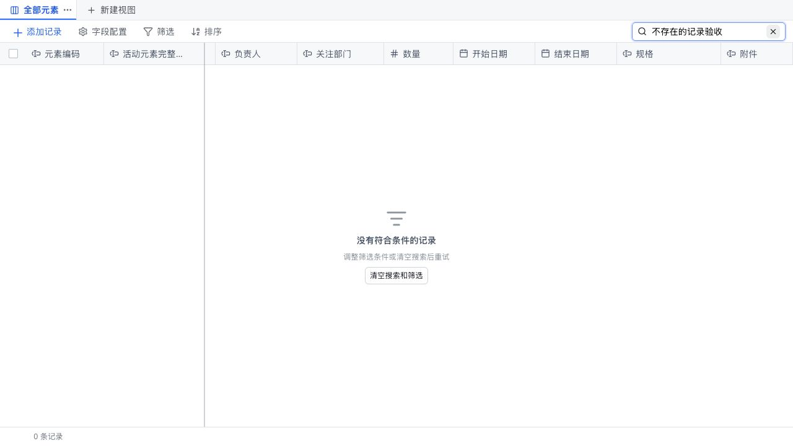
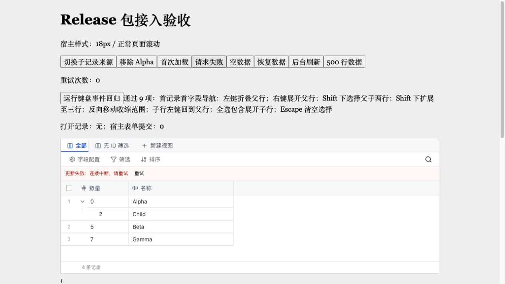

# 搜索、键盘浏览与请求状态验收

完成日期：2026-10-05。本轮在既有未提交工作上增量实现，未回退既有成果，未提交、推送或发布。

## 已实现范围

- TableToolbar 的 onChange 同步更新草稿；默认 300ms 防抖提交查询，可配置 searchDebounceMs。composition 期间不搜索，compositionend 后等待防抖；清空、关闭、外部 searchResetKey 重置和卸载取消未提交任务。
- 网格使用单一 Tab 入口与 aria-activedescendant，焦点地址保留记录/字段 ID；活动虚拟行保持挂载。支持方向键、Home/End、Ctrl/Meta+Home/End、PageUp/PageDown、Space、Shift+上下范围选择、Ctrl/Meta+A、Escape、Enter。树形首字段支持折叠/展开及回到父行；查询保留展开路径。
- 表头支持 Enter 菜单、菜单方向导航、Alt+左右移动列、Shift+左右每次调整 16px 列宽；操作后焦点返回网格。输入框和弹层自行处理键盘。
- 新增 loading/error/onRetry；首次加载、首次失败、空数据、查询无结果分别展示。保留旧 rows 时刷新/失败以非阻塞提示展示，保留选中和滚动；loading 优先于旧 error。NTable 无结果时可清空搜索与筛选，操作后焦点回到网格。
- 仍由宿主处理 HTTP、取消、错误脱敏、重试状态转换和详情编辑；未增加远程分页、受控选择或新筛选运算符。

## 自动化门禁

在 app/ 执行 `npm run verify`，退出码 0：类型检查、演示/Sites 构建、库 ESM/CSS/声明构建、严格消费端类型检查和构建、31/31 测试通过，无跳过项。

`npm pack --dry-run --cache /tmp/ntable-iteration-npm-cache` 退出码 0，包内 25 个文件，约 34.1 kB；仅库产物与 README/package.json，不含消费测试页面或 demo/worker。`git diff --check` 通过。

新增 Node 测试覆盖万行首尾/页边界、记录重排/移除/祖先回退、范围选择收缩，以及初次/后台请求的状态优先级。公共新增 props 同时在严格 package consumer 中检查。

## 内置浏览器验收

使用 Codex in-app browser；独立消费页面为 http://127.0.0.1:5181/，主演示页面为 http://127.0.0.1:5173/。

消费页面保留可重复运行的测试入口，测试代码只位于 app/tests/consumer/：

- 输入事件回归 9/9：即时回显、快速输入仅最终提交、组词取消前一待提交值、不提交拼音、组词结束后等待、完整文字仅提交一次、手动清空、关闭取消、同值外部重置与卸载取消（部分断言归并计数）。通过真实 React DOM 事件链运行。
- 键盘事件回归 9/9：首记录定位、折叠/展开、父子两行选择、扩展三行、反向收缩、子行回父行、全选展开子行、Escape 清空。
- 浏览器实际按键验证列菜单 Home/End/Enter、列宽更新、Alt+右键列重排后焦点仍跟随同一字段、Tab 离开网格；宿主表单未被意外提交，第二实例独立。
- 500 行数据 Ctrl+End 到第 500 行时只挂载约 20 行，活动单元格存在且可见；PageUp 可跨虚拟区域导航。
- 首次加载不闪现无结果；首次失败有重试；重试后进入 loading；空数据显示“暂无记录”；后台刷新保留记录、选择与滚动，提示行高 36px，数据区域未被挤压成单行。
- 主演示约一万条记录：Ctrl+End 跳到最后一条可见投影记录，Enter 打开 ACT-010000，Escape 关闭详情后仍回到原活动单元格和滚动位置。
- 主演示搜索无结果、清空后恢复 10,040 条计数，搜索框为空、焦点回到 treegrid；最终页面无捕获到的 console error。

## 本轮回归发现并修复

1. Checkbox 隐藏表单代理在状态变化时派发冒泡 click，误重置活动列和范围选择锚点。忽略 aria-hidden 的表单代理点击，并通过组件事件回归复验。
2. 请求提示增加 DOM 行后影响原有网格行分配。给提示单独自动高度行，滚动区域继续占满剩余空间。
3. 宽表空态原本按完整内容宽度居中。改为在滚动外壳可视区域居中；清空/重试按钮消失后将焦点回到网格。
4. 非冻结表格 Home 到选择列时同步归零横向滚动，避免活动列在屏幕外。

## 证据与限制

输入法测试使用消费页面派发的 composition/input 事件。内置浏览器不支持 Input.imeSetComposition，因此未完成 macOS 系统输入法候选窗口端到端测试。未执行真实读屏器（VoiceOver/NVDA）验收，也未连接真实业务后端；请求状态由消费宿主模拟，不作为后端可用性证据。

参考：[React 受控 input](https://react.dev/reference/react-dom/components/input)、[W3C Grid](https://www.w3.org/WAI/ARIA/apg/patterns/grid/)、[W3C Treegrid](https://www.w3.org/WAI/ARIA/apg/patterns/treegrid/)。公开接入契约见 [component-integration.md](./component-integration.md) 和 [business-api-contract.md](./business-api-contract.md)。
